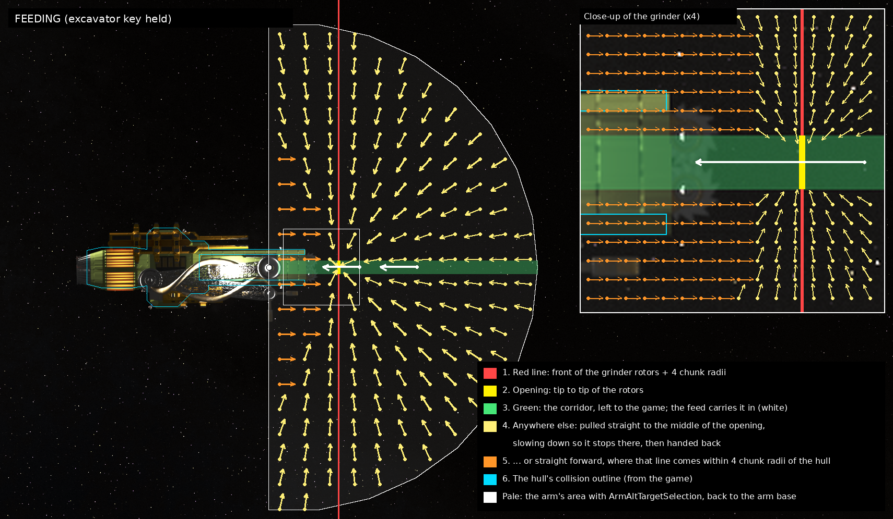
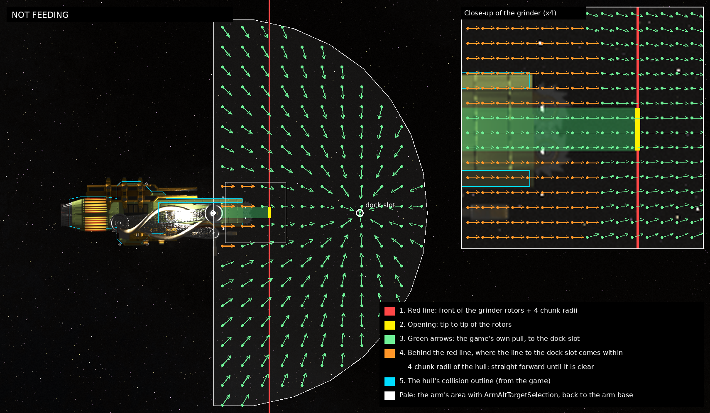

# ArmAltPullBehavior - ΔV: Rings of Saturn

Version 1.5.1. Changes how the AR-1500 salvage arm (`SYSTEM_SALVAGE_ARM` on a ship) brings a target in.
Station dock arms are left alone. Works together with `ArmAltTargetSelection`, but does not need it
(the two do not touch each other's code).

**Only ships with a grinder or an excavator are covered.** On any other ship (the OCP-209, for one) the mod
does nothing at all and the game's own arm handling applies.

*Eagle-Prospector-VP, arm base at the white dot, ship facing right; top right, the grinder 4x. Red: the red line.
Yellow bar: the opening, measured from the tip of one grinder rotor to the other. Cyan: the hull (the ship's
collision outline). First image, feeding (excavator key held): green, the corridor, where the mod pulls the
target straight in (white); yellow arrows, anywhere else the target is pulled straight to the middle of the
opening; orange arrows, where that line would come too close to the hull it is pulled straight forward first.
Second image, not feeding: green arrows, the game's own pull to its dock slot; orange arrows, behind the red line,
where the line to the dock slot would come too close to the hull, the target goes straight forward first.
Pale: the area the arm can take targets from with `ArmAltTargetSelection`, which reaches back to the arm base.
On an excavator (the EIME) the opening is the gap between the claw tips.*

## What it does and why

### 1. Red line and opening
- **How the game pulls:** the game always pulls a target to the arm's dock slot (33.75 m ahead of the arm base
  on the AR-1500, about 26 m ahead of the Vulture's grinder). It only brings a target in while the player holds
  the excavator key, which also "fires" the arm: that adds a feed that pushes the target straight back along
  the direction the arm faces. A target that is not in line with the opening is pushed into the rotors / claws
  or the hull.
- **While feeding (what):** a target in line with the opening (the corridor that runs through the opening
  along the direction the arm faces) is pulled straight in by the mod: along the corridor at the feed's speed
  (`feedVelocity`, 28 m/s on the AR-1500), or faster where the game's own pull would be faster (ahead of the dock
  slot), kept on the corridor's middle line. Any other target, ahead of the red line or behind it, is first pulled
  in a straight line to the middle of the opening (where the red line meets the corridor), until it is in the
  corridor and no longer moving sideways faster than the pull itself does close to the middle (a chunk's radius,
  or half the opening if that is less, from it); then it is pulled straight in as above. Crossing the red line
  outside the corridor does not count.
- **While feeding (why):** the feed pushes a target straight back, so one off to the side reaches the red line
  outside the corridor at about 11 m/s, too fast to be stopped before the rotors / claws. Taking it to the
  opening first, and pulling it in only once it has stopped there, keeps it straight. The mod pulls it in itself
  because the game's pull goes to the dock slot, about 26 m ahead of the grinder: close to the ship it works
  against the feed, so the game takes a chunk in from the opening at only about 8 m/s, starting from a standstill;
  and it measures the chunk's speed against the dock slot, which swings sideways when the ship turns, so a heavy
  chunk could be pushed into a rotor.
- **While not feeding (what):** the game's own pull, to the dock slot, everywhere, except behind the red line
  and outside the corridor where the straight line to the dock slot would come too close to the hull: there the
  target is pulled straight forward first, in the direction the arm faces, until that line is clear (or it
  crosses the red line), and then handed to the game.
- **While not feeding (why):** the game would only take the target out to the dock slot, so going to the
  opening first would be a wasted trip; it is enough to keep it clear of the hull on the way.
- **Too close to the hull:** a circle with the radius the red line keeps clear (`CHUNK_RADIUS_CLEARENCE_FACTOR`
  times a chunk's radius) is swept along the straight line (to the opening, or to the dock slot) and
  tested against the ship's own collision shapes, read from the ship itself, so every hull is covered. If it
  touches them anywhere, the start included, the target goes straight forward, at least to a chunk's radius past
  the red line and on until the line is clear. It goes at full speed (`maxVelocity`), without slowing down for that
  point: the line clears on the way. The rotors / claws are not part of the test: the red line already
  keeps that distance from them, so the circle would touch them at the end of every path to the opening; they sit
  on the nose of the ship, so a target beside them is close to the hull anyway.
- **Stopping at the opening:** the game's pull formula aims at where the target is now, so it overshoots by
  several metres; harmless at the dock slot, not next to the rotors. The mod's pull aims at where the target will
  be a moment later instead: the time that makes the formula critically damped, worked out from the arm's own
  force (`thrust`, `targetMassThrust`, `easeDistance`) and how fast the mod asks the target to move: full speed
  (`maxVelocity`) until `APPROACH_EASE_DISTANCE` from the opening, then slowing down (the game's own pull
  starts slowing down 10 m away, its `easeDistance`). The target slows down in time and stops at the opening. The
  force is never more than the game's own formula gives.
- **Speed measured against the hull:** the game measures the target's speed against its dock slot, 33.75 m
  ahead of the arm base, which moves much faster than the ship's nose when the ship turns. The mod's pull measures
  it against the ship's hull at the target's position instead, also while it pulls the target in through the
  corridor, so a target near the nose is not flung away or pushed into a rotor while the ship turns.
- **Opening:** measured from tip to tip: the distance between the points of the two rotors / claws that
  reach farthest ahead (from their collision shapes). For the EIME's beak that is the gap between the claws'
  tips, so it follows the beak as it opens and closes (0 when closed). It is measured every time, since the
  rotors and claws move.
- **Red line:** the front of the rotors / claws (how far ahead of the middle of the two their farthest
  points are), moved forward by `CHUNK_RADIUS_CLEARENCE_FACTOR` times the largest mineral chunk's
  radius, so the chunk itself, not only its centre, stays clear. The radius (10.4 units, 1.04 m) is read from
  the game's mineral scene: every mineral chunk has the same collision circle and none is scaled above 1.0.
  If the scene cannot be read (the game changed), `CHUNK_RADIUS_FALLBACK` (the radius in the game files when the
  mod was made) is used.
- **No flip-flopping:** a target being pulled in goes back to being taken to the opening only once it is a little
  (as above) outside the corridor; while not feeding, the mod takes a target from the game only once it is that
  far outside the corridor and a chunk's radius behind the red line.
- **No chunk fits:** if the opening is narrower than a chunk (a closed beak), there is no corridor: while
  feeding, a target is pulled straight forward to a chunk's radius past the red line and held there until the
  beak opens.

### 2. Cost of the mod's pull
- **What:** the mod's pull (1) costs what the game's own pull costs, with the game's own formula: energy,
  capped by the arm's power limit; wear, which grows with the square of the power used (added on the game's random 1% of frames, scaled to the same average); and the
  weakening of a worn or overheated arm. An arm that holds nothing is not worn, as in the game.
- **Why:** the game wears the arm only through its own pull, which the mod switches off while it pulls
  a target. Without this, the mod's part of every pull would be free and always at full strength.

### 3. Ships it does not cover
- **What:** a ship without a grinder or excavator (with their two rotors / claws) is left to the game: the
  arm's `maxThrust` is restored and nothing is added. The rotors / claws are looked up on every physics
  frame and nothing is remembered about a ship, so switching ships takes effect at once.
- **Why:** such ships have no rotors or claws to protect and no opening to measure. The OCP-209, for example,
  takes targets in through an opening in its side, not through a grinder or claws.

## For modders
- Script extension of `res://ships/modules/DockingArm.gd` (`installScriptExtension` in `ModMain.gd`).
  The tag `group = DockingArm` in `Mod.manifest` names that game script.
- Overrides `_ready` (reads the chunk radius) and `_physics_process`. Neither calls the parent's: the mod
  loader runs the base first for `_ready`, and the child first for `_physics_process`, which switches the
  base pull off (`maxThrust = 0`) while the mod pulls the target.
- Other functions: `_readChunkRadius`, `_entry` (the measurements; null where the mod does not apply),
  `_frontPoint`, `_outside` (where the target must go; null = let the game pull it), `_hitsHull` (the sweep
  test against the ship's collision shapes), `_pullTo` (the game's pull formula towards a place other than
  the dock slot, aimed a moment ahead, or straight in along the corridor), `_cost` (the game's energy, power
  limit, wear and weakening for an impulse) and `_shipVelocityAt` (the velocity of the ship's hull at a point,
  which the mod's pull measures the target against).
  Members: `_active`, `_radius`, `_clearance`, `_sweep`, `_maxThrust`, `_gamePull`, `_feedIn` (pulling the target
  in along the corridor), `_passThrough` (straight forward without slowing down), `_lastTarget`. If you stack
  another mod on `DockingArm.gd`, keep your member names different.
- The mod reads the arm's `feed` (the excavator command), `feedVelocity` and `areaDockSlot` (its dock slot).
- Everything is taken from the game: the ship's `grinder1node` / `grinder2node` (grinder) or `Claw Left` /
  `Claw Right` (excavator) found through `ship.hasSystem`, their collision shapes, the ship's own collision
  shapes (its hull), and the arm's own
  `maxThrust`, `easeDistance`, `maxVelocity` and so on. No list of ship models is needed.
- The mod only applies where `systemName == "SYSTEM_SALVAGE_ARM"` and the arm has a `ship`.
- Constants at the top of `ArmAltPullBehavior/Code.gd` inside the zip:
  `ENTRY_SYSTEMS`, `CHUNK_RADIUS_CLEARENCE_FACTOR`, `CHUNK_SCENE`, `CHUNK_RADIUS_FALLBACK`,
  `APPROACH_EASE_DISTANCE`. The game shows 10 units as 1 m.
- Tested outside the game, in a headless Godot (3.5.3, then 3.6 with the game's 1.91.61 scripts) with the game's
  scripts (`DockingArm.gd`, `Tool.gd` ...) and stub scenes, including a simulated Eagle-Prospector-VP with the
  arm's real placement and values, the real rotor positions and hull (and the turning inertia Godot works out from
  it), a 109 t and a 330 t ship, 2.8 t and 5 t chunks, feeding and not feeding, with the ship standing still,
  cruising at 10 to 40 m/s and turning: the rotors are not touched in any case, turning included. There, a chunk
  beside the hull is in about 4.4 to 4.8 s after the grab while feeding, against 5.9 to 6.3 s with 1.4.0.
  Version 1.3.0 was tried in the game and broke; 1.4.0 worked in the game but brought chunks in slowly while
  feeding; 1.5.0 has not been checked in the game yet.

## Install
1. In the game folder (next to `Delta-V.exe`), create a folder named `mods`.
2. Put `ArmAltPullBehavior-1.5.1.zip` in it. Do not unzip it.
3. Launch the game with `--enable-mods`.

Mods are unofficial and can break after game updates. Keep a backup of your save.

## About
Made with the help of AI (Claude, by Anthropic).
Licensed under the GNU General Public License v3.0 (GNU GPLv3).
