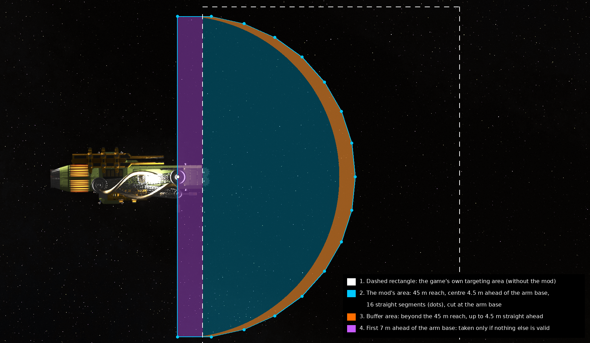

# ArmAltTargetSelection - ΔV: Rings of Saturn

Changes how the AR-1500 salvage arm (`SYSTEM_SALVAGE_ARM` on a ship) chooses its
target. Station dock arms are left alone. Works together with `ArmAltPullBehavior`, but does not
need it (the two do not touch each other's code).

*Eagle-Prospector-VP, arm base at the white dot, ship facing right. Cyan: the area the mod gives the arm,
a polygon of `AREA_SEGMENTS` straight segments (the dots). Orange: the buffer area, the part of it beyond the arm's
45 m reach. Purple: the first 7 m ahead of the arm base, whose targets are taken only when there is nothing
else. Dashed rectangle: the game's own area.*

## Warning
This mod changes how the game plays. Compared to vanilla, the AR-1500 arm on your ship:
- only takes targets it can reach, plus a little beyond straight ahead, not from the game's much larger area;
- also takes targets right next to its base, but only when nothing else is in reach;
- picks the target best lined up with the intake, not the one that came into range first;
- drops its target and empties its queue as soon as it is switched off, and picks a fresh target when it is switched
  on again.

Before reporting a bug with the arm to the game's developers, check that it also happens without the mod.

## What it does and why

### 1. Target area
- **What:** the shape of the arm's dock area (`areaDockArea`) is replaced with the area the arm can reach:
  a circle with the arm's reach as its radius, its centre moved `BUFFER_AREA_FACTOR` times the reach in the
  direction the arm faces, cut by a line through the arm base across that direction. Since this is
  the area itself, the game's own checks follow it: only targets in it enter the arm's queue, and a target that
  leaves it is dropped.
- **Buffer area:** the part of that area beyond the arm's reach from its base. Moving the circle puts it there:
  `BUFFER_AREA_FACTOR` times the reach deep straight ahead of the arm, thinning to nothing towards the sides, where
  the reach stays the arm's own. It is part of the polygon, and its targets count like any other. On
  most ships the arm faces forward; on the OCP-209, whose arm mounts are turned, it points out of the side
  opening.
- **Why:** the game's area is much bigger than what the arm can reach (it extends 78.5 m ahead of the arm base,
  the arm reaches 45 m), so the arm would pick targets it cannot bring in. The buffer area is there because the intake
  is ahead of the arm base, so it can still take in a target a little past the arm's nominal reach straight
  ahead of the arm.
- **Shape:** a polygon of `AREA_SEGMENTS` straight segments along the arc, plus the line at the arm base.
  A straight segment cuts slightly inside the circle, most in the middle of the segment. A mineral chunk's radius
  is about 1 m and a chunk counts as in the area as soon as its edge touches it, so the difference only shows as a
  slightly later detection right at the edge.
- **Reach:** `2 * scale * arm scale * armLength`, read from the arm itself (45 m for the AR-1500; the game
  shows 10 units as 1 m).

### 2. The strip next to the arm base
- **What:** the game's own area starts some way ahead of the arm base (7 m for the AR-1500), so the strip
  between the two was never targetable. The new area covers it, but a target there is taken only if no other
  target is valid. The edge is read from the game's own area before it is replaced.
- **Why:** a target there is close but awkward to bring in, right next to the ship. It is better than nothing,
  but anything else in reach comes first.

### 3. Target choice
- **What:** the best target (among those outside the strip, see 2) has the lowest weighted sum of the
  distance to the intake's centerline and the distance to the entry point. `BALANCE` sets the weight: `1.0` = only the centerline counts,
  `0.5` = both equal, `0.0` = only the entry point. The game still keeps the
  current target until it is lost or taken in.
- **Why:** the game takes the first target in its queue, the one that entered the area first, wherever it is.
  A target lined up with the intake is the easiest and quickest to bring in.
- **Entry point:** the middle between the grinder's two rotors (`grinder1node`, `grinder2node`), or between the
  excavator's two claws (`Claw Left`, `Claw Right`). Ships with neither (the OCP-209, which takes targets
  in through a side opening) use the ship's centre, which is the middle of that opening.
- **Intake centerline:** the line through the entry point along the direction the arm faces (the arm's local
  up). For a grinder or excavator at the front that is the ship's centerline; for the OCP-209, whose arm
  mounts are turned, it runs straight out through the side opening. (The arm's tilted `feedVelocity`
  is not used.) `ArmAltPullBehavior` uses the same entry point and direction for its opening on ships with a grinder or excavator (it leaves the others to the game).
- All of these are taken from the ship's own nodes, so any ship that mounts an arm works without a list of models.

### 4. Switching off and on
- **What:** when the arm is switched off, its target is dropped as soon as it is released (the game releases
  it in the same frame) and its queue is kept empty while it is off, so nothing is selected and nothing stale
  is kept. When it is switched on
  again, the queue is rebuilt from the bodies in the area at that moment, and a fresh target is chosen.
- **Why:** the game keeps the target until the arm is fully retracted (up to a second), and keeps the old queue
  when it is switched on, so the arm can hold on to something it was told to let go, or pick up a target
  that is long gone.

## For modders
- Script extension of `res://ships/modules/DockingArm.gd` (`installScriptExtension` in `ModMain.gd`).
  The tag `group = DockingArm` in `Mod.manifest` names that game script.
- Overrides: `_ready` (builds the area), `_physics_process` (switch off/on handling) and
  `switchTarget` (the target choice). `_ready` and `_physics_process` never call the parent's: the mod loader
  runs the base first for `_ready`, and the child first for `_physics_process`.
  `switchTarget` calls the parent's (`.switchTarget()`) for arms the mod does not apply to.
- Other functions are `_reach`, `_buildArea` and `_intakePosition`; members are `_targeting`,
  `_wasEnabled` and `_rear` (how far ahead of the arm base the game's area started). If you stack another mod on `DockingArm.gd`, keep your member names different.
- The area's `CollisionShape2D` gets a new `ConvexPolygonShape2D` in place of the game's `RectangleShape2D`;
  nothing in the game reads that shape, only the area's overlaps.
- The mod only applies where `systemName == "SYSTEM_SALVAGE_ARM"` and the arm has a `ship`.
- Constants at the top of `ArmAltTargetSelection/Code.gd` inside the zip:
  `BUFFER_AREA_FACTOR`, `BALANCE`, `AREA_SEGMENTS`, `INTAKES`.
- Tested only outside the game, in a headless Godot 3.5.3 with the game's scripts (`DockingArm.gd`, `Tool.gd` ...)
  and stub scenes. It has not been checked in a real game.

## Install
1. In the game folder (next to `Delta-V.exe`), create a folder named `mods`.
2. Put the mod's zip in it, and remove any other version of the mod from there: they would all load. Do not unzip it.
3. Launch the game with `--enable-mods`.

Mods are unofficial and can break after game updates. Keep a backup of your save.

## About
Made with the help of AI (Claude, by Anthropic).
Licensed under the GNU General Public License v3.0 (GNU GPLv3).
