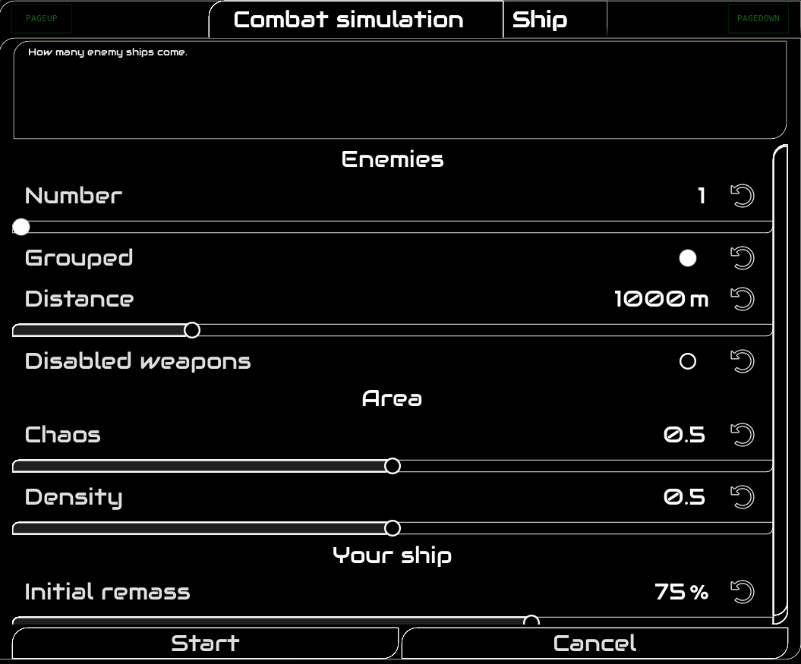
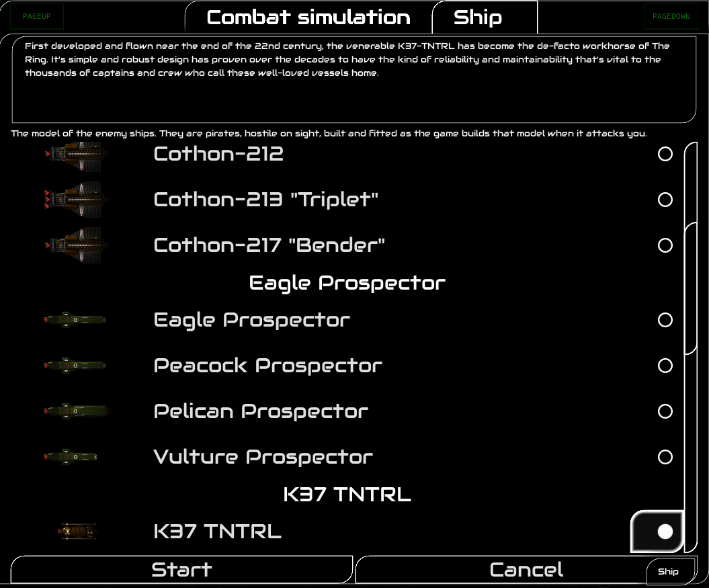

# CombatSimulator - ΔV: Rings of Saturn

Shift+Click on the simulator's button, or Shift plus its key, runs a fight at the station instead of the simulator (a
gamepad has twins of both, and a Shift badge on the button is the reminder): against the enemy ships you pick, at the
distance you pick, among the rocks of a part of the rings with the chaos and density you pick, with as much remass as
you pick. It looks and plays like a dive, and nothing of it carries over to the save. The mod's page in the users' wiki
also explains every ship and weapon of the game in a fight.

| Combat simulation | Ship |
|---|---|
|  |  |

## What it does and why
- **What:** the simulator's button (*Minding Virtual Flight Service*, on the Tuning screen, the Equipment screen's
  User Manual tab and the Examine Ship tab of the Dealer and of the Fleet) still starts the simulator with a click or
  its key (the game's `jury_rig` action, J by default, Back on a gamepad). Shift+Click on it, or Shift plus that key,
  opens the mod's dialog instead. With a gamepad, so does `PAD_BUTTON` pressed on the highlighted button while
  `PAD_MODIFIER` is held, or Back while `PAD_MODIFIER` is held (`Badge.gd`'s constants). *Start* in the dialog runs the
  fight with the ship that screen's simulator would fly: on the Equipment screen with the equipment being looked at, on
  the Dealer and the Fleet the ship being examined.
- **The badge:** a small badge inside the simulator's button, on its left, in the button's frame, says so. It reads
  Shift, or `PAD_TEXT` while the game is played with a gamepad (the game's Controls setting, or with Auto the device
  used last). With the mouse on it, its tooltip says how to open the dialog (`COMBATSIMULATOR_TOOLTIP`, or with a
  gamepad `COMBATSIMULATOR_TOOLTIP_PAD`).
- **The dialog** is laid out as the Crew screen, with two tabs. *Combat simulation*: a window describing the selected
  setting, then the settings in three groups (*Enemies*: Number, Grouped, Distance, Disabled weapons; *Area*: Chaos,
  Density; *Your ship*: Initial remass). *Ship*: the enemies' model, picked from a list laid out as the Dealer's, with
  a picture of every ship model the game has, one switched on, under the game's description of the selected ship.
  Start and Cancel are on both tabs; Esc, or B on a gamepad, cancels. With a gamepad, LB and RB switch the tabs, and
  the right stick scrolls a description too long for its window.
- **The fight** runs as an overlay at the station, the way the simulator runs, but without its hexagons: the game's own
  asteroid field, with the chaos and density set, at a spot of the rings that matches them; bullet time, and time
  slowing while the Onboard Maintenance System is open; the dive's music, western with enough chaos; the HUD's ring map
  and gravimetric readout, which the game shows only in the rings; the mass driver's reload sound. The ship starts at
  rest, with full ammunition and the share of its remass set.
- **The enemies** are pirates (`ENEMY_FACTION`), hostile on sight, each built as the game builds that model: the
  models of `BUILDERS` by the game's own event that brings them against the player (the pirate attack, the pirates'
  abductor, the Hybrid's hunter, the Big Bad Wolf); those of `NEW_BUILDS` new, as the ring race builds its racers; any
  other model as the game builds it for a derelict or a miner (a random used build of its series, else its default
  build). They spawn from Distance to `SPAWN_SPREAD` farther: grouped, on one bearing, side by side `GROUP_SPACING`
  apart; else each on a bearing of its own. With Disabled weapons on, their weapons fire nothing, but they still close
  in, aim and turn their turrets: the weapons stay switched on, so the AI's will to fight is unchanged.
- **Ending it:** with the OMS closed, Esc asks whether to end the fight (`COMBATSIMULATOR_END_QUESTION`), with No
  focused, as in the game's own confirmations, pausing the game with the music muffled while it asks, as the dive's
  pause menu does. The gamepad's Start button, the window losing the focus and a gamepad's disconnection ask too,
  instead of opening the station's pause menu. Losing the ship ends the fight when the game removes it after the
  explosion, as the simulator ends. The station fades back in on the screen left.
- **Nothing carries over:** the save's tables the fight's ships write are copied at Start and put back at the end;
  crew experience, story flags, encounters, the Astrogator's highlights and ships joining the fleet are dropped during
  a fight (talent still grows); the ships' cargo and what the arm holds never reach the save. The station's clock and
  wages run, except while the game is paused.
- **Known differences from an encounter in the rings:** nobody talks; no crew experience; PLOT A COURSE does nothing;
  no random events and no passing miners; every enemy hostile on sight, the Hybrid, ATLAS and the Tsukuyomi included;
  pirates act as in a new game (their faction ignores the save's adjustments); Esc asks instead of opening the pause
  menu.
- **Why:** to try a ship, its equipment and its Tuning against the ships that attack you before risking them in a dive,
  or a Dealer's ship before buying it. The simulator never puts an enemy in front of you.
- **Settings:**
  - Opened with Shift+Click on the simulator's button, or Shift plus its key, or their gamepad twins, as above. Each
    row has a button that resets it to its default; a change applies to the next fight.
  - Kept in the save game, each save with its own, written to disk the next time the game saves. A new game, or a save
    made before the mod, starts with the defaults.
  - The pictures of the ship list are drawn the first time the tab opens, all at once, as the Dealer draws its own,
    and kept until the game quits. Each shows the ship as the Dealer sells it, with nothing on its hardpoints.
  - Each setting's default and range are in `SETTINGS` at the top of `CombatSimulator/Settings.gd`, inside the zip.
    The mod's texts (the badge's tooltips, the tabs, groups and buttons, every setting's name and description, the end
    confirmation, the names and descriptions of the ships the game leaves unnamed) are in `CombatSimulator/i18n/en.po`.

## For modders
- The scripts: `Code.gd` (the station's script extension: the button, the dialog and the arena), `CurrentGame.gd` (the
  autoload's: the running arena and the save guard), `PauseMenu.gd` (the pause menu's), `Hardpoint.gd` and `Turret.gd`
  (the hardpoints' and turrets': Disabled weapons), `HudRingMap.gd`, `HudGravimetric.gd` and `MassDriver.gd` (the ring
  map, the gravimetric readout and the reload sound on the arena's ship), plus the mod's own: `CombatLayer.gd` (the
  arena), `CombatMap.gd` (its map), `SettingsUI.gd` (the dialog), `ShipList.gd` (its ship tab), `Settings.gd` (the
  settings model and what the scripts share) and `Badge.gd` (the Shift badge). `ModMain.gd` installs the eight
  extensions from `_init`, then loads `i18n/en.po`. The tag `group = Simulator` in `Mod.manifest` names the part of
  the game it adds to.
- **Installed from `_init`:** `ModMain.gd`'s `_init` runs while the engine creates the autoloads, before it creates
  `CurrentGame` (after `ModLoader` in the game's `project.godot`) from `res://CurrentGame.gd`, so the autoload gets the
  extension. None of the game scripts extended here preloads a scene, so installing them loads no script a later mod
  extends. There is no extension of `ships/Shipyard.gd`, which preloads every ship scene: MODDING.md *How the game
  loads a mod* says why. Autoloads are read with `get()` and `set()` (`Shipyard.get("ships")`,
  `CurrentGame.get("_csArena")`), as DealerNotifier's README explains.
- **The station** (`Code.gd` extends `res://enceladus/Enceladus.gd`). Its `_ready` (Godot runs the game's first; the
  extension doesn't call it) loads the save's settings (`loadFromState()`), makes the dialog, then the arena, which
  takes the simulator's layer (`_CS_SIMULATION_LAYER`) and the dialog's theme (`pageTheme`), adds the arena right after
  the simulator's layer and the dialog after it, and finds every simulator button under the right-hand screens
  (`menusContainer`): the buttons instanced from `_CS_LAUNCH_VR_BUTTON`.
  - **Shift+Click:** Godot 3 emits a Control's `gui_input` before it calls its own `_gui_input`, and `accept_event()`
    there stops the event: a left press with Shift on an enabled button is accepted, so the button never presses, and
    the dialog opens instead. Its gamepad twin (`Badge.gd` `isPadShortcut`) is `PAD_BUTTON` pressed while
    `PAD_MODIFIER` is held on the same gamepad: a gamepad's buttons reach the highlighted control's `gui_input` as keys
    do, and `PAD_BUTTON` alone does nothing to a button.
  - **Shift plus the key:** `_input` (the game's script has none) takes, through `_csIsShortcut()`, a key press with
    Shift alone held that matches the action (`_CS_ACTION`), or a gamepad button press that matches it while
    `PAD_MODIFIER` is held on the same gamepad. An action bound to a key alone also matches it with Shift held
    (`is_action_pressed`), while the button's shortcut matches the key exactly, so without the mod Shift+J does nothing
    at the station; a gamepad's buttons carry no modifiers, so without the mod the gamepad twin is the action's button
    alone, which starts the simulator. `_input` marks the event handled, so the button's shortcut, which Godot checks
    after it (BaseButton's `_unhandled_input`), never sees it, and opens the dialog from the first visible, enabled
    button, unless the simulator is showing, the dialog is open or a fight runs.
  - **The Shift badge:** `_csMakeShiftBadge()` puts a `Badge.gd`, named `_CS_SHIFT_BADGE`, inside each button: on its
    left, centred from top to bottom, as far from the left edge as the button's key glyph (`_CS_KEY_HINT`, the game's
    `ContextSensitiveControlDisplay`, in a box anchored to the right edge) is from the right one, or without the glyph
    inside the margin of the button's normal stylebox. A Button doesn't lay out its children, so the badge hangs from
    it by its anchors (the middle of its left side), growing right, up and down to its minimum size. It lets the mouse
    through (`MOUSE_FILTER_PASS`), so a click on it is the button's. `dress()` gives it the button's frame and font
    colour, and as its text the Shift key's name (`OS.get_scancode_string(KEY_SHIFT)`), or `PAD_TEXT` with a gamepad;
    `setShiftTooltips()` gives it its tooltip, `tr(_CS_TOOLTIP)` with the Shift key's name and the mod's name from
    `Mod.manifest`, or with a gamepad `tr(_CS_TOOLTIP_PAD)` with `PAD_BUTTON_NAME`, `PAD_MODIFIER_NAME` and the mod's
    name. The released game moves Godot's tooltips off the screen and draws its own through `PlaySoundsOnTheseButtons`
    (`_CS_GAME_TOOLTIPS`), none of which covers these buttons, so one of its own sits on the dialog's layer:
    `connectSounds` registers each button (its hover and focus sounds; the button's own tooltip stays empty, so it
    shows none), and `attachTooltip()` the badge, whose tooltip shows while the mouse is on it and, with a gamepad,
    which shows no hover, while the button, its `focusOwner`, has the focus.
  - **The ship flown** (`_csOpen()`): the button's nearest ancestor with one of the properties in `_CS_CONFIGS`, what
    each screen's `_on_LaunchVR_pressed` sends the simulator (Tuning and Equipment their `previewedConfig`, the Dealer
    and the Fleet their `currentConfig`). Without a config, nothing opens, as nothing would start. The dialog's
    `startRequested` hands it to the arena (`_csStart()`).
- **The badge** (`Badge.gd`, a `PanelContainer`) is shared: CrewCheapHireNotifier, DealerNotifier, DiveSkipTransit,
  MarketAdvisor and ServiceNotifier carry the same file, kept identical, since the mods ship separately; each loads its
  own copy from its own folder. A badge takes no focus, and this one lets clicks through: its tooltip is its only
  interaction. `attachTooltip()` registers it with the game's tooltip node (`connectSounds`) and takes the hover over,
  so the badge plays no sound; while the mouse is on it, the node waits `TOOLTIP_DELAY` and fades in over
  `TOOLTIP_FADE` instead of its own times, and `BUTTON_HOVER_MUTE` keeps the button under it from playing its hover
  sound again when the mouse crosses the badge's edge. It is lettered in the small font of `SMALL_FONT_THEME`. Its text
  and tooltip follow the game's control scheme (`Settings.controlScheme`, which with Auto follows the device used last,
  `menu/Mouse.gd`; the signal `controlSchemeChaged`, spelled as the game spells it) and a change of language (its own
  `_notification`), so the station's extension needs no `_notification` of its own. The gamepad twin of Shift+Click,
  `PAD_MODIFIER` held and `PAD_BUTTON` pressed, is named as the game's gamepad glyphs show them (`PAD_MODIFIER_NAME`,
  `PAD_BUTTON_NAME`, `PAD_TEXT`): at the station the game gives neither button a use, and players can't rebind them
  (the game's `Settings.gd` binds keys and mouse buttons only). It reads the `Settings` autoload through a variable
  (`_gameSettings()`), since the mods' scripts are compiled before the engine creates it. Used here: `dress()`,
  `attachTooltip()` (with the button as its `focusOwner`), `setShiftTooltips()`, `isPadShortcut()` and the `PAD_*`
  constants; `hangBeside()` is for the other mods' badges beside a button.
- **The dialog** (`SettingsUI.gd`, a CanvasLayer on the layer of the station's screens, read from the CanvasLayer
  holding the Tuning screen, else `LAYER_FALLBACK`; the station root's last child, so its `_input` comes first and Esc
  or `pause` cancel there) is an exclusive `Popup` covering the screen it was opened from (the screen's rectangle, or
  what its parts need), laid out as `enceladus/Crew.tscn`: the game's tab hints (`GAME_TAB_HINTS`) over a
  `TabContainer` with the game's tab script (`GAME_TABS_SCRIPT`, the gamepad's shoulder buttons), in the Crew screen's
  theme (`GAME_TAB_THEME`), over a panel copied from the Tuning screen. Each tab is a box named by its title's
  translation key (`TITLE`, then the Ship setting's `label`), in the Tuning screen's theme (`pageTheme`, `GAME_THEME`
  without that screen; the arena's end confirmation takes it too), with a description window nested as
  `enceladus/Tuning.tscn` nests its own (`GAME_WINDOW_MARGIN`, `GAME_WINDOW`, `GAME_WINDOW_INSIDE`), kept at
  `DESCRIPTION_LINES` lines (a longer text scrolls), and Start and Cancel (`START`, `CANCEL`) at the bottom, which
  `attachTooltips()` registers with the mod's own tooltip node on the dialog's layer (`Code.gd` `_csTooltips`) for the
  game's focus and hover sounds.
  - **With a gamepad:** the tab script switches tabs in its own `_input`, which runs first (a child's), and lets the
    press through at the first or last tab, where the screen behind, whose tabs use the same script
    (`enceladus/Dealer.tscn`, `Upgrades.tscn`), would switch its own; so while the dialog is open its `_input` marks
    `ui_page_up` and `ui_page_down` handled. The right stick scrolls the description window of the tab shown
    (`_process`): the strength of `DESCRIPTION_SCROLL_DOWN` less that of `DESCRIPTION_SCROLL_UP`, times
    `DESCRIPTION_SCROLL_SPEED`, in real time and kept in fractions of a pixel, as `enceladus/ScrollWithAnalog.gd`
    scrolls the game's lists. The D-pad can't scroll it, since nothing in the window takes the focus.
  - The first tab holds one `enceladus/Tuning/TuningItems.tscn` group (`GAME_TUNING_ITEMS`) per `GROUPS` entry, titled
    by it, with a row per setting of that `group`: a switch (`"type": "bool"`) or a slider (`"float"`, with its range,
    step, unit and format in the units shown, `toShown`), named by its `label`. On `tuningChanged` (a change, or a row
    taking the focus) it sets the row's `tune.current` (a switch doesn't update it itself), calls `setValue` and shows
    the row's `label` followed by `DESCRIPTION_SUFFIX`. It is filled each time the dialog opens, so names and
    descriptions follow a language change.
  - The second tab is `ShipList.gd`. Showing it focuses the current ship (`focusCurrent()`); the first tab focuses its
    first row.
- **The ship list** (`ShipList.gd`) is DealerNotifier's settings list (its `SettingsUI.gd`), copied since the two mods
  ship separately, and adapted to one choice: a note with the setting's description, then one `TuningItems.tscn` group
  per series (`_groups()`: series with two or more models, titled by the base model's name, then the rest under
  `OTHERS_LABEL`; alphabetical in the game's language), each row a `TuningBoolValue.tscn` switch dressed as a Dealer
  entry (`_dressRow()`, from `GAME_ENTRY`). The switches act as radio buttons: switching another model on picks it and
  switches the current one off (`_setRow()`, with `_syncing` so its signal changes nothing), and switching the current
  one off puts it back on. The focused row's description is what `Dealer.gd` `displayShip` shows: the series' where it
  differs from the ship's, then the ship's (`_description()`). The pictures (`_drawPictures()`, `_drawPicture()`) are
  made as DealerNotifier makes them: every model at once, each ship in a Dealer entry's viewport (`GAME_ENTRY_VIEWPORT`)
  for `PICTURE_DELAY`, kept out of the save (`_previewShip()`: a `transponder`, a `shipName`, a `madeIn` and the
  dealer's faction, `GAME_DEALER_FACTION`), every hardpoint emptied (`_emptyHardpoints()`, `_hardpoints()`,
  `_hardpointSceneSlot()`), kept for the session in the script's metadata (`_pictureCache()`). Once its picture is
  taken, each viewport is freed with its ship still in it, so the ship's physics areas go before the viewport's physics
  space. A ship taken out of its viewport first leaves its monitoring areas pointing into that space, and Godot 3 frees
  them after it, writing into freed memory: the game could crash (fixed only in Godot 4.3, PR #81809).
- **The arena** (`CombatLayer.gd`, a CanvasLayer on the simulator's layer, processing while the game is paused) holds
  what the simulator's layer holds: a container on the game's `MarginViewportUpscale.gd` (`GAME_UPSCALE`, with the
  simulator's scale, stopping while paused) around a viewport on `ViewportWithProxy.gd` (`GAME_VIEWPORT`) with a world
  of its own, shown through a `TextureRect` that fades in and out over `FADE_SECONDS`. The station's extension calls
  `setup(station, simulation, confirmTheme)` with the simulator's layer, whose upscaler (`SIMULATION_UPSCALE`) gives
  the scale, and the end confirmation's theme, the dialog's `pageTheme`. `start(sim, lastFocus)`, which without a ship
  to fly or the station's ring map runs nothing and gives `lastFocus` the focus back at once (the dialog has closed, and
  a gamepad would have nothing to hold on to):
  - copies the save's tables (`_snapshot()`), sets `CurrentGame._csArena`, freezes the pirates' faction
    (`ENEMY_FACTION` in `Factions.frozenFactions`, so their dispositions are the defaults), and builds the map
    (`CombatMap.gd`) on the station's ring map (`STATION_RING`), with the global offset at the spot it picks;
  - stops at the station what would change the arena (`_pauseStation()`): `NoBulletTime` (which would undo bullet
    time), the music, the cursor's fade (the ring scene's for the run) and the focus;
  - builds what the ring scene (`GAME_RING_SCENE`) holds around a ship (`_buildArena()`): its asteroid field
    (`GAME_FIELD`: nothing traced into the save, its ships in the `sim` zone, the ring scene's masks
    `GAME_FIELD_MASKS` read from its state, the arena's map as its `mapInstance`, its own `_process` stopped),
    BulletTimer (`GAME_BULLET_TIMER`, without its notifications layer, `GAME_BULLET_TIMER_NOTIFICATIONS`, and
    disconnected from `gameOver`, which the game emits for any player-controlled ship's meltdown), the music
    (`GAME_MUSIC`) and `GAME_ENVIRONMENT`;
  - builds the player's ship as the simulator's `startSimulation` does (`_buildShip()`: `resupplyThisCfg`, the remass
    set, `test`, the `sim` zone, `SHIP_META`), with `CurrentGame.playerShip` swapped first, since the OMS's
    Astrogator tab reads it in its `_ready`;
  - fills the field as the arrival cutscene of a dive does (`_prefill()`: the ring scene's arrival length,
    `GAME_ARRIVAL_SECONDS`, or `ARRIVAL_SECONDS_FALLBACK`, over the field's `spawnEvery`, at the cutscene's radius),
    over several frames, the arena still hidden (`_filling`): from the frame after Start, each frame makes spawns for
    `PREFILL_FRAME_MS` and leaves the rest for the next, since all in one frame they would stall the game for a moment
    the player sees, and between frames the field has its own radius back for the spawns it makes itself; then `start()`
    goes on;
  - spawns the enemies (`_spawnEnemies()`, `_buildEnemy()`): `BUILDERS` gives the game's builder for a model (the
    event's script, its method and arguments, values set first, and the node of `story/TheRing.tscn`, `GAME_EVENTS`,
    whose values it takes: the Big Bad Wolf's), `NEW_BUILDS` the models built new, any other model gets
    `createShipBuildByName`; then `ENEMY_FACTION`, the AI on, `DISARMED_META` with Disabled weapons, placed by the
    field as it places event ships (`spawnByBlueprint`, `PLACEMENT_RANDOMNESS`), up to `PLACEMENT_TRIES` spots;
  - fades in, then hides the station's background and menu (`STATION_UI`, `setVisibility`), as the simulator does.

  During a run, `_process` sends the field's mood (`handleMood`, the western music), and `_input` (before the
  screens', later in the tree) forwards every event into the viewport as the simulator's container does and marks it
  handled: Esc closes the OMS when it is open, and otherwise `pause` asks (`confirmEnd()`): the tree paused and the
  first effect of the `MUSIC_BUS` bus on, as the dive's pause menu does, with No (the confirmation's cancel button)
  focused, as in the game's own confirmations (`PauseLayer.gd`), so pausing and then accepting goes back to the run
  rather than ending it. While the field fills, `_input` forwards nothing, and `pause` only asks once the arena shows
  (`_endAsked`): until then the arena, and the confirmation with it, is hidden. `end()` runs once, on Yes or on the
  ship's `removal` (the game removes it after the explosion, `Tool.remove`): it fades out, then `_cleanup()` removes the
  viewport's contents, and an idle frame later puts back the player's ship, `inventoryMode`, the time scale, the
  pirates' faction, the global offset, the save's tables (`_restore()`), the station and the focus.
- **The save guard.** The fight's ships write into the save whatever their zone:
  - The tables of `CurrentGame.state` they write (`SAVE_TABLES`, each with where the game writes it) are copied at
    Start and put back at the end, in place, since `Factions.gd` and the game hold those dictionaries; a table the save
    lacked at Start goes again.
  - What has no table to restore is dropped by `CurrentGame.gd` while `_csArena` holds an arena: `giveXp` keeps only
    talent (the crew's daily growth at the station), `setStory`, `recordEncounter`, `setDestinationHighlight` and
    `addShip` do nothing.
  - Every ship entering the viewport is cleaned up before its `_ready` (`_onNodeAdded`, on the tree's `node_added`):
    the `sim` zone (no fleet, logs or dive bonus: `ship-ctrl.gd` `isRealShip`), not hailable, empty dialog trees, no
    talking when docked or held, and `exitedToEnceladus` set, so its `removal` doesn't run `handleExitToEnceladus`
    (which would put what the arm holds into the fleet and cargo into the real ship's). A story flag on any node
    entering (the Tsukuyomi's reactors') is cleared.
- **The autoload** (`CurrentGame.gd` extends `res://CurrentGame.gd`): `_csArena`, the running arena or null, and the
  overrides above, each calling the parent's outside a run. They read `_csArena` with `is_instance_valid`, as
  `PauseMenu.gd` does, so an arena gone without clearing it doesn't leave a run going for the rest of the session.
- **The pause menu** (`PauseMenu.gd` extends `res://PauseLayer.gd`, the station's and the ring scene's pause menus):
  during a run, the station's would still open on focus loss, a gamepad's disconnection or the Steam overlay
  (`CurrentGame`'s `pauseGame` signal), with its save buttons, over the arena; `pauseGame(pause)` opens the arena's
  end confirmation instead, and otherwise calls the parent's.
- **Disabled weapons.** `Hardpoint.gd` extends `res://ships/WeaponSlot.gd` and overrides `fire(p)`: on a ship with
  `DISARMED_META`, any power becomes 0, the path the game takes for a switched-off hardpoint. `Turret.gd` extends
  `res://ships/modules/PDT.gd` and overrides `fire(f)` and `perhapsFire(f)` the same way (`_csDisarmed()`), so a turret
  still finds targets and aims. The switches (`enabled`) stay on: switching them off would lower the ship's combat
  capacity (`ship-ctrl.gd` `getRealStatus`), and with it the AI's will to fight.
- **The ring readouts and the reload sound**, which the game keeps for a ship in the rings (`zone == "rings"`), while
  the arena's ship stays in the `sim` zone: `HudRingMap.gd` extends `res://hud/Video.gd` and `HudGravimetric.gd`
  extends `res://hud/GravimetricReadout.gd`, each adding `_notification` (the game's scripts have none), which sets
  `visible` on the ship with `SHIP_META`: `NOTIFICATION_PROCESS` (`NOTIFICATION_PHYSICS_PROCESS` for the readout)
  reaches it after every level of `_process` (`_physics_process`) has run, so it has the last word. `MassDriver.gd`
  extends `res://weapons/massdriver.gd` and adds `_notification` and `_csFired`: when `fired` turns on, on the player's
  ship with `SHIP_META`, it plays `audioReloadNode`, which the game plays only for a real ship, next to the dive log.
- **The map** (`CombatMap.gd`) extends `res://TheRing.gd` with `extends`, but isn't installed: it is made with `new()`
  and never added to the tree, so the ring's `_ready`, events and timers don't run, and it shares the station ring's
  decoded images (`shareImagesOf()`). The game's density formula and mineral veins run as they are. Every pixel's red
  (chaos) and blue (density) are the dialog's (`getPixelAt`), its green (the size bias) the ring's; `getOddityAt` finds
  nothing, `canEventBeAt` allows nothing, `howManyShips` counts the arena's ships. `pickSpot(samples, margin)` returns
  the ring's pixel closest to the dialog's chaos and density out of `SPOT_SAMPLES` random ones at least
  `SPOT_EDGE_MARGIN` from the ring's edges, so the HUD reads that spot and every run differs.
- **The settings model** (`Settings.gd`, a `Reference`) follows CrewCheapHireNotifier's (`shared()`, `SETTINGS`, `cfg`,
  `getValue` / `setValue`, `toShown` / `fromShown`, `loadFromState` / `saveToState`, `FORMAT_VERSION`, `modId()`,
  `modName()`, `modVersion()`), with a third type, `"choice"` (the ship: a model key of `Shipyard.ships`). `setValue`
  takes a bool for a switch, a number for a slider (snapped to its step, kept in its range) and an offered model for
  the ship, anything else giving the default, and only on a change saves and emits `settingsChanged`. The save keeps it
  in `CurrentGame.state.ui` under the mod's id: `formatVersion`, `modVersion` and each setting. Below the settings, what
  the scripts share: `SHIP_META` and `DISARMED_META`, the metadata the arena sets on its ships; `UNITS_PER_METRE`;
  `DESCRIPTION_SUFFIX` and `GAME_TUNING_ITEMS`, for the dialog and its ship list; and the ship models, `models()`
  (every model of `Shipyard.ships` whose scene is under `SHIP_SCENES`, so not the habitat, each series together),
  `series(model)` (`Shipyard.getShipAlias`), `modelName(model)` (the mod's own key, `MODEL_NAME_PREFIX` and the model's
  key, where `i18n/en.po` has one, for the models the game leaves unnamed; else the scene's `shipName`, read as
  DealerNotifier reads it) and `modelDescription(model)` (`DESCRIPTION_SUFFIX` after it).
- **The texts.** `i18n/en.po` holds every text the mod shows, under keys that start with `COMBATSIMULATOR_`, loaded in
  `ModMain.gd` with `load()` and `TranslationServer.add_translation`, as the game loads its own (the mod loader's
  `addTranslationsFromCSV` reads nothing from a mod's zip).
- **With DiveSkipTransit**, which extends `enceladus/Enceladus.gd` too: mods load by path, so the chain is game ←
  CombatSimulator ← DiveSkipTransit. Both add `_ready` without calling the parent's; this mod adds `_input`,
  DiveSkipTransit overrides `_on_DiveTarget_launch`. Their member names differ.
- **With TransponderAltCodes**, which extends `CurrentGame.gd` from `_init` too: the chain is game ← CombatSimulator ←
  TransponderAltCodes. They override different functions, and their member names differ. The transponders the fight's
  new ships register leave the save again with the save guard's other tables.
- Members of the station's extension (`Code.gd`): `CombatSimulator`, `_CS_SETTINGS_UI`, `_CS_COMBAT_LAYER` and
  `_CS_BADGE_SCRIPT` (preloads), `_CS_LAUNCH_VR_BUTTON`, `_CS_SIMULATION_LAYER`, `_CS_TUNING`, `_CS_CONFIGS`,
  `_CS_ACTION`, `_CS_TOOLTIP`, `_CS_TOOLTIP_PAD`, `_CS_GAME_TOOLTIPS`, `_CS_KEY_HINT`, `_CS_SHIFT_BADGE`, `_csButtons`,
  `_csTooltips`, `_csDialog`, `_csLayer`, `_csSimulation`, `_csSim`, `_csLastFocus`, `_csFindButtons()`,
  `_csMakeShiftBadge()`, `_csOnButtonInput()`, `_csIsShortcut()`, `_csOpen()`, `_csConfigProperty()` and
  `_csStart()`; it adds `_ready` and `_input`. Of the autoload's
  (`CurrentGame.gd`): `_csArena`; it overrides `giveXp`, `setStory`, `recordEncounter`, `setDestinationHighlight` and
  `addShip`. Of `PauseMenu.gd`: it overrides `pauseGame`. Of `Hardpoint.gd`: `CombatSimulator` (preload); it overrides
  `fire`. Of `Turret.gd`: `CombatSimulator` (preload), `_csDisarmed()`; it overrides `fire` and `perhapsFire`. Of
  `HudRingMap.gd` and `HudGravimetric.gd`: `CombatSimulator` (preload); each adds `_notification`. Of `MassDriver.gd`:
  `CombatSimulator` (preload), `_csFired`; it adds `_notification`. The mod's own scripts (`CombatLayer.gd`,
  `CombatMap.gd`, `SettingsUI.gd`, `ShipList.gd`, `Settings.gd`, `Badge.gd`) extend nothing the game has in place, so
  their members need no prefix. No tunables besides the settings; the arena's spawning (`SPAWN_SPREAD`, `GROUP_SPACING`,
  `PLACEMENT_RANDOMNESS`, `PLACEMENT_TRIES`) and spot (`SPOT_SAMPLES`, `SPOT_EDGE_MARGIN`) are constants at the top of
  `CombatLayer.gd`.
- Tested outside the game, in a headless Godot 3.6 (the harness's `combat` suite, described in `_tests/README.md`): a
  station built in code around the game's `Enceladus.gd`, with the game's `CurrentGame.gd`, `TheRing.gd`,
  `PauseLayer.gd`, `WeaponSlot.gd`, `PDT.gd`, `hud/Video.gd`, `hud/GravimetricReadout.gd`, `CanvasHidding.gd`,
  `MouseLayer.gd`, `TuningItems.gd`, `TuningBoolValue.gd` and `TuningFloatValue.gd`, stub ships, a stub asteroid field
  and a stub BulletTimer: the settings model, the texts, the HUD readouts, Disabled weapons, the map, the dialog and
  its ship list, the Shift badge and the gamepad (its twins of Shift+Click and Shift plus the key, the shoulder
  buttons, the right stick's scroll, the focus after a Start that can't run), two runs from Start to their end (input,
  the end confirmation, the pause menu, losing the ship, the save's tables), alone and with TransponderAltCodes; the
  `skip` suite passes with it too. The harness can't run the game's asteroid field, AI, HUD, OMS, bullet time, the
  other builders, the reload sound or the station's own clock.
  In the game, the dialog was opened from the Tuning screen and every ship and weapon was drawn with the mod loaded,
  in the copy of the game `_shots\shots.ps1` runs for the users' wiki's pictures. The author played fights in the
  arena against the pirate K37 TNTRL and the MAD-CERF, leaking their reactors until they ran out of remass.

## Install
1. In the game folder (next to `Delta-V.exe`), create a folder named `mods`.
2. Put the mod's zip in it, and remove any other version of the mod from there: they would all load. Do not unzip it.
3. Launch the game with `--enable-mods`.

Mods are unofficial and can break after game updates. Keep a backup of your save.

## About
Made with the help of AI (Claude, by Anthropic).
Licensed under the GNU General Public License v3.0 (GNU GPLv3).

## Disclaimer
ΔV: Rings of Saturn is made and owned by Kodera Software. The game's name, and everything from the game this mod uses
or shows, belong to Kodera Software.

The author of this mod has no tie of any kind to the game or to Kodera Software. Kodera Software didn't make,
check or approve this mod, and doesn't support it.

This mod is provided as is, for free, and without warranty of any kind, express or implied: use it at your own risk.
The GNU GPLv3 it is licensed under says so in full, in its sections 15 and 16.
