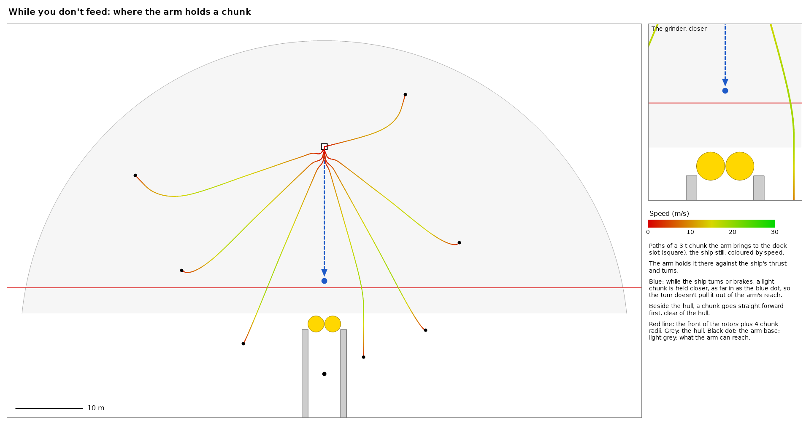

Your ship's arm brings each chunk into the Grinder or Excavator along a smooth curve, clear of the rotors, the claws and
the hull, and holds it steady while you turn and thrust.

## What changes

The arm is the AR-1500 Manipulator: the robot arm some ships carry to grab chunks of ore and feed them into the
ship. The mod only changes ships with a Grinder (two spinning rotors at the front, like the Eagle-Prospector-VP) or an
Excavator (a beak that opens in the middle, like the EIME). On other ships, such as the OCP-209, the arm works as in
the normal game.

- **While you feed** (holding the excavator key, which pulls the chunk in): without the mod, the game pushes the chunk
  straight back towards the ship, so a chunk off to one side hits the rotors, the claws or the hull. With the mod, a
  chunk in front comes straight in, and one from the side or from beside the hull curves round and comes in at an
  angle the rotors can take, never touching their outer side. It doesn't stop on the way, so it gets in sooner.
- **While you don't feed:** the arm holds the chunk at a spot in front of the ship, about 34 m ahead of the arm, as in
  the game. With the mod it keeps it there while you thrust and turn, as far as the arm is strong enough. A chunk
  beside the hull first moves straight forward, so it doesn't scrape along the hull.
- **When you turn or brake:** a chunk lighter than 10 t (every chunk of ore, lifepods, drones) is held closer to the
  ship, so the turn doesn't pull it out of the arm's reach; it goes back out a few seconds after. A derelict ship the
  arm holds stays where it is, so it never bumps into yours.
- **Hard turns:** the arm still has its limits. A turn or a burn stronger than the arm swings the chunk out, and if it
  goes past the arm's reach, the arm lets go of it.
- **Same cost:** the mod's pull uses as much power, and wears the arm as much, as the game's own.

The pictures show the Eagle-Prospector-VP from above, facing up, with a closer view of its Grinder on the right. Each
line is the path of a 3 t chunk from where the arm grabs it, with the ship still: green where it moves fast, red where
it moves slowly. The red line is a safety line in front of the rotors. In the first picture, while you feed, a chunk in
the shaded area comes straight in; from anywhere else it curves round to one of the two circles and then comes
straight in. In the second picture, while you don't feed, the square is where the arm holds a chunk, and the blue dot is
how far in it is held while you turn or brake.

## Changes how the game plays

Compared to the normal game, on ships with a Grinder or an Excavator, your arm:

- while you feed, brings each chunk in along a curve that keeps it off the outer side of the rotors or claws, without
  stopping it on the way, faster than the game does;
- while you don't feed, holds the chunk steady in front of the ship while you thrust and turn, and holds a light one
  closer while you turn or brake;
- keeps a held chunk moving with the hull, so turning the ship doesn't fling it away or push it into the rotors or
  claws.

On other ships nothing changes. If the arm does something wrong, try again without the mod before you report a bug to
the game's developers.

## Works with other mods

It works together with [ArmAltTargetSelection](ArmAltTargetSelection), which changes which chunk the arm goes for,
or on its own.

## Install

See [Installing mods](Home#installing-mods).

<!-- wiki-values (checked by wiki.ps1)
game-checked: 1.93.1
ArmAltPullBehavior/Code.gd CLOSER_MASS_LIMIT = 10.0 -> 10 t
ArmAltPullBehavior/Code.gd CHUNK_RADIUS_CLEARENCE_FACTOR = 4.0 -> 4 chunk radii | images/ArmAltPullBehavior-feeding.png, images/ArmAltPullBehavior-not-feeding.png
ArmAltPullBehavior/Code.gd TURN_FACTOR = 0.5 | images/ArmAltPullBehavior-feeding.png
ArmAltPullBehavior/Code.gd RESPONSE_RATE = 8.0 | images/ArmAltPullBehavior-feeding.png, images/ArmAltPullBehavior-not-feeding.png
ArmAltPullBehavior/Code.gd CLOSER_FULL_SHARE = 0.3 | images/ArmAltPullBehavior-not-feeding.png
game: 34 m, the arm's dock slot ahead of the arm, rounded from 33.75 m (ships/modules/SalvageArm.tscn areaDockSlot)
note: 3 t, the chunk in the pictures (worked out in the test harness)
-->
