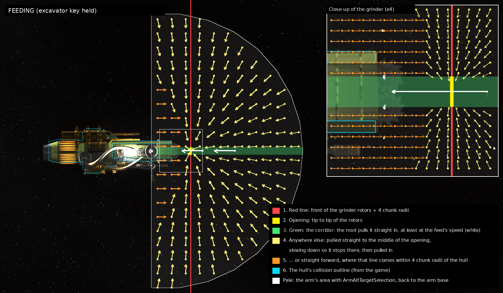

Your ship's arm lines each chunk up with the Grinder or Excavator before pulling it in, so it doesn't crash into the
rotors, the claws or the hull.

## What changes

The arm is the AR-1500 Manipulator: the robot arm some ships carry to grab chunks of ore and feed them into the
ship. The mod only changes ships with a Grinder (two spinning rotors at the front, like the Eagle-Prospector-VP) or an
Excavator (a beak that opens in the middle, like the EIME). On other ships, such as the OCP-209, the arm works as in
the normal game.

- **While you feed** (holding the excavator key, which pulls the chunk in): without the mod, the game pushes the chunk
  straight back towards the ship. A chunk off to one side then hits the rotors, the claws or the hull. With the mod,
  the arm first takes the chunk to the middle of the opening, stops it there, and then pulls it straight in, faster
  than the game does.
- **While you don't feed:** the arm brings the chunk to a spot in front of the ship, about 34 m ahead of the arm, and
  holds it there, as in the game. With the mod, a chunk beside the hull first moves straight forward, so it doesn't
  scrape along the hull on its way.
- **When you turn:** without the mod, turning the ship can fling a held chunk away or swing it into the rotors. With
  the mod, the arm keeps the chunk moving with the ship's hull, so turning doesn't do that.
- **Same cost:** the mod's pull uses as much power, and wears the arm as much, as the game's own.

The pictures show the Eagle-Prospector-VP from above, facing right, with a close-up of its Grinder in the top right
corner. The arrows show which way a chunk is moved from each spot. The red line is a safety line in front of the
rotors, and the yellow bar is the opening between them. The first picture is while you feed: in the green strip, a
chunk is pulled straight in; anywhere else, it is first taken to the middle of the opening. The second picture is
while you don't feed: the green arrows are the game's own pull, and the orange arrows show chunks beside the hull
moving straight forward first.

## Changes how the game plays

Compared to the normal game, on ships with a Grinder or an Excavator, your arm:

- while you feed, takes each chunk to the middle of the opening first, then pulls it straight in, faster than the
  game does;
- while you don't feed, moves a chunk beside the hull straight forward first, so it doesn't hit the hull;
- keeps a held chunk moving with the hull, so turning the ship doesn't fling it away or push it into the rotors or
  claws.

On other ships nothing changes. If the arm does something wrong, try again without the mod before you report a bug to
the game's developers.

## Works with other mods

It works together with [ArmAltTargetSelection](ArmAltTargetSelection), which changes which chunk the arm goes for,
or on its own.

## Install

See [Installing mods](Home#installing-mods).

<!-- wiki-values (checked by wiki.ps1)
game-checked: 1.92.5
ArmAltPullBehavior/Code.gd CHUNK_RADIUS_CLEARENCE_FACTOR = 4.0 -> 4 chunk radii | images/ArmAltPullBehavior-feeding.png, images/ArmAltPullBehavior-not-feeding.png
game: 34 m, the arm's dock slot ahead of the arm, rounded from 33.75 m (ships/modules/SalvageArm.tscn areaDockSlot)
-->
