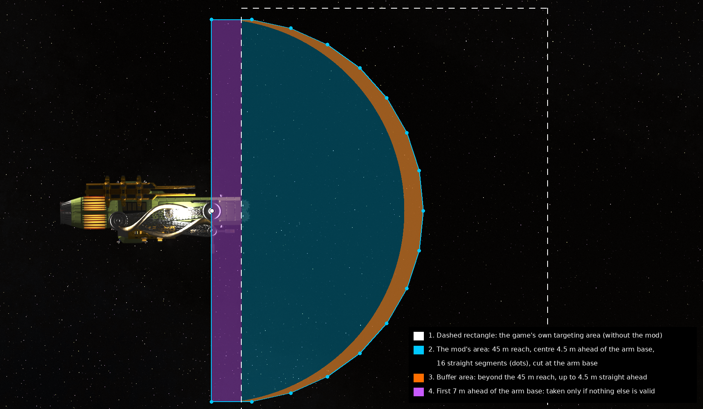

Your ship's arm only goes for chunks it can really reach, and picks the one that is easiest to bring in.

## What changes

The arm is the AR-1500 Manipulator: the robot arm some ships carry to grab chunks of ore and feed them into the
ship's Grinder or Excavator.

- **Where it looks.** Without the mod, the arm looks for chunks in a big box in front of the ship. The box reaches
  about 78.5 m ahead, but the arm only reaches 45 m, so it often picks a chunk it can't bring in yet. With the mod,
  the arm only looks where it can reach: a half circle in front of it, plus a little more straight ahead (up to
  4.5 m), because the Grinder or Excavator sits in front of the arm.
- **Right in front of the ship.** Without the mod, the arm never takes anything in the first 7 m in front of it.
  With the mod it does, but only when there is nothing else in reach: a chunk that close is awkward to bring in.
- **Which chunk first.** Without the mod, the arm takes the chunk that came into range first, wherever it is. With
  the mod, it takes the one best lined up with your Grinder or Excavator: how well a chunk is lined up counts three
  times as much as how close it is to them. That chunk is the quickest to bring in. Once the arm has picked a chunk,
  it keeps it until it is taken in or lost, as in the game.
- **Switching the arm off.** When you switch the arm off, it lets go of its chunk and forgets the others at once.
  When you switch it back on, it picks a fresh chunk.

The picture shows the Eagle-Prospector-VP from above, facing right, with the arm at the white dot. The dashed box is
where the arm looks without the mod. The blue half circle is where it looks with the mod, and the orange edge is the
little extra straight ahead. The purple strip right in front of the arm is used only when there is nothing else.

It works on every ship that carries the arm. On the OCP-209, whose arm points out of an opening in its side, the half
circle points that way too.

## Changes how the game plays

Compared to the normal game, your arm:

- only takes chunks it can reach, plus a little more straight ahead, instead of from the game's much bigger box;
- also takes chunks right in front of it, but only when nothing else is in reach;
- picks the chunk best lined up with your Grinder or Excavator, not the one that came into range first;
- lets go and forgets its chunks as soon as you switch it off.

If the arm does something wrong, try again without the mod before you report a bug to the game's developers.

## Works with other mods

It works together with [ArmAltPullBehavior](ArmAltPullBehavior), which changes how the arm brings a chunk in, or on
its own.

## Install

See [Installing mods](Home#installing-mods).

<!-- wiki-values (checked by wiki.ps1)
game-checked: 1.93.1
ArmAltTargetSelection/Code.gd BUFFER_AREA_FACTOR = 0.10 -> 4.5 m | images/ArmAltTargetSelection-area.png
ArmAltTargetSelection/Code.gd BALANCE = 0.75 -> three times as much
ArmAltTargetSelection/Code.gd AREA_SEGMENTS = 16 | images/ArmAltTargetSelection-area.png
game: 45 m, how far the AR-1500 reaches (ships/modules/SalvageArm.tscn scale, Arm.gd armLength)
game: 78.5 m and 7 m, where the arm's own search box ends and starts, ahead of the arm (ships/modules/SalvageArm.tscn, DockingArm.tscn areaDockArea)
-->
