Try your ship in a fight at the station, against the enemy ships, distance and rocks you pick, with nothing carried
over to your ship or your save.

## What changes

**Opening it.** The simulator's button, *Minding Virtual Flight Service*, is on the Tuning screen, on the User Manual
tab of the Equipment screen, and on the Examine Ship tab of the Dealer and of the Fleet. A click on it, or J, still
starts the simulator, the station's flight simulator. With the mod, **Shift+Click** on the button, or **Shift+J**,
opens the combat simulation instead. If you moved J to another key in the game's controls, hold Shift with that key:
the button shows which key it is.

With a gamepad, highlight the button and press **X** while holding **LT**. Or hold **LT** and press **Back**, the
button that starts the simulator. Like Shift+J, LT+Back works without highlighting the button.

A small badge on the left of the button reminds you how. It reads *Shift*, or *LT+X* while you play with a gamepad
(the game's *Controls* setting on *Gamepad*, or on *Auto* when you last used the gamepad). Point at the badge to read
*Click the button while pressing Shift to open the CombatSimulator interface.* With a gamepad, highlighting the button
shows *Highlight the button and press X while holding LT to open the CombatSimulator interface.*

**Without the mod:**

**With the mod:**

You fly the ship that screen's simulator would fly. On the Tuning screen, that is your ship as you tuned it. On the
Equipment screen, it has the piece of equipment you are looking at, even before you buy it. On the Dealer and the
Fleet, it is the ship you are examining, so you can try a ship in a fight before you buy it.

**The combat simulation** covers the screen you opened it from, laid out like the Crew screen, with two tabs. *Start*
and *Cancel* are at the bottom of both; Esc, or B on a gamepad, cancels too. With a gamepad, LB and RB switch between
the tabs, and the right stick scrolls a description too long for its window.

| Combat simulation | Ship |
|---|---|
| 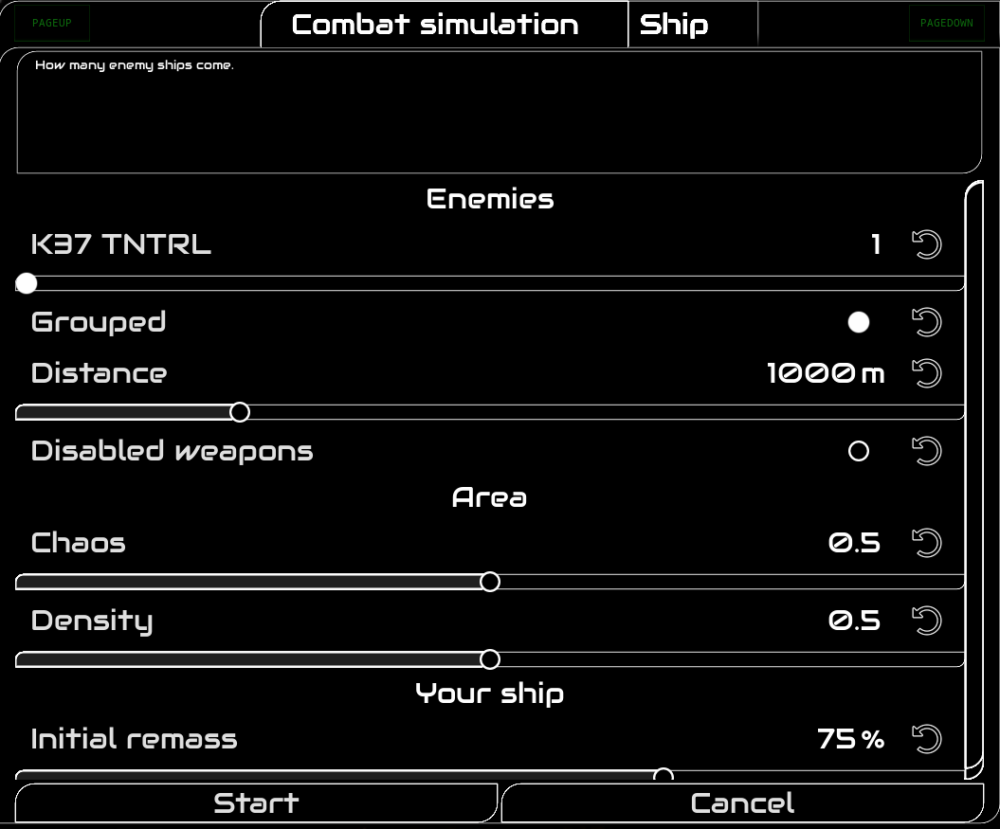 | 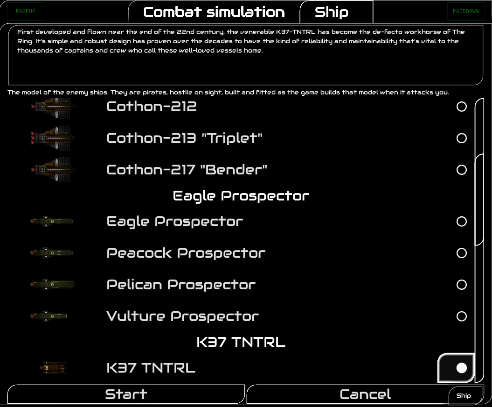 |

- *Combat simulation*: at the top, a window describes the setting you have selected. Below it, the settings, in three
  groups: *Enemies*, *Area* and *Your ship* (see [Settings](#settings)). The first row of *Enemies*, how many enemy
  ships come, shows the name of the ship you picked on the *Ship* tab, so you can see what you will fight.
- *Ship*: every ship model in the game, even those the station doesn't sell, each with its picture and a switch. The
  ship switched on is the model of the enemies: switch another one on to pick it. At the top, the game's own
  description of the ship you have selected, as the Dealer shows it. The ships are grouped by series (a ship and the
  models built from it), in alphabetical order; ships alone in their series come last, under *Others*. Each picture
  shows the ship as the Dealer sells it, but with nothing on its hardpoints (the mounts for weapons and other
  equipment). The pictures are drawn the first time you open the tab.

**The fight.** *Start* fades the station out, and your ship appears in a stretch of ring, at rest. It works like the
simulator, but it looks and sounds like a dive, without the simulator's hexagons:

- the rocks are the game's own, as in a part of the rings with the chaos and density you set (at a real spot of
  the rings that matches them, so every fight is a little different);
- the dive's music plays;
- bullet time (the slow motion of the Adrenaline booster, your pilot and the smart camera) works as in a dive;
- J opens the Onboard Maintenance System and Esc closes it, and time slows while it is open, as in a dive;
- the HUD shows its map of the rings and, with the Runasimi Gravimetric USV fitted, its gravimetric readout, which the
  game hides outside the rings;
- mass drivers play their reload sound.

Your ship starts with full ammunition and as much remass as you set. The enemy ships are pirates, hostile as soon as
they see you, each built and fitted as the game builds that model when it attacks you: [Ships](#ships) says what each
one brings. They appear between the Distance you set and 1,000 m farther: side by side, 300 m apart, from one
direction when *Grouped* is on, or each from a direction of its own when it is off. Then they come for you.

With *Disabled weapons* on, their weapons fire nothing. They still come for you and aim, and their turrets still
follow you: their weapons stay switched on, so they fight as hard as they would armed.

**Ending it.** With the Onboard Maintenance System closed, Esc asks *End the combat simulation?*, with *Yes* and *No*.
*No* is selected, so confirming right away takes you back to the fight. The game pauses while it asks, with the music
muffled, as the pause menu does in a dive. It also asks, instead of opening the pause menu, when you press the
gamepad's Start button, when the game's window loses the focus, and when a gamepad is disconnected. If your ship is destroyed, the fight ends 16 s after the explosion, as the simulator
does. Either way the station fades back in, on the screen you left.

**Nothing carries over.** What happens in the fight stays there:

- your ship's damage, remass and ammunition are as before you pressed *Start*, and so are the ships the game
  remembers, their names and codes, and how the pirates feel about you;
- your crew gains no experience in the fight, but their talent grows each day as always;
- nothing in the fight moves the story along, and a ship you hold with the arm doesn't join your fleet;
- the station's clock runs during the fight, and your crew's wages with it, except while the game is paused.

**Not quite a fight in the rings.** Compared with meeting the same ships in the rings:

- nobody talks: you can't hail the enemies, and they don't call you;
- your crew gains no experience;
- *PLOT A COURSE* in the Astrogator tab does nothing;
- no random events happen and no miners pass by: only the enemies you picked are there;
- every enemy is hostile on sight, even a model that in the rings would only come to look at you, or talk first;
- pirates treat you as in a new game: the pirates you have fought don't make them fear you more;
- Esc asks whether to end the fight instead of opening the pause menu.

## Settings

Open them with Shift+Click on the simulator's button or Shift+J, or with a gamepad, LT+X on the highlighted button or
LT+Back. Each row has a button that resets it to its default. A change applies to the next fight. Each save game keeps its own settings, written to disk the next time the game
saves; a new game starts with the defaults.

| Setting | What it does | Default | Range |
|---|---|---|---|
| **Ship** (the *Ship* tab) | The model of the enemy ships. | K37 TNTRL | every ship model in the game |
| **Number** (*Enemies*, the row named after the enemy ship, such as *K37 TNTRL*) | How many enemy ships come. | 1 | 1 to 3 |
| **Grouped** (*Enemies*) | On: the enemy ships come together, side by side from one direction. Off: each one comes from a direction of its own. | on | on or off |
| **Distance** (*Enemies*) | How close the enemy ships appear, at least. Each one appears up to 1,000 m farther. | 1,000 m | 100 to 4,000 m, in steps of 100 m |
| **Disabled weapons** (*Enemies*) | On: the enemies' weapons fire nothing. | off | on or off |
| **Chaos** (*Area*) | How restless the rocks around you are: the more chaos, the faster they drift and spin. With enough of it, the music turns western, as in the rings. In the rings, chaos is mostly 0.3 to 0.5, more the deeper you dive. | 0.5 | 0 to 1, in steps of 0.1 |
| **Density** (*Area*) | How many rocks there are around you, as in a part of the rings this dense. | 0.5 | 0 to 1, in steps of 0.1 |
| **Initial remass** (*Your ship*) | How full your ship's remass tanks are at the start. Remass is your ship's propellant. | 75 % | 20 to 100 %, in steps of 5 % |

## Works with other mods

It works together with [DiveSkipTransit](DiveSkipTransit) and [TransponderAltCodes](TransponderAltCodes), which change
some of the same parts of the game: the station, and what the game keeps about ships.

## Install

See [Installing mods](Home#installing-mods).

## Ships

The ships you can fight, with what matters in a fight. The figures are worked out from the game's own files, for game
version 1.93.1: a game update can change them.

- **Enemy remass**: what an enemy of that model carries in the fight.
- **Reactor Core**: how big the enemy's reactor core is. A bigger core takes longer to melt down (see
  [Melting a reactor down](#melting-a-reactor-down)).
- **Leaks**: kinetic hits close to a reactor (slugs, thrown iron, collisions) make it leak. Past a quarter of a full
  leak, the reactor vents remass now and then, more often the worse the leak, and at a full leak all the time, up to
  the figure in the table, while it is hot. A ship out of remass has no power: its reactor's turbine runs on remass.
  The table says how far from the reactor's centre a single EMD-14 slug still makes it leak, then how many slugs on
  the reactor start it venting and leak it fully (see [Leaking a reactor](#leaking-a-reactor) for other hits). At a
  full leak, a K37 TNTRL pirate's 10 t of remass is gone in 20 s, 30 t in 60 s, 80 t in 160 s.
- **EMP shielding**: EMP below it does nothing to the ship (see
  [Shutting a reactor down](#shutting-a-reactor-down)).
- **Hardpoints**: how many, and how many of them are high-stress. Rear hardpoints and docking bays take only cargo
  containers, drones and turrets, no other weapons.

Enemies are built used, so each part of one may start with up to 35 % damage. Its reactor may already leak: it then
melts down sooner and starts venting sooner.

**The pictures.** One picture per series (a ship and the models built from it), of its first model: where hits damage
the reactors is the same on all of them. Each ship is seen from above, nose up, with nothing on its hardpoints (turrets
that come with the hull stay). Most are drawn at one scale, 10 pixels to the metre, so you can compare their sizes; a
ship too small or too big for that is drawn bigger or smaller. The bar at the bottom left is 5 m long, unless the
picture's title gives another length. The glow shows where a kinetic hit damages a reactor: full colour over the reactor's core, then fading as a hit
there would do 10, 100 and 1,000 times less damage, with a thin line at each of those steps. Every picture uses the
same colours for the same damage, so ships compare: red, orange and yellow is reactor leak; blue is the coolant damage
of the Eon Interstellar Model E's fusion reactor, which doesn't leak. Where reactors overlap, the one a hit there
damages more shows.

### Ships the station sells

| Ship | Enemy remass | Reactor | Vents at a full leak | One EMD-14 slug leaks it within; slugs to vent, to a full leak | EMP shielding | Hardpoints |
|---|---|---|---|---|---|---|
| K37 TNTRL | 10 t | 1 fission | 0.5 t/s | 15 m; 2, 5 | none | 3 (1 high-stress) |
| KX37 TNTRL | 30 to 80 t | 1 fission | 0.5 t/s | 15 m; 2, 5 | none | 3 (1 high-stress) |
| Runasimi KR37 TNTRL | 30 to 80 t | 1 fission | 0.5 t/s | 15 m; 2, 5 | 200 MW | 3 (1 high-stress) |
| KTA24 TNTRL | 30 to 80 t | 1 fission | 0.5 t/s | 15 m; 2, 5 | none | 3 (1 high-stress) |
| Eagle Prospector | 30 to 80 t | 1 fission | 0.5 t/s | 15 m; 2, 5 | none | 2, and 2 drone mounts |
| Peacock Prospector | 30 to 80 t | 1 fission | 0.5 t/s | 15 m; 2, 5 | none | 2, and 2 drone mounts |
| Vulture Prospector | 30 to 80 t | 1 fission | 0.5 t/s | 15 m; 2, 5 | none | 3 (1 high-stress) |
| Pelican Prospector | 30 to 80 t | 1 fission | 0.5 t/s | 15 m; 2, 5 | none | 2, and 2 drone mounts |
| Eon Interstellar Model E | 30 t | 1 fusion | doesn't leak | doesn't leak | none | 3 (1 high-stress) |
| Cothon-212 | 80 t | 1 fission, bigger | 0.5 t/s | 23.5 m; 2, 8 | 100 MW | 2, and 2 rear |
| Cothon-211 "Chonker" | 80 t | 1 fission, bigger | 0.5 t/s | 23.5 m; 2, 8 | 100 MW | 2, and 2 rear |
| Cothon-213 "Triplet" | 80 t | 1 fission, bigger | 0.5 t/s | 23.5 m; 2, 8 | none | 2, and 2 rear |
| Cothon-217 "Bender" | 80 t | 1 fission, bigger | 0.5 t/s | 23.5 m; 2, 8 | 100 MW | 2, and 2 rear |
| Antonoff-Titan K225 | 80 t | 1 fission, wide | 0.5 t/s | 40 m; 2, 8 | none | 2, and 6 docking bays |
| Antonoff-Titan K225-BB | 80 t | 1 fission, wide | 0.5 t/s | 40 m; 2, 8 | none | 2, and 2 docking bays |
| OCP-209 | 80 t | 1 fission | 0.5 t/s | 15 m; 2, 5 | none | 4 (2 high-stress) |
| ND-LIS Kitsune | 15 t | 1 fission | 0.5 t/s | 15 m; 2, 5 | none | 1, spinal |

None of these ships has weapons of its own. In the fight, each enemy comes as the game builds it:

| Ship | Its weapons in the fight | Reactor Core |
|---|---|---|
| K37 TNTRL | an ERFMD-17 mass driver and 5 t of ammunition, as the pirates fly it | 4 GW |
| KX37, Runasimi KR37 and KTA24 TNTRL | one of the 20 used TNTRL builds, at random: an MWG, an EMD-14, a CL-150, a CL-600P, an MWG and a CL-600P, an MPI Railgun MkI, an MPI Railgun MkI and 2 MWG, 3 ERFMD-17, 3 MWG, or a CL-150 with MLF Haul Drones | 4 or 8 GW |
| Eagle, Peacock, Vulture and Pelican Prospector | one of the 10 used Prospector builds: 2 AEMD-14, 2 CL-200AP, an MWG and a CL-600P, 2 MWG, an AEMD-14 and an MWG, a CL-200AP and an MWG, or 2 EMD-14 | 8 to 40 GW |
| Eon Interstellar Model E | none | fusion |
| Cothon-212, Chonker, Triplet and Bender | one of the 2 used Cothon builds: an EMD-14, or 2 ONMWG-650 | 8 or 12 GW |
| Antonoff-Titan K225 | an EMD-14, and 6 THI Cargo Containers | 16 GW |
| Antonoff-Titan K225-BB | an EMD-14, and 2 THI Cargo Containers | 16 GW |
| OCP-209 | none: 2 AR-1500 arms | 16 GW |
| ND-LIS Kitsune | an MWG | 4 GW |

The Cothons' reactors are bigger and the K225s' wider, so a hit leaks them from farther away, but it takes more hits
to leak them fully. The Eon Interstellar Model E's fusion reactor doesn't leak: kinetic hits damage its coolant
instead, EMP doesn't shut it down, and weapon heat barely warms it.

K37 TNTRL series: the K37, KX37, Runasimi KR37 and KTA24 TNTRL

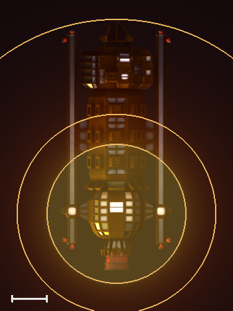

Eagle Prospector series: the Eagle, Peacock, Vulture and Pelican Prospector

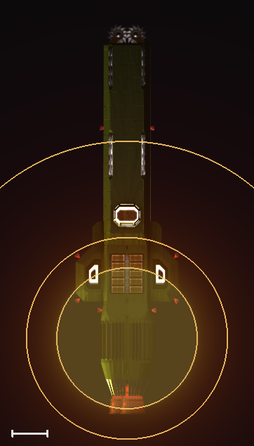

Eon Interstellar Model E (bar: 10 m)

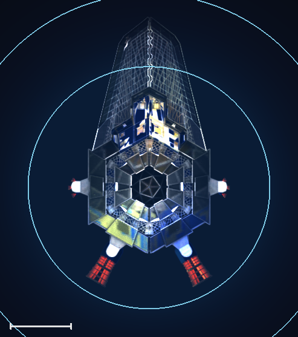

Cothon series: the Cothon-212, the Chonker, the Triplet and the Bender (bar: 10 m)

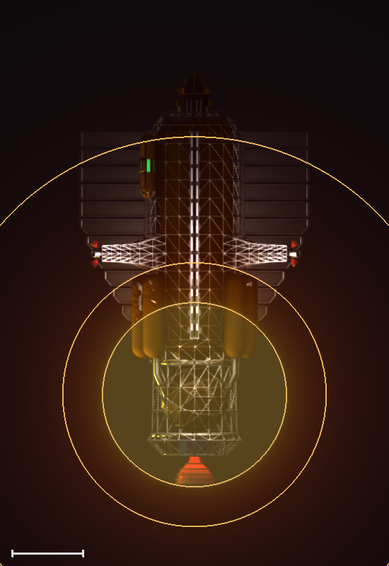

Antonoff-Titan K225 series: the K225 and the K225-BB (bar: 10 m)

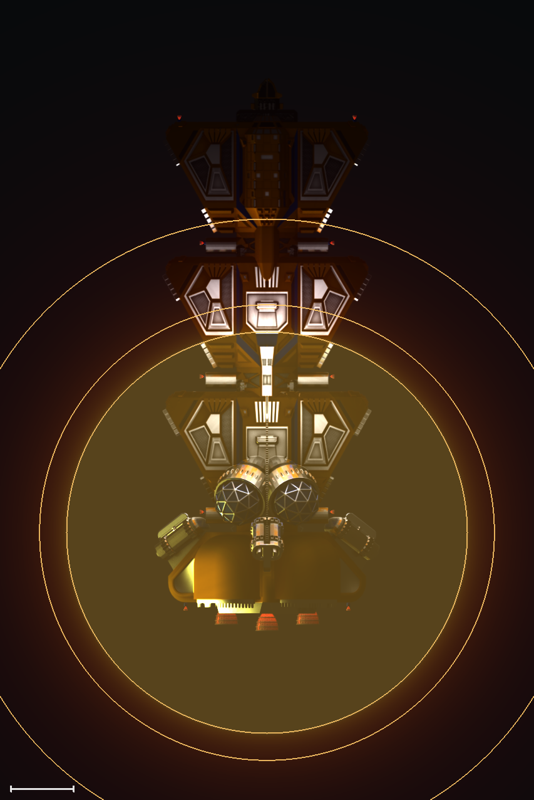

OCP-209 (bar: 10 m)

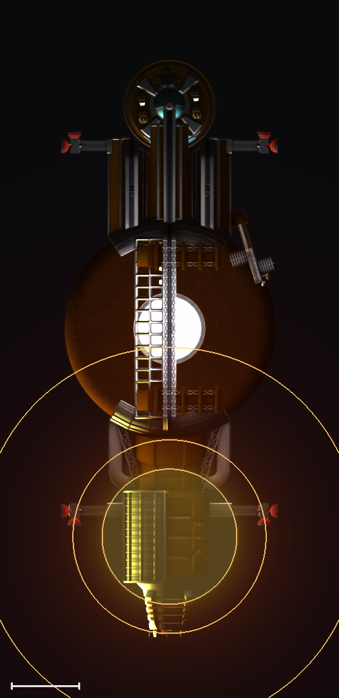

ND-LIS Kitsune

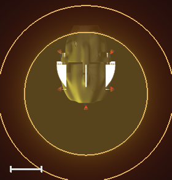

<b>SPOILER ALERT</b>: ships the station doesn't sell (click to show)

| Ship | Enemy remass | Reactor | Vents at a full leak | One EMD-14 slug leaks it within; slugs to vent, to a full leak | EMP shielding | Hardpoints |
|---|---|---|---|---|---|---|
| K44 MHFTR Prototype | 30 to 80 t | 1 fission | 0.5 t/s | 15 m; 2, 5 | none | 2, and 2 rear |
| Bald Eagle | 30 t | 1 fission | 0.5 t/s | 15 m; 2, 5 | none | 2, and 2 drone mounts |
| Antonoff-Titan K225 (modified) | 80 t | 1 fission, wide | 0.5 t/s | 40 m; 2, 8 | 100 MW | 2 |
| MAD-CERF | 800 t | 2 fission, large | 3 t/s each | 27.5 m; 1, 4 | none | 6, which the station can't fit |
| Hybrid | 15 t | 1 fission | 0.5 t/s | 15 m; 2, 5 | 500 MW | 1 (1 high-stress) |
| Tsukuyomi | 1,300 t | 3 fission, large | 3 t/s each | 55 m; 1, 4 | none | none |
| Racing drone | 2 t | 1 fission, tiny | 0.03 t/s | 1.2 m; a single slug is a full leak | none | none |
| ATLAS | 40 t | 1 fission | 0.03 t/s | 12 m; 1, 4 | none | 2 |

| Ship | Its weapons in the fight | Reactor Core |
|---|---|---|
| K44 MHFTR Prototype | the TNTRL builds, but it has no high-stress hardpoint: unarmed in 12 of the 20, else 1 or 2 MWG or 2 ERFMD-17 | 4 or 8 GW |
| Bald Eagle | none (built new) | 50 GW |
| Antonoff-Titan K225 (modified) | 2 ONMWG-650 | 40 GW |
| MAD-CERF | as the pirates fly it to abduct crews: 4 ERFMD-17, 2 MWG and 15 t of ammunition | 2 of 12 GW, each holding heat like an 8 GW core |
| Hybrid | as the hybrid hunter: an MWG, with 500 MW of EMP shielding, which stops any MWG | 4 GW |
| Tsukuyomi | as the Big Bad Wolf, Vilcy's frigate: its own 7 turrets, 2 CL-150, 2 CL-600P and 3 MWG | 3 of 25 GW, each holding heat like a 50 GW core |
| Racing drone | none (built new) | 4 GW |
| ATLAS | 2 MWG (built new) | 40 GW |

Only the Tsukuyomi has weapons of its own, its turrets (see [Turrets](#turrets)); it keeps them in its picture. The
Bald Eagle, the racing drone and ATLAS come new, without damage. At a full leak, the MAD-CERF's remass is gone in 133 s
with both reactors venting, the Tsukuyomi's in 144 s with all three, and ATLAS's in 22 min. The Tsukuyomi's reactors
hold 3,000 K, as the Eagle's do, so they take longer to melt down.

The K44 MHFTR Prototype is in the K37 TNTRL series and the Antonoff-Titan K225 (modified) in the K225 series: their
reactors are where those series' pictures, above, show them.

Bald Eagle

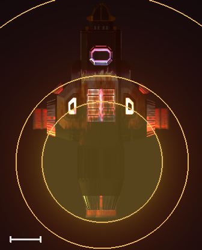

MAD-CERF (bar: 20 m)

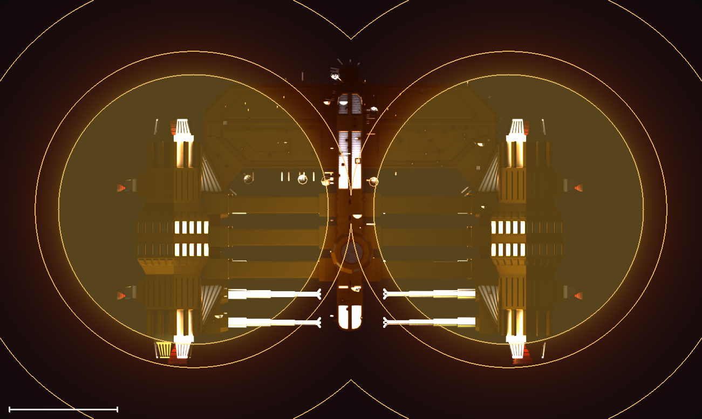

Hybrid

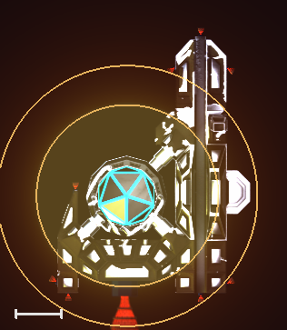

Tsukuyomi (drawn smaller; bar: 20 m)

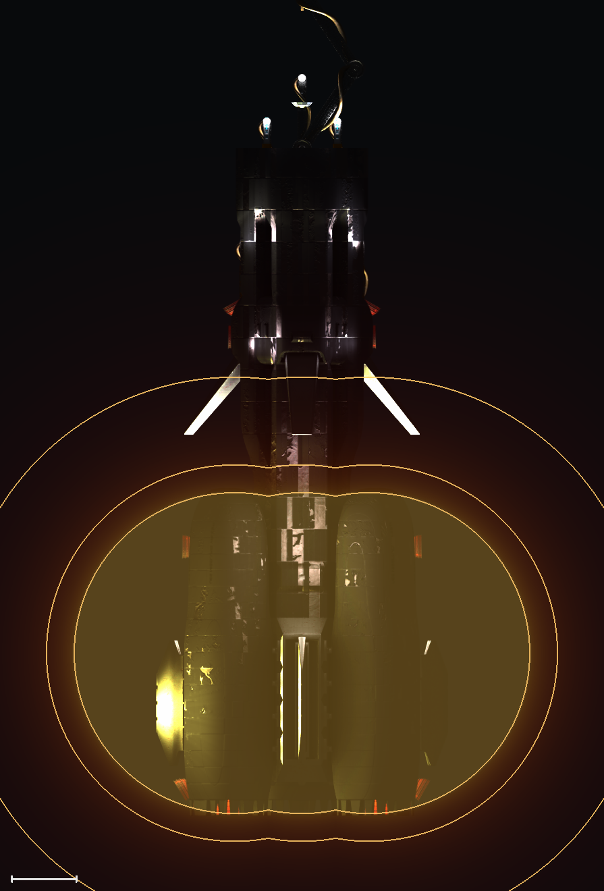

Racing drone (drawn bigger; bar: 1 m)

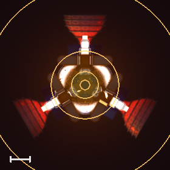

ATLAS

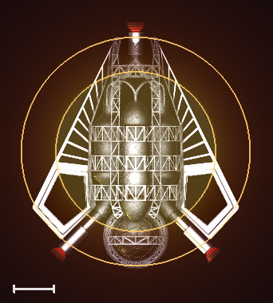

## Weapons

Every weapon a ship can carry, by family: what it costs, where it fits, what it does to ships and to rocks, and how to
tune it. The figures are at the default Tuning, with the game's physics at 60 steps a second, its default (see
[Slower physics](#slower-physics)), for game version 1.93.1.

### How weapons do damage

| | To ships | To rocks |
|---|---|---|
| **Kinetic**: slugs, thrown iron, a pulse's kinetic part, the SPC Gungnir's, collisions | leaks the reactor near the hit; chokes and bends thrusters near it; bends weapons near it | counts in full, less a small part of each hit |
| **Heat**: lasers, microwave emitters, slugs, thrown iron, exhaust rays, the SPC Gungnir's | heats the reactor near the hit, toward a meltdown; makes thrusters near it fire by themselves; spoils the focus of weapons near it | counts a fortieth as much |
| **EMP**: microwave emitters, the SPC Gungnir's | only what gets past the ship's EMP shielding: shuts the reactor down while it lasts; *Short Circuit* on the HUD; *Pump Failure* on lasers anywhere on the ship | nothing |

- **Rocks** come in five sizes, of about 16, 64, 256, 1,024 and 4,096 t (each rock 0.75 to 1.25 times that). A rock's
  damage builds up for good. Once it is more than the rock can take, the rock breaks into two rocks of the next size
  down; the smallest break into chunks. A single hit that goes far past what the rock can take makes it skip a size: it
  breaks into two rocks of the size after next, with half the ore, and so on for each size skipped. The smallest rocks
  never skip. No hit of 1.5 MJ or less skips a size, even on the smallest 64 t rocks. Nothing damages a chunk.
- **A reactor** holds its usual temperature, 3,500 K on most ships (3,000 K on the Eagle, Peacock and Vulture
  Prospector). Heat that lands within 10 m of a standard reactor's centre warms it 3.8 times as much as the weapon puts
  out, and it cools by itself, faster the hotter it is. Above 6,000 K for 8 s, it melts down and the ship explodes. A leaking
  reactor melts down sooner: its limit drops by up to 2,000 K at a full leak.
- **Thrusters**: an EMD-14 slug within 1.5 m of a thruster chokes and bends it fully. Heat near a thruster makes it
  fire by itself, at up to half power.
- **Lasers' pumps**: a default MWG gives a laser full *Pump Failure* in 23 s, an MWG at 75 MW and 10 % in 8.4 s.

**The pictures.** Each weapon has two panels, mounted on a K37 TNTRL (the SPC Gungnir on its left side mount).

- On the left, close up, with a 10 m bar: the yellow fill is the spread of a new weapon at its default Tuning (a line
  where it has none), and the orange edges its widest spread, once its focus is fully worn (for the MWG, also at its
  highest power). A turret also shows, in light blue, how far it can turn (all the way round, or 2° each way for the
  AEMD-14 and the CL-200AP), brighter as far as it turns in 1 s, and in green its safety distance.
- On the right, a wide view, with your ship as a ringed dot. A fixed weapon shows its cone out to its range, with a mark
  there; a mass driver's cone fades past the 2 km the AI aims at, since slugs fly on; lasers and the SPC Gungnir are
  straight lines. A turret shows where it picks targets up instead: magenta for ships, amber for rocks, violet for both,
  and its weapon's range. An exhaust weapon shows its heat ray as long as the game makes it, brighter where half of it
  falls, fading as it weakens; the Tetsuo's thrown iron is a line out to the 800 m the AI aims at.
- The right-hand bar's length is given with each picture.

### Mass drivers

| Weapon | Price | Fits | Mass driver power (Tuning) | Ammunition per shot | Shots per second | Slug speed | Each hit: kinetic, heat | Electricity per shot | Spread |
|---|---|---|---|---|---|---|---|---|---|
| EMD-14 mass driver | 10,000 E$ | any weapon hardpoint | 750 MW (375 to 1,125) | 10 kg | 2 | 4,500 m/s | 10.1 MJ, 11.3 MJ | 120 MJ | none |
| ERFMD-17 mass driver | 30,000 E$ | any weapon hardpoint | 500 MW (250 to 750) | 10 kg | 5 | 3,000 m/s | 4.5 MJ, 11.3 MJ | 80 MJ | none |
| MPI Railgun MkI | 20,000 E$ | any weapon hardpoint | 800 MW (400 to 1,200) | 2 kg | 10 | 4,900 m/s | 4.9 MJ, 2.3 MJ | 48 MJ | 0.75° each way |
| AEMD-14 mass driver | 32,000 E$ | any weapon hardpoint | 750 MW (375 to 1,125) | 10 kg | 2 | 4,500 m/s | 10.1 MJ, 11.3 MJ | 120 MJ | none; it aims itself, up to 2° each way |

- *Any weapon hardpoint* means a high-stress, spinal, low-stress or front low-stress hardpoint.
- Slugs fly on until they hit something. The AI and turrets aim up to 2 km away.
- Every shot pushes your own ship back.
- A higher *Mass driver power* makes every hit and the electricity per shot grow with it (1.5 times at the most), and
  wears the barrel faster (2.25 times at the most).
- A worn focus widens any mass driver's spread, up to 7.5° each way.

EMD-14 mass driver (bars: 10 m and 500 m)

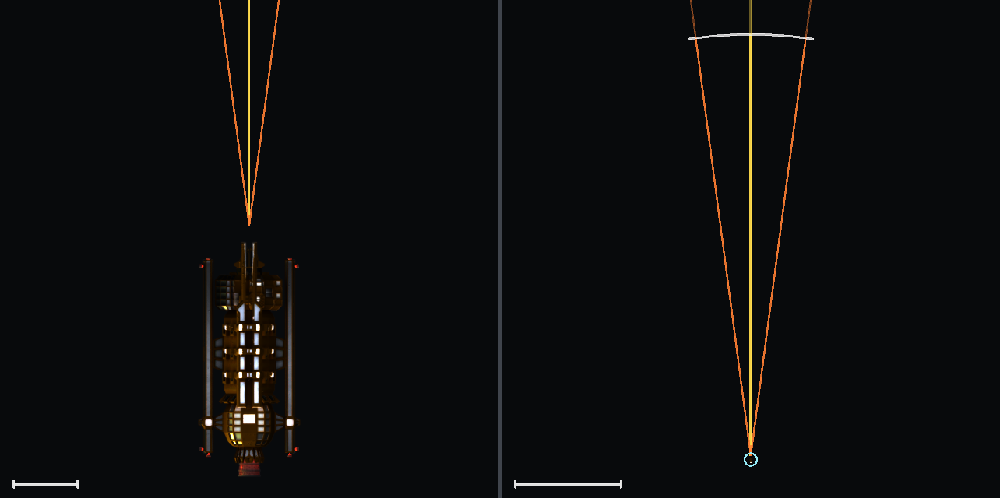

ERFMD-17 mass driver (bars: 10 m and 500 m)

MPI Railgun MkI (bars: 10 m and 500 m)

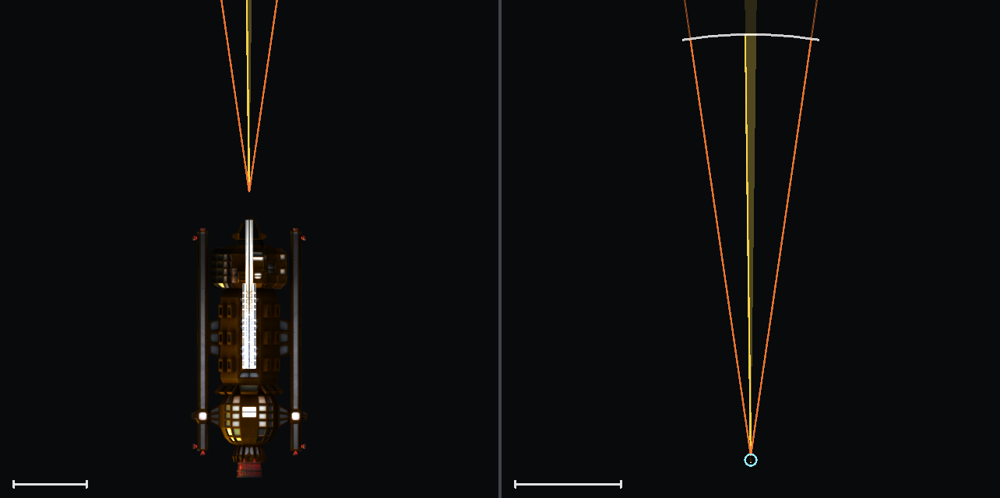

AEMD-14 mass driver (bars: 10 m and 200 m)

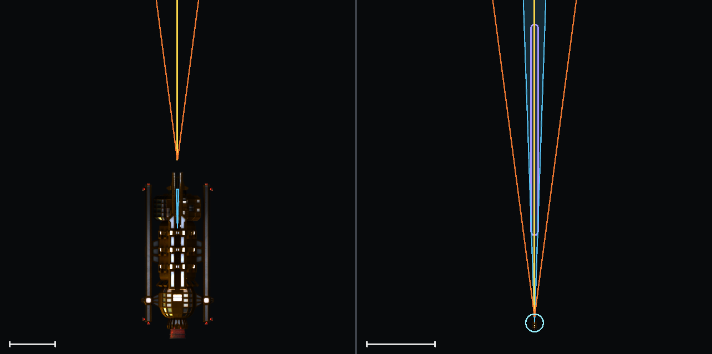

### Lasers

| Weapon | Price | Fits | Laser Power Supply (average) | Pulse frequency | Puts out | Each pulse at default | Range |
|---|---|---|---|---|---|---|---|
| CL-150 mining laser | 150,000 E$ | any weapon hardpoint | 150 MW (75 to 225) | none: a steady beam | 125 MW, all heat | | 6.6 km |
| CL-600P pulse mining laser | 320,000 E$ | any weapon hardpoint | 660 MW (330 to 990) | 12 Hz (3 to 24) | 600 MW | 50 MJ: half heat, half kinetic (it hits like 0.6 MJ) | 6.6 km |
| CL-200AP pulse mining laser | 220,000 E$ | any weapon hardpoint | 220 MW (110 to 330) | 24 Hz (6 to 48) | 200 MW | 8.3 MJ: half heat, half kinetic (it hits like 0.1 MJ) | 6.6 km; it aims itself, up to 2° each way |

- A pulse carries the power divided by the frequency, and the laser fires at most one pulse per physics step. The
  average draw is the *Laser Power Supply* you set, at any frequency.
- A pulse's kinetic part is 6 ÷ frequency for the CL-600P, 12 ÷ frequency for the CL-200AP, all of it at that
  frequency or lower; the rest is heat. A kinetic part hits like a fortieth of its energy.
- Lasers have no spread.

CL-150 mining laser (bars: 10 m and 1,000 m)

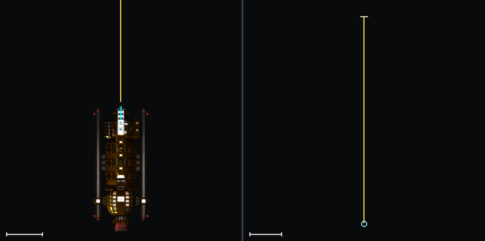

CL-600P pulse mining laser (bars: 10 m and 1,000 m)

CL-200AP pulse mining laser (bars: 10 m and 200 m)

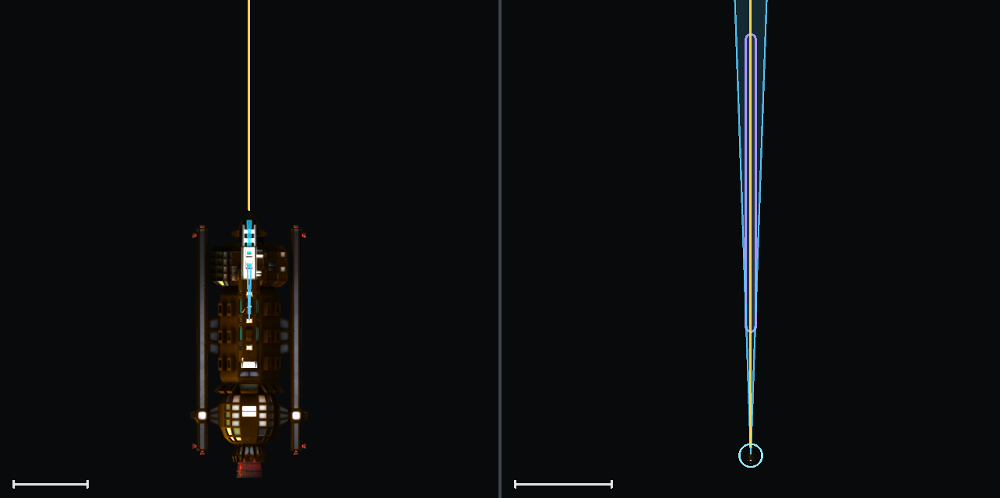

### Microwave emitters

| Weapon | Price | Fits | Microwave Power | Water Resonance | Puts out at default | Range | Cone |
|---|---|---|---|---|---|---|---|
| MWG microwave emitter | 70,000 E$ | any weapon hardpoint | 50 MW (25 to 75) | 50 % (10 to 90 %) | 45 MW: 22.5 MW of heat and 22.5 MW of EMP | 800 m | 5° (0° at 25 MW, 10° at 75 MW) |
| ONMWG-650, a turret | 180,000 E$ | any weapon hardpoint, rear hardpoints, docking bays | the same | the same | the same | 800 m | the same |

- It puts out 90 % of its power: the share you set as *Water Resonance* as heat, the rest as EMP. At 75 MW and 90 %:
  60.8 MW of heat and 6.8 MW of EMP. At 75 MW and 10 %, the other way round.
- Its damage doesn't fall with distance, but it spreads over the cone, so far away less of it hits a small ship.

MWG microwave emitter (bars: 10 m and 200 m)

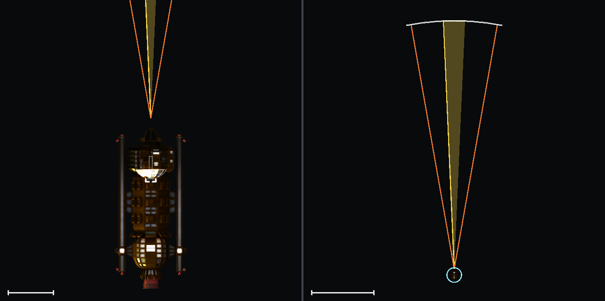

ONMWG-650 (bars: 10 m and 200 m)

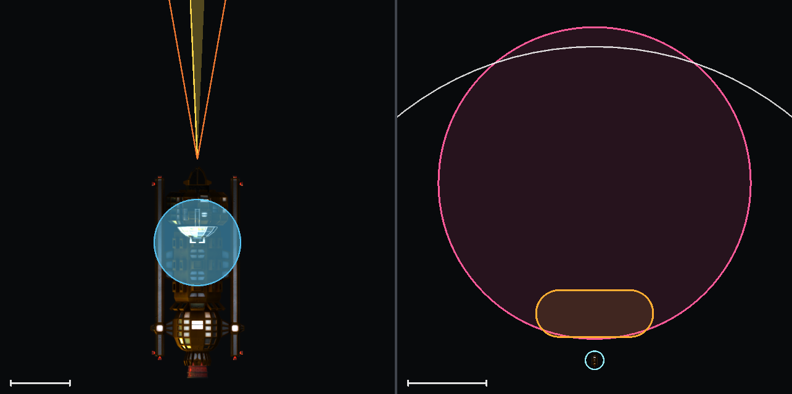

### SPC Gungnir

| Price | Fits | Power | Charge | Each shot | Range |
|---|---|---|---|---|---|
| 270,000 E$ | low-stress and front low-stress hardpoints only | 400 MW while you hold the trigger | full in 30 s, 11,250 MJ; it fires when you let go, if you held it at least 1.5 s; a smaller charge drains away | a quarter heat and a quarter EMP, at once; a quarter kinetic (it hits like 70 MJ at full charge); a quarter left at the hit as up to 5 storm discharges | 6.6 km |

It has no Tuning.

SPC Gungnir (bars: 10 m and 1,000 m)

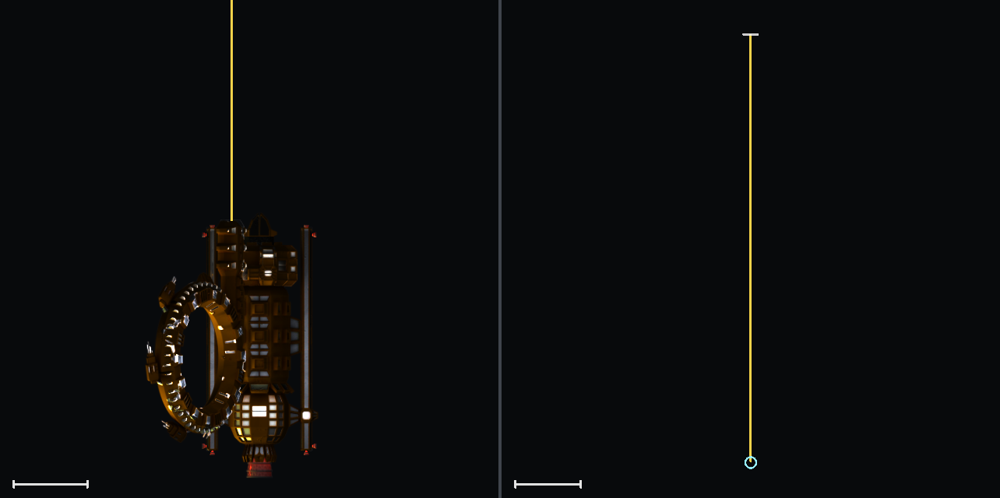

### Exhaust weapons

These are thrusters pointed forward: they push your ship back as hard as they push out.

| Weapon | Price | Fits | Thrust (Tuning) | Takes | What it fires |
|---|---|---|---|---|---|
| EINAT Kzinti Lesson MkII | 100,000 E$ | high-stress and spinal hardpoints | 1,100 kN (550 to 1,650) | 200 MW, and about 25 GW of your reactor's heat | a heat ray along its 53 m plume: 35 GW of heat at 10 m, 19 GW at 20 m, 7.5 GW at 50 m |
| NANI | 300,000 E$ | high-stress hardpoints only | 3,450 kN (1,725 to 5,175) | 200 MW, and 2 GW of your reactor's heat; 60 s of firing, full again each time your ship is loaded (every dive) | a heat ray along its 422 m plume: 455 GW out to 80 m, 91 GW at 400 m |
| Tetsuo HMX-2000I | 160,000 E$ | any weapon hardpoint | 1,100 kN (550 to 1,650) | 200 MW, about 25 GW of your reactor's heat, and 600 kg/s of iron ore or ammunition from your cargo | 60 lumps of iron a second at 1,800 m/s, each hitting like 1.7 MJ kinetic and 13.5 MJ of heat, for 1 s (about 1.8 km); and the same 53 m heat ray as the EINAT |

- The heat ray, the push and the reactor heat taken all follow *Thrust*; wear follows it twice over.
- The ray is only as strong as your reactor can feed it: the Equipment screen warns you below a 20 GW Reactor Core, and
  a 20 GW core gives about 80 % of it.
- The Tetsuo's iron flies faster with more *Thrust*, so it hits harder; its heat stays the same.

EINAT Kzinti Lesson MkII (bars: 10 m and 20 m)

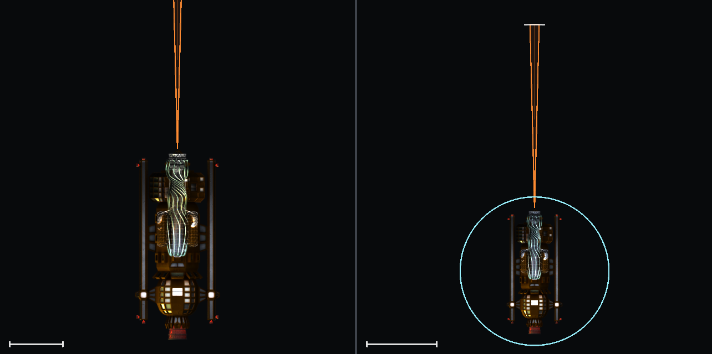

NANI (bars: 10 m and 100 m)

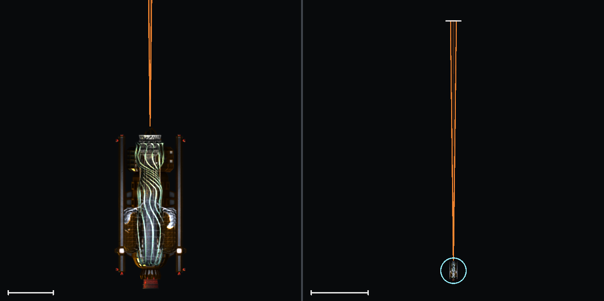

Tetsuo HMX-2000I (bars: 10 m and 200 m)

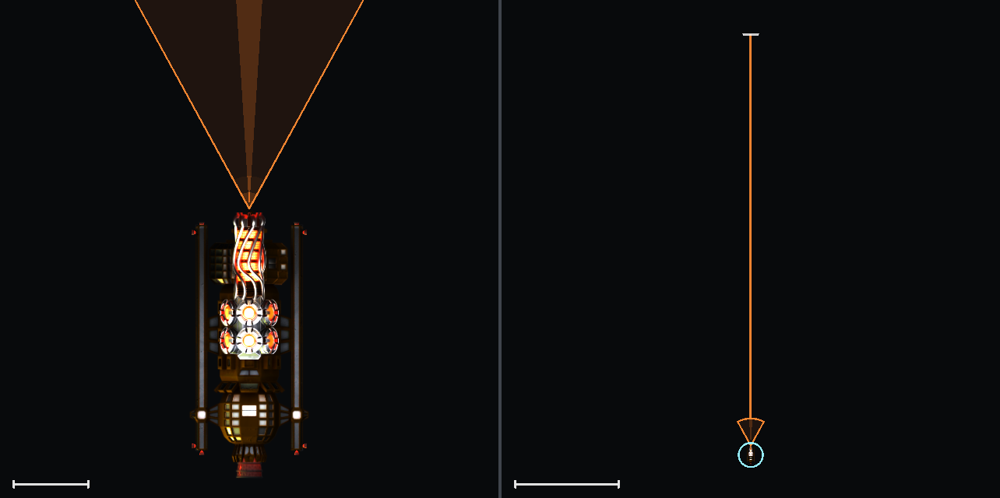

### Turrets

A turret turns its weapon toward a target by itself. It takes rocks over 8 t (so no chunks, except for the AEMD-14).

| Turret | Turns | Fires within | Ships it picks up | Rocks it picks up | Safety | Fires |
|---|---|---|---|---|---|---|
| ONMWG-650 | 180° a second, all the way round | 1.1° of its target | ships you are hostile to, such as pirates, within 400 m of a point 435 m ahead | in a band 300 m wide, 40 to 160 m ahead | none | by itself |
| AEMD-14 and CL-200AP | 18° a second, up to 2° each way | 0.1° of its target | any ship in a strip 20 m wide, 240 to 860 m ahead | in the same strip | none | when you fire, locked on or not |

<b>SPOILER ALERT</b>: turrets you can't buy at first, or at all (click to show)

**The NDPT-4205**, a mass-driver turret, is sold at the station only once an Obonto habitat licenses its point-defence
hardware to you: for 800,000 E$, or for nothing if they know you as a friend of the mining guilds.

| Weapon | Price | Fits | Mass driver power (Tuning) | Ammunition per shot | Shots per second | Slug speed | Each hit: kinetic, heat | Electricity per shot |
|---|---|---|---|---|---|---|---|---|
| NDPT-4205 | 135,000 E$ | any weapon hardpoint, rear hardpoints, docking bays | 400 MW (200 to 600) | 2 kg | 5 | 3,700 m/s | 2.8 MJ, 2.3 MJ | 24 MJ |

**The laser turret** has no name in the game. No ship carries it, and the station never sells it. It draws 80 MW and
fires a steady beam of 78 MW, all heat, out to 6.6 km.

**The Tsukuyomi's turrets** come with the ship: 2 CL-150, 2 CL-600P and 3 MWG. Its laser turrets aim at reactors.

| Turret | Turns | Fires within | Ships it picks up | Rocks it picks up | Safety | Fires |
|---|---|---|---|---|---|---|
| NDPT-4205 | 45° a second, all the way round | 2.9° of its target | ships you are hostile to, within 400 m of a point 500 m ahead | in a band 750 m wide, 30 to 350 m ahead | Safety Protocol and Ignore obscured targets, both on | only while you fire |
| Laser turret | 180° a second, all the way round | 1.1° of its target | as the NDPT-4205 | as the NDPT-4205 | Safety Protocol on | by itself |
| The Tsukuyomi's | 4.5° a second (CL-150), 72° a second (CL-600P, MWG) | 0.6° of its target | its MWG turrets: ships it is hostile to, within 250 m of a point 250 m out | its laser turrets: rocks and reactors, to about 580 m ahead and 600 m to the sides | Safety Protocol on | by themselves |

*Safety Protocol* keeps a turret from firing when your own ship is in the way, checking from 12.8 m out.

NDPT-4205 (bars: 10 m and 200 m)

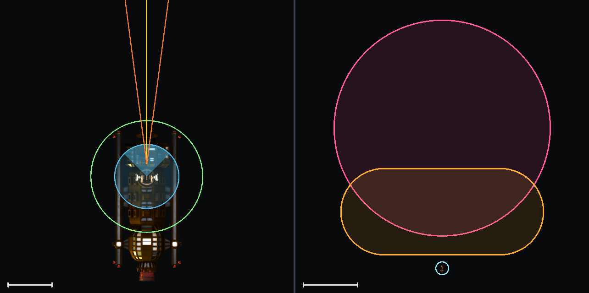

Laser turret (bars: 10 m and 200 m)

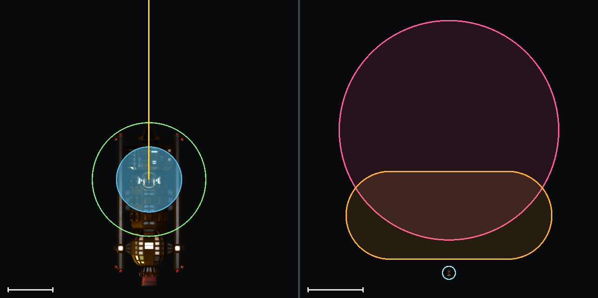

The Tsukuyomi's turrets (bars: 100 m and 200 m)

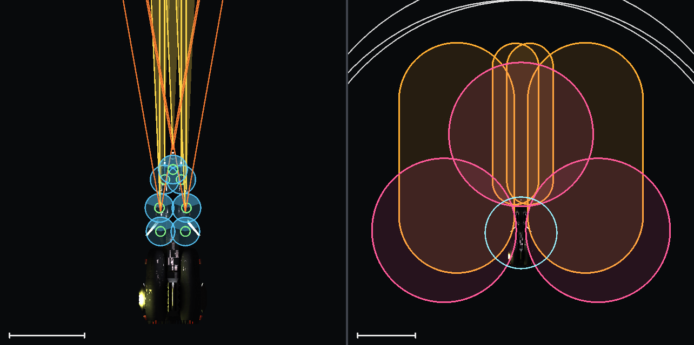

### Time on target

Beams and fast pulses do their damage while they stay on target: it builds up, on a rock for good, on a reactor as heat
that it sheds again by itself. So a laser, a microwave emitter or an exhaust ray has to be held on its target for a
while. These are the times at the default Tuning, in the best case for the shooter: the weapon held on target all the
time, the target's reactor at its usual temperature, not leaking and not drawing heat away with its thrusters.

#### Splitting rocks

The time to break a rock of each size, held on it from the start. Mass drivers count from their first shot.
\* = it skips a size, which halves that rock's ore; † = it skips a size on the smaller rocks of that size.

| Weapon | 16 t | 64 t | 256 t | 1,024 t | 4,096 t |
|---|---|---|---|---|---|
| CL-150 | 0.08 s | 0.33 s | 1.3 s | 5.2 s | 21 s |
| CL-600P | at once | at once | 0.25 s | 1.1 s | 4.4 s |
| CL-200AP | 0.04 s | 0.21 s | 0.88 s | 3.6 s | 15 s |
| MWG, ONMWG-650 | 0.46 s | 1.8 s | 7.3 s | 29 s | 117 s |
| EMD-14, AEMD-14 | at once | at once \* | at once \* | 0.5 s | 3 s |
| ERFMD-17 | at once | at once \* | at once | 0.6 s | 2.6 s |
| MPI Railgun MkI | at once | at once \* | at once | 0.3 s | 1.3 s |
| Tetsuo HMX-2000I, its iron | at once | at once † | 0.03 s | 0.13 s | 0.53 s |
| EINAT or Tetsuo heat ray, at 20 m | at once | at once | 0.01 s | 0.03 s | 0.14 s |
| SPC Gungnir, held 1.5 s | at once | at once \* | at once | 43 % of the way | 11 % of the way |
| SPC Gungnir, full charge | at once | at once \* | at once \* | at once \* | at once \* |

The NANI's ray breaks any rock in about 0.01 s.

<b>SPOILER ALERT</b>: the NDPT-4205 (click to show)

| Weapon | 16 t | 64 t | 256 t | 1,024 t | 4,096 t |
|---|---|---|---|---|---|
| NDPT-4205 | at once | at once \* | 0.2 s | 1 s | 4.6 s |

#### Melting a reactor down

A standard 4 GW reactor, starting at 3,500 K, with the weapon on target within 10 m of its centre:

| Weapon | Reaches 6,000 K | Melts down |
|---|---|---|
| CL-150 | 6 s | 14 s |
| CL-600P | 2.3 s | 10 s |
| CL-200AP | 7.9 s | 16 s |
| MWG, ONMWG-650 | never: it stays near 5,400 K | never, unless the reactor already leaks 30 % or more |
| Tetsuo HMX-2000I, its iron (810 MW of heat) | in under 1 s | in about 9 s |
| EINAT, NANI or Tetsuo heat ray | at once | in 8 s |
| SPC Gungnir, a full charge | at once: it adds about 10,700 K | it melts 4 and 8 GW reactors by itself, unless it lands within 11 m of the reactor: then it also leaks it fully, and the venting carries the heat away first |

Seconds to reach 6,000 K by Reactor Core, from 3,500 K; add 8 s for the meltdown. Reactors that start at 3,000 K take
about 15 % longer.

| Heat on the reactor | 4 GW | 8 GW | 16 GW | 40 GW |
|---|---|---|---|---|
| CL-150 at 150 MW | 6 | 12 | 24 | 60 |
| CL-150 at 225 MW | 3.8 | 7.7 | 15 | 38 |
| CL-600P at 660 MW, 12 Hz | 2.3 | 4.6 | 9.3 | 23 |
| CL-600P at 990 MW, 15 Hz | 1.3 | 2.5 | 5 | 12.5 |
| CL-600P at 990 MW, 24 Hz | 1 | 2 | 4 | 10 |
| CL-200AP at 220 MW, 24 Hz | 7.9 | 16 | 31 | 79 |
| CL-200AP at 330 MW, 30 Hz | 4 | 8 | 16 | 40 |
| CL-200AP at 330 MW, 48 Hz | 3.1 | 6.3 | 13 | 31 |
| MWG at 75 MW, 90 % | 15 | 30 | 60 | 151 |

A reactor that already leaks melts down at a lower temperature, but its venting carries heat away. Seconds to a
meltdown for a reactor that already leaks:

| Weapon | No leak | 35 % | 50 % | 75 % | Full leak |
|---|---|---|---|---|---|
| CL-150 | 14 | 12.2 | 11.7 | 12.5 | never |
| CL-600P at 660 MW, 12 Hz | 10.3 | 9.6 | 9.4 | 9.1 | 9.1 |
| CL-200AP | 15.8 | 13.4 | 12.8 | 16.2 | never |
| MWG | never | 71 | never | never | never |
| MWG at 75 MW, 90 % | 23.1 | 17.7 | 17.2 | never | never |

So lasers melt a reactor down best before it leaks hard.

<b>SPOILER ALERT</b>: the MAD-CERF and the Tsukuyomi (click to show)

Each of the MAD-CERF's reactors holds heat like an 8 GW core. Each of the Tsukuyomi's reactors starts at 3,000 K and
takes, in the same order as the table above: 89, 57, 34, 19, 15, 115, 59, 47 and 217 s to reach 6,000 K.

#### Leaking a reactor

Each cell: the farthest from the reactor's centre that hit still leaks it; then the hits on the reactor that start it
venting, and that leak it fully.

| Hit | Standard reactor | Cothons | K225s |
|---|---|---|---|
| EMD-14 or AEMD-14 slug (10.1 MJ) | 15 m; 2, 5 | 23.5 m; 2, 8 | 40 m; 2, 8 |
| EMD-14 slug at 1,125 MW (15.2 MJ) | 17 m; 1, 3 | 26 m; 2, 6 | 42 m; 2, 6 |
| ERFMD-17 slug (4.5 MJ) | 13 m; 3, 11 | 19 m; 5, 19 | 37 m; 5, 19 |
| MPI Railgun MkI slug (4.9 MJ) | 13 m; 3, 10 | 19 m; 5, 18 | 37 m; 5, 18 |
| Tetsuo HMX-2000I iron (1.7 MJ) | 11 m; 11, 44 | 16 m; 15, 60 | 34 m; 15, 60 |
| CL-600P pulse at default (0.6 MJ) | never | 14 m; 86, 342 | 32 m; 86, 342 |
| CL-600P pulse at 990 MW, 3 Hz (7.5 MJ) | 14 m; 2, 6 | 22 m; 3, 11 | 39 m; 3, 11 |
| SPC Gungnir, full charge (70.3 MJ) | 27 m; 1, 1 | 45 m; 1, 2 | 57 m; 1, 2 |

The smallest hit that leaks a standard reactor is 0.8 MJ; 0.4 MJ for the Cothons and K225s.

<b>SPOILER ALERT</b>: the NDPT-4205, and ships the station doesn't sell (click to show)

| Hit | Standard reactor | Cothons | K225s | MAD-CERF | Tsukuyomi | ATLAS |
|---|---|---|---|---|---|---|
| EMD-14 or AEMD-14 slug (10.1 MJ) | 15 m; 2, 5 | 23.5 m; 2, 8 | 40 m; 2, 8 | 27.5 m; 1, 4 | 55 m; 1, 4 | 12 m; 1, 4 |
| EMD-14 slug at 1,125 MW (15.2 MJ) | 17 m; 1, 3 | 26 m; 2, 6 | 42 m; 2, 6 | 29 m; 1, 2 | 57 m; 1, 2 | 13 m; 1, 3 |
| ERFMD-17 slug (4.5 MJ) | 13 m; 3, 11 | 19 m; 5, 19 | 37 m; 5, 19 | 26 m; 3, 11 | 52 m; 3, 11 | 11 m; 4, 13 |
| MPI Railgun MkI slug (4.9 MJ) | 13 m; 3, 10 | 19 m; 5, 18 | 37 m; 5, 18 | 26 m; 3, 9 | 52 m; 3, 9 | 11 m; 3, 11 |
| NDPT-4205 round (2.8 MJ) | 12 m; 5, 20 | 17 m; 9, 33 | 35 m; 9, 33 | 25 m; 9, 34 | 51 m; 9, 34 | 10 m; 18, 72 |
| Tetsuo HMX-2000I iron (1.7 MJ) | 11 m; 11, 44 | 16 m; 15, 60 | 34 m; 15, 60 | never | never | never |
| CL-600P pulse at default (0.6 MJ) | never | 14 m; 86, 342 | 32 m; 86, 342 | never | never | never |
| CL-600P pulse at 990 MW, 3 Hz (7.5 MJ) | 14 m; 2, 6 | 22 m; 3, 11 | 39 m; 3, 11 | 27 m; 2, 5 | 54 m; 2, 5 | 12 m; 2, 6 |
| SPC Gungnir, full charge (70.3 MJ) | 27 m; 1, 1 | 45 m; 1, 2 | 57 m; 1, 2 | 35 m; 1, 1 | 70 m; 1, 1 | 19 m; 1, 1 |

The smallest hit that leaks them: the MAD-CERF and the Tsukuyomi 2 MJ, ATLAS 2.4 MJ, the racing drone 0.024 MJ.

#### Shutting a reactor down

- EMP shuts a reactor down at once, and only while the beam stays on it, when what gets past the ship's EMP shielding
  is still more than 0.6 MW at the reactor.
- A standard reactor shuts down when a default MWG hits within 20 m of its centre (an MWG at 75 MW and 10 %: within
  28 m; at 75 MW and 90 %: within 15 m).
- A default MWG puts out 22.5 MW of EMP, so it gets through EMP shielding below about 22 MW; an MWG at 75 MW and 10 %,
  60.8 MW of EMP, through shielding below about 60 MW. No MWG setting gets through the 100 MW of the Cothon-212, the
  Chonker and the Bender, or the 200 MW of the Runasimi KR37 TNTRL. The SPC Gungnir's EMP, a quarter of its charge at
  once, gets through any shielding.
- A reactor shut down stops heating, but the ship keeps its power until the reactor cools below 1,500 K. Left alone, a
  4 GW reactor takes 136 s to fall to half power and 910 s to none; a ship firing its thrusters cools it much faster.

### Best Tuning

Where a weapon's Tuning helps, the best settings for fighting, for mining, and for both, at 60 physics steps a second.

- **EMD-14, AEMD-14, ERFMD-17 and MPI Railgun MkI** (*Mass driver power*):
  - Fighting: the most (1,125 MW for the EMD-14 and AEMD-14, 750 MW for the ERFMD-17, 1,200 MW for the railgun).
    Every hit is half as strong again: one EMD-14 slug then starts a standard reactor venting, and 3 leak it fully. It
    takes more electricity per shot and wears the barrel 2.25 times as fast.
  - Mining: the least (375, 250 and 400 MW). Weaker slugs skip fewer sizes: the EMD-14 no longer skips one on 256 t
    rocks. None of them stops halving the ore of 64 t rocks.
  - Both: no setting is good at both; keep the default, or set it for what you are doing.
- **CL-150** (*Laser Power Supply*): 225 MW for fighting and mining alike, if your ship can supply it (it wears 2.25
  times as fast): a 4 GW reactor melts down in 12 s instead of 14, a 4,096 t rock breaks in 14 s instead of 21.
- **CL-600P** (*Laser Power Supply* and *Pulse frequency*). Each pulse carries the power divided by the frequency; its
  kinetic part is 6 ÷ frequency, the rest heat.
  - Fighting, to melt a reactor down: 990 MW at 24 Hz. That is 675 MW of heat: a 4 GW reactor melts down in 9 s, a
    40 GW one in 18 s.
  - Fighting, to make a reactor leak: 990 MW at 3 Hz. All kinetic, every pulse hitting like 7.5 MJ: a standard
    reactor starts venting after 2 pulses and leaks fully after 6. No heat at all, so no meltdown.
  - Mining: as much power as your ship keeps up, at a frequency of at least the power ÷ 66, rounded up. Then no pulse
    carries more than 1.5 MJ to a rock, so even the smallest 64 t rocks never skip a size. Around 400 MW, that is
    396 MW at 6 Hz. How fast it breaks rocks follows the power (about 22 damage a second per MW), hardly the
    frequency.
  - Both: 990 MW at 15 Hz. It breaks rocks as fast as at 24 Hz, never skips a size, and is 60 % heat (a 4 GW reactor
    in 9.3 s).
  - The mining setting at low power is all kinetic (396 MW at 6 Hz: no heat, and 14 pulses just to start a standard
    reactor venting): set 24 Hz to fight.
  - How much power your ship keeps up: its Powerplant (Turbine 100 MW, Twin Turbine 200 MW, Military-grade Turbine
    500 MW), plus its Auxiliary Power System (the MPD5035 adds 350 MW). Above that, the capacitor drains, then the
    pulses misfire: a pulse needs 90 % of its energy.
- **CL-200AP** (*Laser Power Supply* and *Pulse frequency*). Its kinetic part is 12 ÷ frequency, and no setting
  carries more than 1.2 MJ per pulse, so it never skips a rock size.
  - Fighting: 330 MW at 48 Hz (225 MW of heat: a 4 GW reactor in 11 s).
  - Mining: 330 MW at any frequency.
  - Both: 330 MW at 30 Hz (180 MW of heat: a 4 GW reactor in 12 s). It works the same when the physics slows down to
    30 steps a second.
- **MWG and ONMWG-650** (*Microwave Power* and *Water Resonance*):
  - Fighting: 75 MW at 90 %, the only setting that melts a 4 GW reactor down (in 23 s). Its 6.8 MW of EMP still shuts
    down unshielded reactors near the hit.
  - To cripple an unshielded ship's lasers and HUD instead: 75 MW at 10 % (full *Pump Failure* in 8.4 s).
  - Against ships with EMP shielding, the EMP never gets through: set 90 %.
  - Mining: 75 MW at 90 %, 2.7 times as fast as the default. Its wider cone (10°) matters little at turret range.
  - Both: 75 MW at 90 %.
- **SPC Gungnir**: no Tuning. Hold the trigger to charge it (30 s to full), let go to fire.
- **EINAT, NANI and Tetsuo HMX-2000I** (*Thrust*). Even the lowest *Thrust* melts a reactor in the ray and breaks rocks
  in under a second, so set the lowest *Thrust* for everything. The Tetsuo's iron is the exception: below about 770 kN
  it no longer leaks a standard reactor, and at 935 kN or less it doesn't make 64 t rocks skip a size.

<b>SPOILER ALERT</b>: the NDPT-4205 (click to show)

- **NDPT-4205** (*Mass driver power*, *Safety Protocol*, *Ignore obscured targets*): for fighting, 600 MW (3 rounds
  start a standard reactor venting, 12 leak it fully); for mining, 200 MW, the only mass driver setting that never
  skips a rock size (1.4 MJ per round), but only at 60 physics steps a second; for both, the default 400 MW. Keep both
  safety switches on.

### Slower physics

All the figures above are for the game's physics at 60 steps a second, its default (*Physics Simulation FPS* in the
game's settings). With *Dynamic Temporal Simulation Simplification* on, as it is at first, the game lowers it when
your computer can't keep up, down to 30. At 30:

- mass driver slugs carry 23 % more energy (EMD-14, ERFMD-17, AEMD-14) or 78 % more (MPI Railgun MkI): an EMD-14 slug
  hits like 12.5 MJ, a railgun slug like 8.7 MJ. They leak reactors more, and skip more rock sizes;
- a single hit must be twice as strong to leak a reactor: the Tetsuo's iron barely leaks a standard reactor (120 lumps
  to start it venting), the default CL-600P no longer leaks the Cothons or the K225s, and the CL-600P at 990 MW and
  3 Hz still starts a standard reactor venting with 2 pulses, but needs 7 for a full leak;
- the CL-200AP fires at most 30 pulses a second: above 30 Hz it loses pulses (at 48 Hz it puts out 141 MW of heat
  instead of 225 MW), so set it to 30 Hz;
- beams, microwave emitters, exhaust rays and pulse frequencies of 30 Hz or less work the same.

<b>SPOILER ALERT</b>: the NDPT-4205 (click to show)

At 30 physics steps a second, an NDPT-4205 round carries 78 % more energy, hitting like 4.9 MJ; at 200 MW it hits like
2.5 MJ, and then it skips sizes on 64 t rocks too.

### Faster physics

*Physics Simulation FPS* also has faster settings, 75 to 165 steps a second, which *Dynamic Temporal Simulation
Simplification* lowers too when your computer can't keep up. The game counts a hit's strength against a part's
threshold once per step, so the faster the physics, the weaker a single hit needs to be. At 120:

- mass driver slugs carry the same energy as at 60: each fires over twice as many steps, each half as long;
- a single hit needs half the strength to leak a reactor: one EMD-14 slug starts a standard reactor venting (2 at 60)
  and 4 leak it fully (5 at 60), from up to 18 m away (15 m at 60); the default CL-600P now leaks standard reactors,
  43 pulses to start venting; the Tetsuo's iron now leaks the MAD-CERF, the Tsukuyomi and ATLAS too; and a full SPC
  Gungnir charge leaks a standard reactor from up to 35 m away (27 m at 60);
- rocks break as at 60;
- beams, microwave emitters, exhaust rays and every pulse frequency work the same.

At 165:

- the EMD-14, ERFMD-17 and AEMD-14 slugs carry 2 % more energy, the MPI Railgun MkI's 19 % more (hitting like
  5.8 MJ), and they fire about 3 % slower (the ERFMD-17 4.85 shots a second instead of 5, the railgun 9.7 instead of
  10);
- a single hit needs 36 % of the strength it needs at 60 to leak a reactor: one EMD-14 slug starts a standard reactor
  venting and 4 leak it fully, from up to 20 m away; a railgun slug starts it venting after 2 and leaks it fully after
  7 (3 and 10 at 60); the default CL-600P starts it venting after 29 pulses; and a full SPC Gungnir charge leaks it
  from up to 39 m away;
- the EMD-14 at its default power skips a size on every 256 t rock, not only the lighter ones, and the railgun on
  every 64 t rock even at its least power;
- beams, microwave emitters, exhaust rays and every pulse frequency work the same.

<b>SPOILER ALERT</b>: the NDPT-4205 at faster physics (click to show)

At 120 physics steps a second, the NDPT-4205 breaks rocks as at 60, and at 200 MW still never skips a size; its rounds
start a standard reactor venting after 5 and leak it fully after 17. At 165, a round carries 19 % more energy, hitting
like 3.3 MJ, and at 200 MW it skips sizes on 64 t rocks too.

### How sure these figures are

- They come from reading the game's files, not from measuring in the game.
- A few depend on how the game's engine rounds the length of a physics step: the mass drivers' slug energy, and the
  CL-600P's exact 6 Hz and 12 Hz. Rounded the other way, an EMD-14 slug would carry 23 % more energy, and 6 Hz and
  12 Hz would fire like 5.5 Hz and 10 Hz. At 120 physics steps a second the slug would carry 11 % more; at 165 the
  rounding doesn't matter.
- A slug's hit assumes the target isn't moving toward you or away from you: one flying into your slugs takes harder
  hits.
- The times on target are the shooter's best case (see [Time on target](#time-on-target)), and enemies come with
  damage that changes from one fight to the next.
- A few kinds of rock are softer than the tables assume: one kind of 4,096 t rock breaks at half the damage.
- The exhaust rays assume your reactor feeds them all they take.
- A turret mounted at an angle turns its pick-up areas with it.
- Where the game's descriptions give other figures, these follow what the game does: the MWG's and ONMWG-650's range
  (600 m in the description), the CL-600P's (8,000 m), the EINAT's (100 m, 18.4 GW), the Tetsuo's (1000 m, 500 kg/s,
  17.0 GW, low-stress hardpoints only), the SPC Gungnir's charge (11.2 GJ), and the fuel rods' failure point (4,500 K).

<!-- wiki-values (checked by wiki.ps1)
game-checked: 1.93.1
CombatSimulator/i18n/en.po COMBATSIMULATOR_TOOLTIP = "Click the button while pressing %s to open the %s interface." -> Click the button while pressing Shift to open the CombatSimulator interface.
CombatSimulator/i18n/en.po COMBATSIMULATOR_TOOLTIP_PAD = "Highlight the button and press %s while holding %s to open the %s interface." -> Highlight the button and press X while holding LT to open the CombatSimulator interface.
CombatSimulator/Badge.gd PAD_MODIFIER_NAME = "LT" -> LT
CombatSimulator/Badge.gd PAD_BUTTON_NAME = "X" -> X
game: J and Back, the simulator's key and gamepad button (project.godot jury_rig, joypad button 10); B, which cancels (ui_cancel, button 1); LB and RB, which switch tabs (ui_page_up and ui_page_down, buttons 4 and 5); the right stick, which scrolls (ui_scroll_up2 and ui_scroll_down2, axis 3); the Controls setting's Auto and Gamepad (en.po SETTINGS_CONTROLS_AUTO, SETTINGS_CONTROLS_GAMEPAD)
CombatSimulator/i18n/en.po COMBATSIMULATOR_TITLE = "Combat simulation" | images/CombatSimulator-dialog.png, images/CombatSimulator-ships.png
CombatSimulator/i18n/en.po COMBATSIMULATOR_GROUP_ENEMIES = "Enemies" | images/CombatSimulator-dialog.png
CombatSimulator/i18n/en.po COMBATSIMULATOR_GROUP_AREA = "Area" | images/CombatSimulator-dialog.png
CombatSimulator/i18n/en.po COMBATSIMULATOR_GROUP_SHIP = "Your ship" | images/CombatSimulator-dialog.png
CombatSimulator/i18n/en.po COMBATSIMULATOR_START = "Start" | images/CombatSimulator-dialog.png, images/CombatSimulator-ships.png
CombatSimulator/i18n/en.po COMBATSIMULATOR_CANCEL = "Cancel" | images/CombatSimulator-dialog.png, images/CombatSimulator-ships.png
CombatSimulator/i18n/en.po COMBATSIMULATOR_NUMBER_DESC = "How many enemy ships come." | images/CombatSimulator-dialog.png
CombatSimulator/i18n/en.po COMBATSIMULATOR_SHIP_DESC = "The model of the enemy ships. They are pirates, hostile on sight, built and fitted as the game builds that model when it attacks you." | images/CombatSimulator-ships.png
CombatSimulator/i18n/en.po COMBATSIMULATOR_OTHERS = "Others"
CombatSimulator/i18n/en.po COMBATSIMULATOR_END_QUESTION = "End the combat simulation?"
CombatSimulator/i18n/en.po COMBATSIMULATOR_END_YES = "Yes"
CombatSimulator/i18n/en.po COMBATSIMULATOR_END_NO = "No"
CombatSimulator/i18n/en.po COMBATSIMULATOR_SHIP = "Ship" | images/CombatSimulator-ships.png
CombatSimulator/i18n/en.po COMBATSIMULATOR_NUMBER = "Number"
CombatSimulator/i18n/en.po COMBATSIMULATOR_GROUPED = "Grouped" | images/CombatSimulator-dialog.png
CombatSimulator/i18n/en.po COMBATSIMULATOR_DISTANCE = "Distance" | images/CombatSimulator-dialog.png
CombatSimulator/i18n/en.po COMBATSIMULATOR_DISABLED_WEAPONS = "Disabled weapons" | images/CombatSimulator-dialog.png
CombatSimulator/i18n/en.po COMBATSIMULATOR_CHAOS = "Chaos" | images/CombatSimulator-dialog.png
CombatSimulator/i18n/en.po COMBATSIMULATOR_DENSITY = "Density" | images/CombatSimulator-dialog.png
CombatSimulator/i18n/en.po COMBATSIMULATOR_REMASS = "Initial remass" | images/CombatSimulator-dialog.png
CombatSimulator/i18n/en.po COMBATSIMULATOR_MODEL_MADCERF = "MAD-CERF"
CombatSimulator/i18n/en.po COMBATSIMULATOR_MODEL_TSUKUYOMI = "Tsukuyomi"
CombatSimulator/i18n/en.po COMBATSIMULATOR_MODEL_HYBRID = "Hybrid"
CombatSimulator/i18n/en.po COMBATSIMULATOR_MODEL_DRONE = "Racing drone"
CombatSimulator/i18n/en.po COMBATSIMULATOR_MODEL_ATLAS = "ATLAS"
CombatSimulator/Settings.gd SETTINGS.ship.default = "TRTL" -> K37 TNTRL | images/CombatSimulator-dialog.png
CombatSimulator/Settings.gd SETTINGS.number.default = 1 -> 1 | images/CombatSimulator-dialog.png
CombatSimulator/Settings.gd SETTINGS.number.min = 1 -> 1
CombatSimulator/Settings.gd SETTINGS.number.max = 3 -> 3
CombatSimulator/Settings.gd SETTINGS.grouped.default = true -> on | images/CombatSimulator-dialog.png
CombatSimulator/Settings.gd SETTINGS.distance.default = 1000 -> 1,000 m | images/CombatSimulator-dialog.png
CombatSimulator/Settings.gd SETTINGS.distance.min = 100 -> 100 m
CombatSimulator/Settings.gd SETTINGS.distance.max = 4000 -> 4,000 m
CombatSimulator/Settings.gd SETTINGS.distance.step = 100 -> 100 m
CombatSimulator/Settings.gd SETTINGS.disabledWeapons.default = false -> off | images/CombatSimulator-dialog.png
CombatSimulator/Settings.gd SETTINGS.chaos.default = 0.5 -> 0.5 | images/CombatSimulator-dialog.png
CombatSimulator/Settings.gd SETTINGS.chaos.min = 0.0 -> 0
CombatSimulator/Settings.gd SETTINGS.chaos.max = 1.0 -> 1
CombatSimulator/Settings.gd SETTINGS.chaos.step = 0.1 -> 0.1
CombatSimulator/Settings.gd SETTINGS.density.default = 0.5 -> 0.5 | images/CombatSimulator-dialog.png
CombatSimulator/Settings.gd SETTINGS.density.min = 0.0 -> 0
CombatSimulator/Settings.gd SETTINGS.density.max = 1.0 -> 1
CombatSimulator/Settings.gd SETTINGS.density.step = 0.1 -> 0.1
CombatSimulator/Settings.gd SETTINGS.remass.default = 0.75 -> 75 % | images/CombatSimulator-dialog.png
CombatSimulator/Settings.gd SETTINGS.remass.min = 0.2 -> 20 %
CombatSimulator/Settings.gd SETTINGS.remass.max = 1.0 -> 100 %
CombatSimulator/Settings.gd SETTINGS.remass.step = 0.05 -> 5 %
CombatSimulator/CombatLayer.gd SPAWN_SPREAD = 1000 -> 1,000 m
CombatSimulator/CombatLayer.gd GROUP_SPACING = 300 -> 300 m
CombatSimulator/CombatLayer.gd ENEMY_FACTION = "pirate" -> pirates
CombatSimulator/CombatLayer.gd BUILDERS.TRTL.script = "res://story/PirateCombat.gd" -> as the pirates fly it
CombatSimulator/CombatLayer.gd BUILDERS.MADCERF.method = "makeAbductor" -> to abduct crews
CombatSimulator/CombatLayer.gd BUILDERS.HYBRID.script = "res://story/HybridHunter.gd" -> as the hybrid hunter
CombatSimulator/CombatLayer.gd BUILDERS.TSUKUYOMI.node = "BigBadWolf" -> as the Big Bad Wolf
CombatSimulator/CombatLayer.gd NEW_BUILDS = ["ATLAS", "DRONE", "PROSPECTOR-BALD"] -> Bald Eagle, the racing drone and ATLAS come new
game: 16 s, from a ship's explosion to its removal, which ends the fight (sfx/Explosion.tscn, the explosion animation's explodeCleanup key; ships/Reactor.gd explodeCleanup)
game: 0.3 to 0.5, the chaos of most of the rings, more the deeper (ring/ring-map.png red channel by depth; GAME.md, Chaos)
game: 30 to 80 t; 30 t; 80 t; 15 t; 800 t; 1,300 t; 2 t; 40 t: the remass an enemy carries, its tanks full as built (ships/Shipyard.gd defaultConfig, defaultShipConfig and usedShipConfigs fuel.capacity)
game: 10 t and 5 t, the remass and ammunition of the pirate K37 TNTRL (story/PirateCombat.gd makeAt fuel.initial, ammo)
game: 0.5, 3 and 0.03 t/s, the most remass a reactor vents at a full leak (ships/modules/NuclearReactor.tscn, MAD-CERF.tscn, Tsukuyomi.tscn, drone/ATLAS.tscn, drone/Drone.tscn leakFuelConsumption); a quarter, where venting starts (ships/Reactor.gd damageLeakOffset 0.25)
note: 20 s, 60 s, 160 s, 133 s, 144 s and 22 min: a full leak emptying an enemy's 10, 30, 80, 800 (both reactors), 1,300 (all three) and 40 t at the reactors' leakFuelConsumption
game: 200, 100 and 500 MW, EMP shielding (ships/RA-TRTL-R.tscn, Cothon.tscn empShield, Cothon-Lnd.tscn empShield 0; Shipyard.gd AT225-R shielding.emp; story/HybridHunter.gd makeAt shielding.emp)
game: 3 (1 high-stress), 2 and 2 drone mounts, 2 and 2 rear, 2 and 6 docking bays, 2 and 2 docking bays, 4 (2 high-stress), 1 spinal, 2, 6 the station can't fit, 1 (1 high-stress): hardpoints (ships/*.tscn WeaponSlot nodes and placeholders, less remove = true; MAD-CERF.tscn has no left2 and two right2; en.po SLOT_*)
game: 1 fission, 1 fusion, 2 and 3 fission: the ships' reactors (ships/*.tscn reactor nodes; EIME's FusionReactor.gd)
note: 15, 23.5, 40, 27.5, 55, 12 and 1.2 m, how far from a reactor's centre an EMD-14 slug still leaks it (standard, Cothon, K225, MAD-CERF, Tsukuyomi, ATLAS, racing drone), from Reactor.gd _on_impact and the reactors' damageLeakThreshold, reactorRadius, reactorMinRadius and scale
note: 2 and 5, 2 and 8, 1 and 4: EMD-14 slugs on the reactor to start venting and to a full leak, from Reactor.gd _on_impact, damageLeakCapacity and damageLeakOffset 0.25
game: 35 %, the most damage an aged ship's part starts with (CurrentGame.gd ageToDamageWithSeed damageLimit; Shipyard.gd createShipByConfig ages every ship not built new)
game: 20 used TNTRL builds, 12 of them leaving the K44 unarmed, 10 used Prospector builds, 2 used Cothon builds (Shipyard.gd usedShipConfigs; RA-TRTL-K44.tscn WeaponSlot remove)
game: 6 and 2 THI Cargo Containers on the K225 and K225-BB (Shipyard.gd AT225 weaponSlot; ATK225-B.tscn remove); 2 AR-1500 arms on the OCP-209; 2 ONMWG-650 on the K225 (modified); 2 MWG on ATLAS
game: 4 ERFMD-17, 2 MWG and 15 t of ammunition, the MAD-CERF abductor (story/RescueOperation.gd makeAbductor with MAD-CERF.tscn slots); 500 MW, the hybrid hunter's shielding (story/HybridHunter.gd)
game: 7 turrets, 2 CL-150, 2 CL-600P and 3 MWG, the Tsukuyomi's (ships/Tsukuyomi.tscn PDT-* WeaponSlot default)
game: 4, 8, 12, 16, 25, 40 and 50 GW, the enemies' reactor cores (Shipyard.gd reactor.power; Reactor.gd thermalReactorPower; MAD-CERF.tscn thermalReactorPower)
note: 4 or 8 GW, 8 to 40 GW, 8 or 12 GW, the cores of the used TNTRL, Prospector and Cothon builds (Shipyard.gd usedShipConfigs reactor.power)
note: 2 of 12 GW holding heat like an 8 GW core, 3 of 25 GW holding heat like a 50 GW core: heat capacity 2,000 and 12,500, from Reactor.gd _ready (specificHeat scaled with thermalReactorPower) and the scenes' specificHeat
game: 3,500 K and 3,000 K, a reactor's usual temperature (ships/modules/NuclearReactor.tscn targetTemperature; Eagle-Prospector.tscn, Tsukuyomi.tscn targetTemperature 3000)
game: 10, 100 and 1,000 times, the heat map's three powers of ten; 10 pixels to the metre; bars of 5 m, 10 m (Pelican, EIME, Cothons, K225s, OCP-209), 20 m (MAD-CERF, Tsukuyomi) and 1 m (racing drone) (_shots/ShotRenderer/ModMain.gd SHIP_PX_PER_METRE, HEAT_DECADES; the run's printed scale bars)
game: weapon pictures' bars: 10 m on the left (100 m for the Tsukuyomi's turrets); on the right 500 m (EMD-14, ERFMD-17, MPI Railgun MkI), 1,000 m (CL-150, CL-600P, SPC Gungnir), 200 m (AEMD-14, CL-200AP, MWG, ONMWG-650, NDPT-4205, laser turret, Tetsuo HMX-2000I, the Tsukuyomi's), 100 m (NANI), 20 m (EINAT); 2° each way, the AEMD-14's and CL-200AP's gimbal; 1 s of turning; 2 km and 800 m, the AI's aim for mass drivers and the Tetsuo (the run's printed scale bars; massdriver.gd boresight; act-massdriver.tscn, act-laser.tscn gimbalLimit)
game: 60 and 30 physics steps a second, the default and the least the game drops to; 75 to 165, the faster settings (Settings.gd gameplay.fps 60, adaptiveFps clamp 30; menu/SettingsLayer.tscn Physics Simulation FPS)
game: 16, 64, 256, 1,024 and 4,096 t rocks, each 0.75 to 1.25 times that (asteroids/asteroid.gd classes; AsteroidSpawner.gd); a fortieth, heat on rocks (asteroid.gd energyDamageScale 0.025)
note: 1.5 MJ, the most a hit carries without skipping a size on the smallest 64 t rocks (2 × 16 × 64 × 0.75, asteroid.gd splitEnergyThreshold, obliterating)
game: 10 m, a standard reactor's full-effect distance; 3.8, the heat it takes from a hit there (Reactor.gd reactorRadius 80 + reactorMinRadius 20; _on_thermal × 10, heatReflection 0.62)
game: 6,000 K for 8 s, a meltdown, lower by up to 2,000 K at a full leak (Reactor.gd meltdownTemperature, telegraphTimeLimit, jamTemperatureAdj)
note: 1.5 m, an EMD-14 slug choking and bending a thruster fully; half power, heat making a thruster fire (sfx/thruster.gd _on_impact, damageChokeCapacity, damageBentCapacity; :262)
note: 23 s and 8.4 s, a default and a 75 MW, 10 % MWG's time to full Pump Failure; 75 MW and 10 % (laser.gd _on_emp, damagePumpDamageThreshold 20, damagePumpDamageCapacity 500000)
game: 10,000, 30,000, 20,000, 32,000, 135,000, 150,000, 320,000, 220,000, 70,000, 180,000, 270,000, 100,000, 300,000 and 160,000 E$, the weapons' prices (enceladus/Upgrades/WeaponSlotUpgrade.tscn price)
game: 750 (375 to 1,125), 500 (250 to 750), 800 (400 to 1,200), 400 (200 to 600) MW, Mass driver power and its Tuning range (weapons/massdriver.gd powerDraw, getTuneables 0.5 to 1.5; WeaponSlot.tscn SYSTEM_EMD17RF, railgun_tor.tscn, minirail.tscn powerDraw)
game: 10 kg and 2 kg, ammunition per shot (massdriver.gd ammoWeight from the slugs' mass)
note: 2, 5, 10 and 5 shots per second, from timeFire + timeReload (0.15 + 0.35, 0.15 + 0.05, 0.05 + 0.05, 0.05 + 0.15 s) at 60 physics steps a second
note: 4,500, 3,000, 4,900 and 3,700 m/s, slug speeds at default power, from thrust × push frames ÷ slug mass
note: 10.1, 4.5, 4.9 and 2.8 MJ kinetic, 11.3 and 2.3 MJ heat per hit, from the slug speeds, penetration and the projectile's temperature 2500 × mass × 450 (projectile.gd)
note: 120, 80, 48 and 24 MJ of electricity per shot, from 1 % of powerDraw at the trigger plus the push frames' draw (massdriver.gd fire, _physics_process)
game: 2 km, the mass drivers' aiming range (massdriver.gd boresight range 20000)
game: 0.75° each way, the railgun's scatter (railgun_tor.tscn focusMin 0.1 × defocusAngleDegrees 15 ÷ 2); 7.5° each way, the widest with a worn focus
game: 2° each way, how far the AEMD-14 and CL-200AP turn (ships/modules/act-massdriver.tscn, act-laser.tscn gimbalLimit)
note: 1.5 and 2.25 times, the most Mass driver power and its wear grow (massdriver.gd getPowerDraw, wear powerFactor squared)
game: 150 (75 to 225) MW, the CL-150; 660 (330 to 990) MW and 12 (3 to 24) Hz, the CL-600P (laster-pulse.tscn powerDraw 3300000, pulsesPerSecond 12); 220 (110 to 330) MW and 24 (6 to 48) Hz, the CL-200AP (ships/modules/act-laser.tscn powerDraw 550000, pulsesPerSecond 24) (weapons/laser.gd toAveragePower, getTuneables)
note: 125 MW, 600 MW and 200 MW put out, from power ÷ powerDraw (125000 ÷ 150000, 3000000 ÷ 3300000, 500000 ÷ 550000)
note: 50 MJ and 8.3 MJ per pulse at default, hitting like 0.6 MJ and 0.1 MJ for their kinetic half; 6 and 12 ÷ frequency, the kinetic part (laser.gd energyRequired, kineticPart 0.5 × default frequency, kineticDamageScale 0.025, a fortieth)
game: 6.6 km, the lasers' and the SPC Gungnir's reach (laser.gd, synchrotron.gd maxDistance 65536)
game: 50 (25 to 75) MW, 50 % (10 to 90 %), the MWG's Microwave Power and Water Resonance (weapons/emp.gd powerDraw, resonance, getTuneables)
note: 90 %, 45 MW put out, 22.5 MW of heat and 22.5 MW of EMP at default; 60.8 MW and 6.8 MW at 75 MW and 90 % (emp.gd power ÷ powerDraw 0.9 and resonance)
game: 800 m, the MWG's reach (emp.gd maxDistance 8000)
note: 5°, 0° at 25 MW and 10° at 75 MW, the MWG's cone (emp.gd getSpread)
game: 400 MW, 11,250 MJ, 30 s, 1.5 s, 5: the SPC Gungnir's draw, full charge, time to charge, least charge and storm discharges (synchrotron.gd powerDraw, maxStorms; synchrotron.tscn maxCharge, minCharge)
note: 70 MJ, the SPC Gungnir's kinetic quarter at full charge (maxCharge × kineticPart 0.25 × kineticDamageScale 0.025)
game: 1,100 kN (550 to 1,650), 3,450 kN (1,725 to 5,175), Thrust and its Tuning range (weapons/not-a-thruster.tscn, nani.tscn, iron-thrower.tscn thrust; sfx/thruster.gd getTuneables 0.5 to 1.5)
game: 200 MW and 2 GW, the exhaust weapons' electricity and the NANI's reactor heat (not-a-thruster.tscn powerDraw; nani.tscn thrust × thermalFactor); 20 GW, where the Equipment screen warns (WeaponSlotUpgrade.tscn warnIfThermalBelow)
note: about 25 GW, the EINAT's and Tetsuo's reactor heat at default Thrust (thruster.gd powerNeeded, thrust × specificImpulse 45 ÷ 2 × 10); about 80 %, a 20 GW core's share
note: 53 m and 422 m, the plumes, from the sprite frame (sfx/thrusters.png, 512 px tall, offset 16 px) × scale (nani.tscn 8)
note: 35 GW at 10 m, 19 GW at 20 m, 7.5 GW at 50 m, 455 GW out to 80 m, 91 GW at 400 m, the heat rays (thruster.gd damageThermal, distanceScale 15 and 800)
game: 60 s, the NANI's firing time (nani.tscn specialFuelLimit, refilled in thruster.gd _ready)
note: 60 lumps of iron a second, 1,800 m/s, 1.7 MJ kinetic, 13.5 MJ heat, 600 kg/s, 1 s, about 1.8 km: the Tetsuo's iron (thruster.gd setupExhaust and doConsumeCargo, iron-blob.tscn mass, temperature 3000 and maxLifetime)
game: 8 t, the smallest rock a turret takes (PDT.gd massLimit; act-massdriver.tscn massLimit 0)
game: 180, 18, 45, 4.5 and 72° a second, turret turn rates (PDT-microwave.tscn, PDT-laser.tscn rotationPerSecond 3.14; PDT.gd default 0.314; PDT-minigun.tscn 0.785; Tsukuyomi.tscn PDT-* 0.078 and 1.256)
game: 1.1, 0.1, 2.9 and 0.6°, how close to its target a turret fires (PDT-microwave.tscn, PDT-laser.tscn accurancy 0.02; act-massdriver.tscn, act-laser.tscn 0.002; PDT.gd default 0.05; Tsukuyomi.tscn 0.01)
game: 400 m of a point 435 m ahead, a band 300 m wide 40 to 160 m ahead: the ONMWG-650's areas (PDT-microwave.tscn circle 4000 at 4350, capsule 600 / 1800 at 1000)
game: a strip 20 m wide, 240 to 860 m ahead: the AEMD-14's and CL-200AP's (act-massdriver.tscn, act-laser.tscn capsule 100 / 6000 at 5500)
game: 400 m of a point 500 m ahead, a band 750 m wide 30 to 350 m ahead: the NDPT-4205's and laser turret's areas (PDT-minigun.tscn, PDT-laser.tscn DefendArea circle 4000 at 5000, RockArea capsule 1600 / 4300 at 1900)
game: 250 m of a point 250 m out, about 580 m ahead and 600 m to the sides: the Tsukuyomi's turrets (Tsukuyomi.tscn PDT-* CollisionShape2D)
game: 12.8 m, where Safety Protocol starts checking (PDT-minigun.tscn, PDT-laser.tscn safetyDistance 128)
game: 800,000 E$, the Obonto habitat's licence for the NDPT-4205 (i18n/en.po DIALOG_HABITAT_LICENCING_PAY; storyFlag hardware.nakamura 5 in WeaponSlotUpgrade.tscn and the licensing lines)
game: 80 MW drawn, 78 MW put out, the laser turret (ships/modules/PDT-laser.tscn laser powerDraw 80000, power 78000)
note: 0.08, 0.33, 1.3, 5.2 and 21 s, a CL-150 breaking 16, 64, 256, 1,024 and 4,096 t rocks (asteroid.gd applyEnergyDamage, baseEnergyThreshold 16)
note: 0.25, 1.1 and 4.4 s, a CL-600P; 0.04, 0.21, 0.88, 3.6 and 15 s, a CL-200AP; 0.46, 1.8, 7.3, 29 and 117 s, an MWG (asteroid.gd and the lasers' pulses)
note: 0.5, 3, 0.6, 2.6, 0.3, 1.3, 0.2, 1 and 4.6 s, mass drivers breaking rocks (their hit energy less asteroid.gd hardness 20, and their rate of fire)
note: 0.03, 0.13 and 0.53 s, the Tetsuo's iron; 0.01, 0.03 and 0.14 s, a heat ray at 20 m; 43 % and 11 %, a 1.5 s SPC Gungnir shot on 1,024 and 4,096 t rocks; 0.01 s, the NANI
note: 6, 2.3 and 7.9 s to 6,000 K, 14, 10 and 16 s to a meltdown at default Tuning, a 4 GW reactor (heat capacity 1,000) from 3,500 K (Reactor.gd _on_thermal, radiationFactor, meltdownTemperature 6000, telegraphTimeLimit 8)
note: 5,400 K, where a default MWG stalls a reactor; 30 %, the leak that brings the meltdown point under it (meltdownTemperature 6000 - jamTemperatureAdj 2000 × leak)
note: 810 MW and about 9 s, the Tetsuo's iron heat and meltdown time; 8 s, a heat ray's; 10,700 K, 4 and 8 GW, 11 m: a full SPC Gungnir charge (Reactor.gd, synchrotron.gd)
note: 6, 12, 24, 60; 3.8, 7.7, 15, 38; 2.3, 4.6, 9.3, 23; 1.3, 2.5, 5, 12.5; 1, 2, 4, 10; 7.9, 16, 31, 79; 4, 8, 16, 40; 3.1, 6.3, 13, 31; 15, 30, 60, 151 s to 6,000 K by weapon and Reactor Core; the Tsukuyomi's 89, 57, 34, 19, 15, 115, 59, 47 and 217 s (Reactor.gd)
note: 150 MW, 225 MW, 660 MW at 12 Hz, 990 MW at 15 Hz and 24 Hz, 220 MW at 24 Hz, 330 MW at 30 Hz and 48 Hz, 75 MW at 90 %: the settings in the meltdown table; 15 %, how much longer reactors that start at 3,000 K take
note: no leak, 35, 50, 75 %, a full leak; 14, 12.2, 11.7, 12.5; 10.3, 9.6, 9.4, 9.1, 9.1; 15.8, 13.4, 12.8, 16.2; 71; 23.1, 17.7, 17.2 s: a meltdown with a leaking reactor (Reactor.gd: leak venting, heat)
note: 15, 23.5, 40, 27.5, 55, 12; 17, 26, 42, 29, 57, 13; 13, 19, 37, 26, 52, 11; 12, 17, 35, 25, 51, 10; 11, 16, 34; 14, 32; 22, 39, 27, 54; 27, 45, 57, 35, 70, 19 m: how far each hit leaks each reactor (Reactor.gd _on_impact)
note: 2 and 5, 2 and 8, 1 and 4, 1 and 3, 2 and 6, 1 and 2, 3 and 11, 5 and 19, 4 and 13, 3 and 10, 5 and 18, 3 and 9, 5 and 20, 9 and 33, 9 and 34, 18 and 72, 11 and 44, 15 and 60, 86 and 342, 2 and 6, 3 and 11, 2 and 5, 1 and 1, 1 and 2: hits to start venting and to a full leak (Reactor.gd _on_impact)
note: 10.1, 15.2, 4.5, 4.9, 2.8, 1.7, 0.6, 7.5 and 70.3 MJ, the hits in the leak table; 1,125 MW and 990 MW at 3 Hz, their settings
note: 0.8, 0.4, 2, 2.4 and 0.024 MJ, the smallest hit that leaks each reactor (damageLeakThreshold × reactorMinRadius² ÷ 100)
note: 0.6 MW, the EMP a reactor must take after shielding to shut down (Reactor.gd damageEmpResistance 10 per frame)
note: 20 m, 28 m and 15 m, where an MWG still shuts a standard reactor down (default, 75 MW at 10 %, 75 MW at 90 %); 22 MW and 60 MW, the shielding they get through; 22.5 and 60.8 MW of EMP
game: 1,500 K, below which a shut-down reactor gives no power (Reactor.gd minTemperature, _physics_process output)
note: 136 s and 910 s, a shut-down 4 GW reactor falling to half power and to none by radiation alone
note: 1,125, 750 and 1,200 MW; one slug, 3; 375, 250 and 400 MW; 2.25 times; 256 t and 64 t: mass driver Tuning (massdriver.gd getPowerDraw and wear powerFactor)
note: 225 MW, 12 s, 14 s, 4,096 t, 14 s, 21 s, 2.25 times: CL-150 Tuning
note: 990 MW at 24 Hz, 675 MW, 9 s, 40 GW, 18 s; 3 Hz, 7.5 MJ, 2 and 6 pulses; power ÷ 66; 1.5 MJ, 64 t; around 400 MW, 396 MW at 6 Hz; 22 damage a second per MW; 15 Hz, 60 %, 9.3 s; 14 pulses: CL-600P Tuning (laser.gd, asteroid.gd)
game: 100, 200 and 500 MW, the Turbine, Twin Turbine and Military-grade Turbine; 350 MW, the MPD5035; 90 %, how much of a pulse's energy a laser needs (Shipyard.gd turbineValue; ships/modules/AuxMpd.gd powerSupply; laser.gd energyRequired × 0.9)
note: 12 ÷ frequency, 1.2 MJ; 330 MW at 48 Hz, 225 MW, 11 s; 330 MW at 30 Hz, 180 MW, 12 s; 30 physics steps a second: CL-200AP Tuning
note: 75 MW at 90 %, 23 s, 6.8 MW; 75 MW at 10 %, 8.4 s; 2.7 times, 10°: MWG Tuning
note: 30 s, the SPC Gungnir's full charge
note: 770 kN and 935 kN, 70 % and 85 % of the Tetsuo's 1,100 kN, where its iron stops leaking standard reactors and stops making 64 t rocks skip a size (blob kinetic energy grows with Thrust squared)
note: 600 MW, 3 and 12 rounds; 200 MW, 1.4 MJ; 400 MW; 60 physics steps a second: NDPT-4205 Tuning (minirail.tscn)
note: at 30 physics steps a second: 23 %, 12.5 MJ; 78 %, 8.7 MJ and 4.9 MJ; 200 MW, 2.5 MJ, 64 t; 120 lumps; 990 MW at 3 Hz, 2 and 7 pulses; 30 pulses a second, 48 Hz, 141 MW instead of 225 MW
note: at 120 physics steps a second: one EMD-14 slug and 4 slugs (2 and 5 at 60), 18 m (15 m); 43 CL-600P pulses; 35 m (27 m) for a full SPC Gungnir charge; 5 and 17 NDPT-4205 rounds; 200 MW (Reactor.gd _on_impact with the per-step threshold; massdriver.gd push frames)
note: at 165 physics steps a second: 2 % and 19 % more slug energy, 5.8 MJ and 3.3 MJ; 3 % slower, 4.85 and 5, 9.7 and 10 shots a second; 36 % of the strength; 4 slugs, 20 m; 2 and 7, 3 and 10 railgun slugs; 29 pulses; 39 m; 256 t and 64 t rocks (same sources, asteroid.gd obliterating)
note: 6 Hz and 12 Hz firing like 5.5 Hz and 10 Hz, and 23 % more slug energy, with the physics step rounded the other way (exactly 1/60 s instead of Godot 3's 32-bit step); 11 % at 120 physics steps a second (19 push steps instead of 18), none at 165 (0.15 s isn't a whole number of steps)
game: 4,096 t, the rock kind that breaks at half the damage (asteroids class-11, baseEnergyThreshold 8)
game: 600 m, 8,000 m, 100 m, 18.4 GW, 1000 m, 500 kg/s, 17.0 GW, 11.2 GJ, 4,500 K: figures in the game's descriptions (i18n/en.po SYSTEM_MWG_SPECS, SYSTEM_PDMWG_SPECS, SYSTEM_CL600P_SPECS, SYSTEM_EINAT_SPECS, SYSTEM_IROH_SPECS, SYSTEM_SYNCHRO_SPECS, SYSTEM_RODS_*_SPECS)
-->
