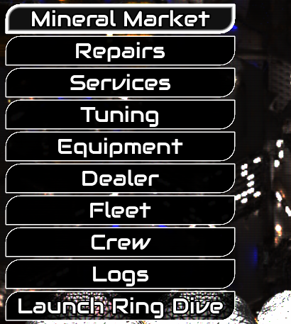
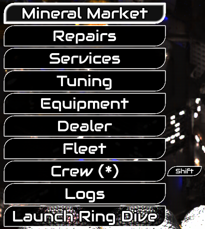
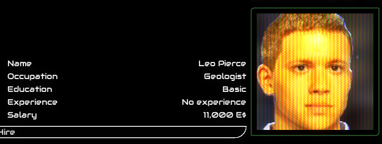
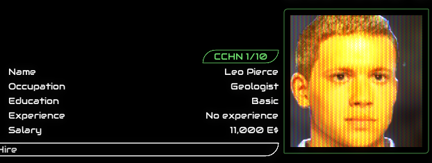
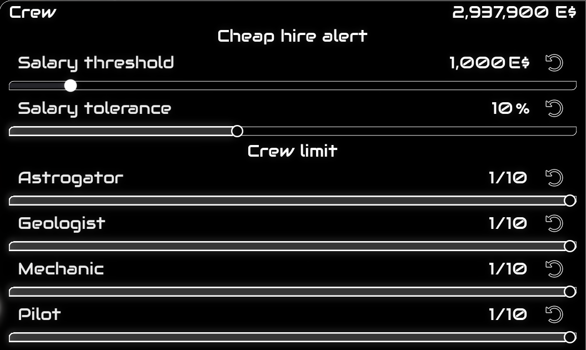

The station menu tells you when someone cheap is for hire, and the Hire screen shows you who.

## What changes

- **The station menu.** Without the mod, the menu's Crew entry always reads *Crew*. With the mod, it reads
  **Crew (\*)** while someone cheap is for hire, so you know when the Hire screen is worth a look without opening it
  every day.
- **The Hire screen.** Everyone cheap gets a small green badge on their entry: **CCHN**, then how many people with
  their job you have hired and how many you want (its **Crew limit**, see below). Point at the badge to see your limit
  for their job, with those two numbers in words.

| Without the mod | With the mod |
|---|---|
|  |  |
|  |  |

### Who counts as cheap

Someone for hire is cheap when their salary is at most the limit for their job. The limit is the higher of two
numbers:

- the **Salary threshold**: anyone earning that much or less counts, whatever your crew earns;
- the salary of your best-paid crew member with that job, plus the **Salary tolerance**. With the default tolerance of
  10 %, if your best-paid pilot earns 2,000 E$, a pilot for hire counts up to 2,200 E$.

Each job also has a **Crew limit**: how many people with that job you want. Once you have that many, the job is full,
and someone for hire with that job only counts if they earn less than your best-paid crew member in it: hiring them
would mean replacing someone, and only a cheaper hire saves you money.

Your crew means everyone you have hired, also those benched or on leave, because they all draw wages.

The mark and the badges update when you arrive at the station, every in-game day, when you hire or fire someone, and
when you change a setting.

## Settings

Hold **Shift** and click the Crew entry to open the settings (a plain click still opens the Crew screen). They show
where the Tuning screen does, and close with Esc or when you pick another entry of the menu. A change applies at once.
Each save game keeps its own settings.

The first group, *Cheap hire alert*:

| Setting | What it does | At first | Range |
|---|---|---|---|
| *Salary threshold* | Anyone earning this much or less counts as cheap. | 1,000 E$ | 0 E$ to 10,000 E$ |
| *Salary tolerance* | How much more than your best-paid crew member in that job a hire may earn and still count. Below 0 %, how much less they must earn. | 10 % | −50 % to 100 % |

Then *Crew limit*, one row per job: how many people with that job you want. It starts at 10, so no job is full until
you lower it, and goes from 0 to 10. Each row shows how many people with that job you have hired, then the limit:
in green when they are the same, in light red when you have hired more.

## Works with other mods

It works with [CrewPerfectSort](CrewPerfectSort), which sorts the Hire screen by salary (the badges stay on the right
people), and with [CrewHighlightJobAndSalary](CrewHighlightJobAndSalary).

## Install

See [Installing mods](Home#installing-mods).

<!-- wiki-values (checked by wiki.ps1)
game-checked: 1.92.5
CrewCheapHireNotifier/i18n/en.po CREWCHEAPHIRENOTIFIER_ALERT = "%s (*)" -> Crew (*) | images/CrewCheapHireNotifier-menu-with.png
CrewCheapHireNotifier/i18n/en.po CREWCHEAPHIRENOTIFIER_BADGE = "%s %d/%d" | images/CrewCheapHireNotifier-hire-with.png
CrewCheapHireNotifier/i18n/en.po CREWCHEAPHIRENOTIFIER_GROUP = "Cheap hire alert" | images/CrewCheapHireNotifier-settings.png
CrewCheapHireNotifier/Settings.gd SETTINGS.salaryThreshold.default = 1000 -> 1,000 E$ | images/CrewCheapHireNotifier-settings.png
CrewCheapHireNotifier/Settings.gd SETTINGS.salaryThreshold.min = 0 -> 0 E$
CrewCheapHireNotifier/Settings.gd SETTINGS.salaryThreshold.max = 10000 -> 10,000 E$
CrewCheapHireNotifier/i18n/en.po CREWCHEAPHIRENOTIFIER_SALARY_THRESHOLD = "Salary threshold" | images/CrewCheapHireNotifier-settings.png
CrewCheapHireNotifier/Settings.gd SETTINGS.salaryTolerance.default = 0.10 -> 10 % | images/CrewCheapHireNotifier-settings.png
CrewCheapHireNotifier/Settings.gd SETTINGS.salaryTolerance.min = -0.5 -> −50 %
CrewCheapHireNotifier/Settings.gd SETTINGS.salaryTolerance.max = 1.0 -> 100 %
CrewCheapHireNotifier/i18n/en.po CREWCHEAPHIRENOTIFIER_SALARY_TOLERANCE = "Salary tolerance" | images/CrewCheapHireNotifier-settings.png
CrewCheapHireNotifier/Settings.gd SETTINGS.crewLimit.default = 10 | images/CrewCheapHireNotifier-settings.png, images/CrewCheapHireNotifier-hire-with.png
CrewCheapHireNotifier/Settings.gd SETTINGS.crewLimit.min = 0
CrewCheapHireNotifier/Settings.gd SETTINGS.crewLimit.max = 10
CrewCheapHireNotifier/i18n/en.po CREWCHEAPHIRENOTIFIER_CREW_LIMIT = "Crew limit" | images/CrewCheapHireNotifier-settings.png
CrewCheapHireNotifier/i18n/en.po CREWCHEAPHIRENOTIFIER_CREW_LIMIT_VALUE = "%s/%s" | images/CrewCheapHireNotifier-settings.png
game: green and light red, the crew screens' colours for a better and a worse stat (enceladus/CrewBio.gd colorBetter, colorWorse)
note: 2,000 E$ and 2,200 E$, an example worked out from the tolerance's default: change it with that
-->
