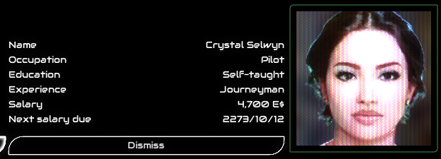
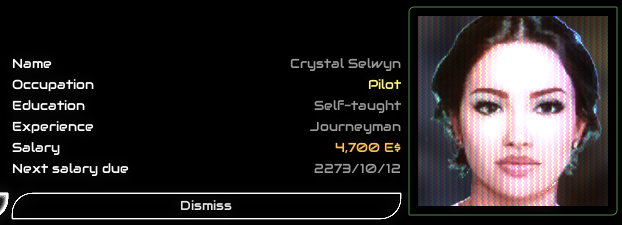
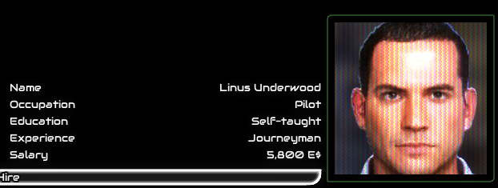
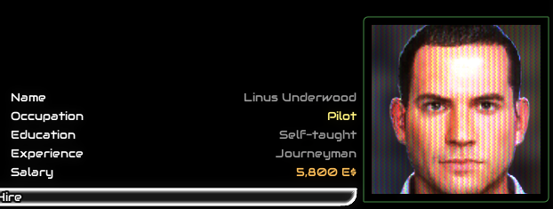

On the crew screens, each person's job and salary stand out, so you can compare people at a glance.

## What changes

On both tabs of the station's Crew screen, *Your Crew* and *Hire*, every person's entry shows:

- their **job** in bright yellow;
- their **salary** in amber;
- everything else (their name, Education, Experience, the next salary due, and leave) dimmed to grey, so the job and
  the salary are easy to spot.

| Without the mod | With the mod |
|---|---|
|  |  |
|  |  |

## Works with other mods

It works with the other crew mods, [CrewCheapHireNotifier](CrewCheapHireNotifier) and
[CrewPerfectSort](CrewPerfectSort).

## Install

See [Installing mods](Home#installing-mods).

<!-- wiki-values (checked by wiki.ps1)
game-checked: 1.93.1
CrewHighlightJobAndSalary/Code.gd JOB_COLOR = Color(1.0, 0.95, 0.5) -> bright yellow | images/CrewHighlightJobAndSalary-yourcrew-with.png, images/CrewHighlightJobAndSalary-hire-with.png
CrewHighlightJobAndSalary/Code.gd SALARY_COLOR = Color(1.0, 0.75, 0.35) -> amber | images/CrewHighlightJobAndSalary-yourcrew-with.png, images/CrewHighlightJobAndSalary-hire-with.png
CrewHighlightJobAndSalary/Code.gd DIM_COLOR = Color(0.6, 0.6, 0.6) -> grey | images/CrewHighlightJobAndSalary-yourcrew-with.png, images/CrewHighlightJobAndSalary-hire-with.png
-->
