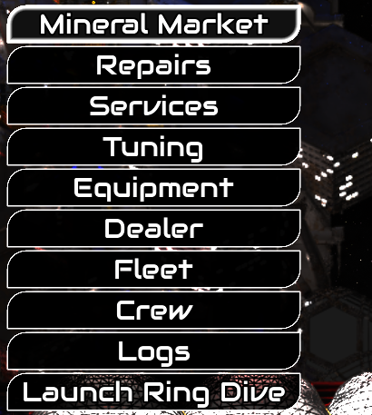
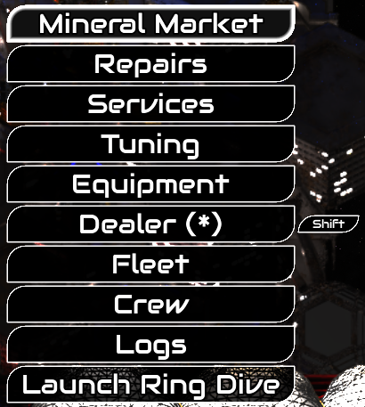
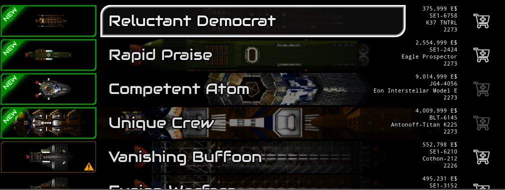
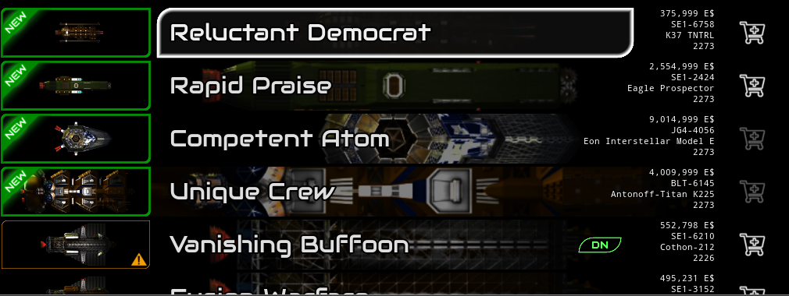
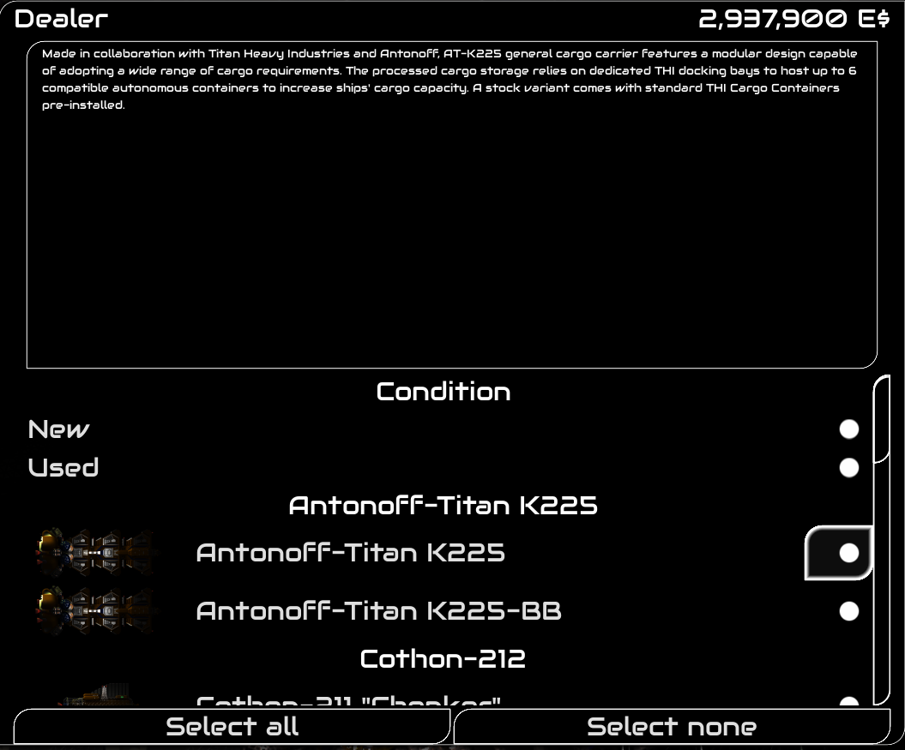

The station menu tells you when a ship you are waiting for comes up for sale at the Dealer, and the Dealer shows you
which one.

## What changes

- **The station menu.** Without the mod, the menu's Dealer entry always reads *Dealer*. With the mod, it reads
  **Dealer (\*)** when a ship you are waiting for has come up for sale, so you don't have to open the Dealer every
  hour to check. A small badge beside the entry tells you how to open the mod's settings (see [Settings](#settings)).
- **Which ships count.** Only ships of the kinds you switched on in the settings, new or used as you choose there,
  that arrived after you switched them on and after you last opened the Dealer. Opening the Dealer clears the mark,
  until another such ship arrives. A ship you sold yourself, which the Dealer offers again for a while, doesn't count.
- **The Dealer.** The ships that set the mark get a small green **DN** badge at the right end of their name, until
  you leave the station. Point at the badge, or with a gamepad highlight the ship, to see why it is there.

The mark updates when you arrive at the station, every in-game hour you spend there, and when you open the Dealer.
Ships that come up for sale while you are on a dive show up as soon as you get back.

In these pictures every kind of ship is switched on, and then a day has passed: the Dealer's used ship of the day has
come up for sale.

| Without the mod | With the mod |
|---|---|
|  |  |

**Without the mod:**

**With the mod:**

## Settings

Hold **Shift** and click the Dealer entry to open the settings (a plain click still opens the Dealer). With a gamepad,
highlight the Dealer entry, hold **LT** and press **X**. The small badge beside the entry reminds you: it reads
**Shift**, or **LT+X** while you play with a gamepad. Point at it with the mouse, or highlight the entry with a gamepad,
to see how to open the settings.

The settings show where the Dealer does and look like it: at the top, the game's own description of the ship you have
selected; below it, the switches. A long description scrolls with the mouse wheel or the right stick. The settings
close with Esc (B on a gamepad) or when you pick another entry of the menu. A change applies at once. Each save game
keeps its own settings.

- **Condition**, the first group, has two switches, both on at first:
  - **New**: new ships count, the ones the Dealer shows with a green *NEW* ribbon on their picture. The Dealer gets
    a few of these every week.
  - **Used**: used ships count, all the others. The Dealer gets one a day.

  Some kinds of ship come both new and used. Switch **New** off to wait for a used one without the mark coming back
  every week for the new one.
- **The ships**: every kind of ship the Dealer can offer, each with its picture, its name and a switch where the
  Dealer has its buy button. Point at a switch to read *Mark Dealer when this ship comes up for sale*. Every switch
  starts off. The ships are grouped by series: a ship and the models built from it, such as the Eagle Prospector with
  the Vulture, Peacock and Pelican Prospector. The series and the ships in them are in alphabetical order; ships that
  are alone in their series come last, under *Others*.
- **Select all** and **Select none**, under the list, switch every switch on or off, **New** and **Used** too.

Each picture shows the ship as the Dealer sells it, but with nothing on its hardpoints (the mounts for weapons, arms,
cargo containers and other equipment), so you see the ship itself. The pictures are drawn the first time you open the
settings.

## Works with other mods

It works with [ShipHighlightTypeAndPrice](ShipHighlightTypeAndPrice), [ShipSortByTypeAndPrice](ShipSortByTypeAndPrice)
and [ShipCopyPaste](ShipCopyPaste), which change the Dealer's list too, and with
[CrewCheapHireNotifier](CrewCheapHireNotifier), [DiveSkipTransit](DiveSkipTransit), [MarketAdvisor](MarketAdvisor) and
[ServiceNotifier](ServiceNotifier), whose settings also open with Shift and a click: on their menu entries, and for
MarketAdvisor on its Trade button.

## Install

See [Installing mods](Home#installing-mods).

<!-- wiki-values (checked by wiki.ps1)
game-checked: 1.93.1
DealerNotifier/i18n/en.po DEALERNOTIFIER_ALERT = "%s (*)" -> Dealer (*) | images/DealerNotifier-menu-with.png
DealerNotifier/Badge.gd PAD_MODIFIER_NAME = "LT" -> LT
DealerNotifier/Badge.gd PAD_BUTTON_NAME = "X" -> X
DealerNotifier/Settings.gd SETTINGS.watched.default = false -> off
DealerNotifier/Settings.gd SETTINGS.watchNew.default = true -> on
DealerNotifier/Settings.gd SETTINGS.watchUsed.default = true -> on
DealerNotifier/i18n/en.po DEALERNOTIFIER_WATCHED = "Mark Dealer when this ship comes up for sale"
DealerNotifier/i18n/en.po DEALERNOTIFIER_OTHERS = "Others"
DealerNotifier/i18n/en.po DEALERNOTIFIER_CONDITION = "Condition" | images/DealerNotifier-settings.png
DealerNotifier/i18n/en.po DEALERNOTIFIER_NEW = "New" | images/DealerNotifier-settings.png
DealerNotifier/i18n/en.po DEALERNOTIFIER_USED = "Used" | images/DealerNotifier-settings.png
DealerNotifier/i18n/en.po DEALERNOTIFIER_SELECT_ALL = "Select all" | images/DealerNotifier-settings.png
DealerNotifier/i18n/en.po DEALERNOTIFIER_SELECT_NONE = "Select none" | images/DealerNotifier-settings.png
game: a few new ships a week and one used ship a day, what the Dealer gets (CurrentGame.gd getShipsAvailableForSale)
game: the green NEW ribbon on a new ship's picture (enceladus/SystemBuyUI.gd checkPrice, Dealer/new-marker.png)
-->
