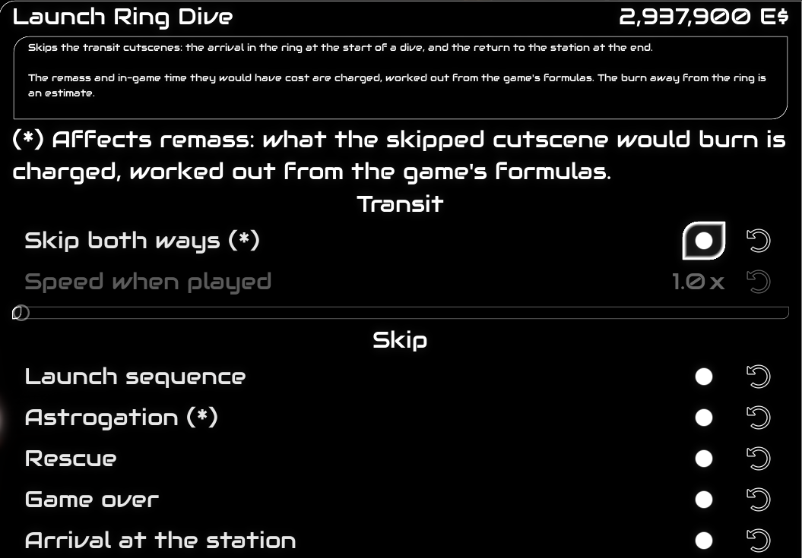

Skips the cutscenes of a dive, so you get to the mining sooner, or plays the trip to and from the rings faster.
Each skip has its own switch.

## What changes

A dive has several cutscenes: moments where the game flies your ship and you just watch. With the mod, these are
skipped:

- **The transit.** Every dive starts with your ship arriving in the rings and braking, under the title card, and ends
  with it burning away from the rings, back to the station. Without the mod you watch both, and holding Space speeds
  them up to 3x. With the mod, you start in the rings in control from the first moment, and when you leave, the
  station loads at once.
- **The launch sequence.** After *Launch Ring Dive* and the dive entry point, your ship leaves the station's dock.
  With the mod, you go straight to the rings.
- **Astrogation.** When you travel with *PLOT A COURSE*, the trip is a cutscene. With the mod, once the course is
  done, your ship is right where the trip would leave it, still moving at the travel speed, and the trip's time has
  passed.
- **The rescue.** When you run out of remass (your ship's propellant), a rescue ship comes for you. With the mod, the
  station loads at once. The time you spend stranded still passes.
- **The game over.** After a reactor meltdown, you go straight to the title screen.
- **Arriving at the station.** Back at the station, the menu works at once, instead of after the screen fades in.

Skipping isn't free: the remass and the in-game time a skipped cutscene would have used are still taken, worked out
with the game's own formulas. The remass you have left after a dive carries over to the next one, so the mod keeps
that fair.

**Watching the transit instead:** switch its skip off, and the transit plays at the speed you set, without holding
Space, from 1x up to 24x. Faster than 3x it plays without sound, and a slow computer may not reach the speed you set.

## Settings

Hold **Shift** and click *Launch Ring Dive* to open the settings (a plain click still launches a dive). They show
where the Tuning screen does, and close with Esc or when you pick another entry of the menu. At the top, a window
explains the setting you have selected. The skips marked (\*) take remass.

Every skip starts switched on. The settings are the same for all your save games.

The *Transit* group:

| Setting | What it does | At first |
|---|---|---|
| *Skip both ways* (\*) | Skips the arrival in the rings and the trip back to the station. | on |
| *Speed when played* | How fast the transit plays while it isn't skipped, from 1x to 24x. Dimmed while the transit is skipped. | 1x |

The *Skip* group:

| Setting | What it skips | At first |
|---|---|---|
| *Launch sequence* | Leaving the station's dock. | on |
| *Astrogation* (\*) | The trip after *PLOT A COURSE*. | on |
| *Rescue* | The rescue ship flying in when you're out of remass. | on |
| *Game over* | The game over cutscene after a meltdown. | on |
| *Arrival at the station* | The station's fade-in. | on |

## Changes how the game plays

The mod tries not to change the game, but compared to the normal game:

- the remass a skipped cutscene would burn is worked out instead of flown, so it can be a little off: the burn away
  from the rings is an estimate, and can take a bit more remass than the cutscene would;
- you don't see the rescue ship fly in, or your ship explode;
- a transit played faster than 3x has no sound;
- the game's playtime counts only the time you really play.

Any skip can be switched off. If a cutscene, your remass or the in-game time around a cutscene goes wrong, try again
without the mod before you report a bug to the game's developers.

## Install

See [Installing mods](Home#installing-mods).

<!-- wiki-values (checked by wiki.ps1)
game-checked: 1.92.5
DiveSkipTransit/Code.gd _DST_SPACE_SPEED = 3.0 -> 3x
DiveSkipTransit/SettingsUI.gd REMASS_MARK = "(*)" | images/DiveSkipTransit-settings.png
DiveSkipTransit/i18n/en.po DIVESKIPTRANSIT_REMASS_NOTE = "%s Affects remass: what the skipped cutscene would burn is charged, worked out from the game's formulas." | images/DiveSkipTransit-settings.png
DiveSkipTransit/i18n/en.po DIVESKIPTRANSIT_GROUP_TRANSIT = "Transit" | images/DiveSkipTransit-settings.png
DiveSkipTransit/Settings.gd SETTINGS.skipTransit.default = true -> on | images/DiveSkipTransit-settings.png
DiveSkipTransit/i18n/en.po DIVESKIPTRANSIT_SKIP_TRANSIT = "Skip both ways" | images/DiveSkipTransit-settings.png
DiveSkipTransit/i18n/en.po DIVESKIPTRANSIT_SKIP_TRANSIT_DESC = "Skips the transit cutscenes: the arrival in the ring at the start of a dive, and the return to the station at the end.\n\nThe remass and in-game time they would have cost are charged, worked out from the game's formulas. The burn away from the ring is an estimate." | images/DiveSkipTransit-settings.png
DiveSkipTransit/Settings.gd SETTINGS.transitSpeed.default = 1.0 -> 1x | images/DiveSkipTransit-settings.png
DiveSkipTransit/Settings.gd SETTINGS.transitSpeed.min = 1.0 -> 1x
DiveSkipTransit/Settings.gd SETTINGS.transitSpeed.max = 24.0 -> 24x
DiveSkipTransit/i18n/en.po DIVESKIPTRANSIT_TRANSIT_SPEED = "Speed when played" | images/DiveSkipTransit-settings.png
DiveSkipTransit/i18n/en.po DIVESKIPTRANSIT_GROUP = "Skip" | images/DiveSkipTransit-settings.png
DiveSkipTransit/Settings.gd SETTINGS.skipLaunch.default = true -> on | images/DiveSkipTransit-settings.png
DiveSkipTransit/i18n/en.po DIVESKIPTRANSIT_SKIP_LAUNCH = "Launch sequence" | images/DiveSkipTransit-settings.png
DiveSkipTransit/Settings.gd SETTINGS.skipAstrogation.default = true -> on | images/DiveSkipTransit-settings.png
DiveSkipTransit/i18n/en.po DIVESKIPTRANSIT_SKIP_ASTROGATION = "Astrogation" | images/DiveSkipTransit-settings.png
DiveSkipTransit/Settings.gd SETTINGS.skipRescue.default = true -> on | images/DiveSkipTransit-settings.png
DiveSkipTransit/i18n/en.po DIVESKIPTRANSIT_SKIP_RESCUE = "Rescue" | images/DiveSkipTransit-settings.png
DiveSkipTransit/Settings.gd SETTINGS.skipGameOver.default = true -> on | images/DiveSkipTransit-settings.png
DiveSkipTransit/i18n/en.po DIVESKIPTRANSIT_SKIP_GAME_OVER = "Game over" | images/DiveSkipTransit-settings.png
DiveSkipTransit/Settings.gd SETTINGS.skipStationFadeIn.default = true -> on | images/DiveSkipTransit-settings.png
DiveSkipTransit/i18n/en.po DIVESKIPTRANSIT_SKIP_STATION_FADE_IN = "Arrival at the station" | images/DiveSkipTransit-settings.png
-->
