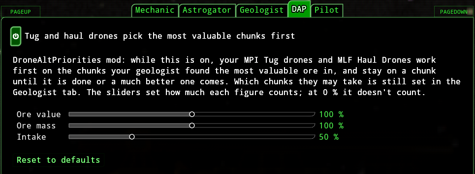

Your tug and haul drones go for the most valuable chunks first, instead of the heaviest and fastest.

## What changes

MPI Tug drones and MLF Haul Drones are nanodrones: equipment your ship launches to slow chunks down (tug drones) or
bring them to your excavator (haul drones). Each set works on one chunk at a time. Without the mod, they go for the
heaviest chunk moving the fastest. They rarely stop it before it flies off, and each time they switch to another
chunk, the drones already on their way are lost. Meanwhile light, valuable chunks, Be above all, get away.

With the mod, a new tab, **DAP** (short for DroneAltPriorities), sits right after the *Geologist* tab of the Onboard
Maintenance System (press **J**). Switch it on, and your tug and haul drones work first on the chunks your geologist
found the most valuable ore in, and stay on a chunk until it is done or a much better one comes along. Haul drones
also prefer chunks close to where they gather them, just ahead of the excavator.

They still take only the chunks they could take without the mod: which ones is still set by their rows in the
*Geologist* tab. Chunks your geologist hasn't identified yet come after the others. Your OME Maintenance drones work as
normal.

With the switch off, the game works as normal.

## Settings

In the **DAP** tab:

- The switch at the top, *Tug and haul drones pick the most valuable chunks first*: off at first.
- **Ore value**: how much the price of the best ore in a chunk counts. It starts at 100 %.
- **Ore mass**: how much the amount of ore in a chunk counts, as your geologist estimates it. It starts at 100 %. With
  Ore value at the same level, the drones go for the chunks worth the most.
- **Intake**: how much it counts that a chunk is close to where the haul drones gather chunks, ahead of the excavator.
  It starts at 50 %. Higher brings in more chunks, lower more value. Tug drones ignore it.
- Each slider goes from 0 % to 200 %, in steps of 25 %. At 0 %, that one doesn't count at all.
- **Reset to defaults** puts the switch and every slider back to how they started.

The sliders work like the ones in the *Geologist* tab. While the switch is off they are dimmed, but you can still set
them. Point at a slider, or at **Reset to defaults**, to read what it does. Each ship keeps its own settings, for all
its drones, saved with your game.

With a gamepad, the D-pad moves down from the switch through the sliders to **Reset to defaults**, and back up, and
the description of the slider or button you select shows under it. Press A on a slider to change it with left and
right, then A or B when you are done.

## Changes how the game plays

Compared to the normal game, while the mod's switch is on, your tug and haul drones choose which chunk to work on
first by the ore in it and, for haul drones, how close it is to the excavator, not by how heavy and fast it is; and
they stay on a chunk longer. With the switch off, nothing changes.

If your drones do something wrong, try again without the mod before you report a bug to the game's developers.

## Works with other mods

[GeologyByMass](GeologyByMass) also adds a tab right after the *Geologist* tab: both show, its **GBM** tab first.

## Install

See [Installing mods](Home#installing-mods).

<!-- wiki-values (checked by wiki.ps1)
game-checked: 1.93.1
DroneAltPriorities/i18n/en.po DRONEALTPRIORITIES_TAB = "DAP" | images/DroneAltPriorities-settings.png
DroneAltPriorities/Settings.gd ENABLED.default = false -> off at first
DroneAltPriorities/i18n/en.po DRONEALTPRIORITIES_ENABLED = "Tug and haul drones pick the most valuable chunks first" | images/DroneAltPriorities-settings.png
DroneAltPriorities/i18n/en.po DRONEALTPRIORITIES_VALUE = "Ore value" | images/DroneAltPriorities-settings.png
DroneAltPriorities/Settings.gd WEIGHTS[0].default = 1.0 -> 100 %
DroneAltPriorities/Settings.gd WEIGHTS[0].min = 0.0 -> 0 %
DroneAltPriorities/Settings.gd WEIGHTS[0].max = 2.0 -> 200 %
DroneAltPriorities/Settings.gd WEIGHTS[0].step = 0.25 -> 25 %
DroneAltPriorities/i18n/en.po DRONEALTPRIORITIES_MASS = "Ore mass" | images/DroneAltPriorities-settings.png
DroneAltPriorities/Settings.gd WEIGHTS[1].default = 1.0 -> 100 %
DroneAltPriorities/Settings.gd WEIGHTS[1].min = 0.0 -> 0 %
DroneAltPriorities/Settings.gd WEIGHTS[1].max = 2.0 -> 200 %
DroneAltPriorities/Settings.gd WEIGHTS[1].step = 0.25 -> 25 %
DroneAltPriorities/i18n/en.po DRONEALTPRIORITIES_MASS_DESC = "How much the mass of ore in a chunk counts, as your geologist estimates it. With Ore value at the same level, the drones go for the chunks worth the most." -> With Ore value at the same level, the drones go for the chunks worth the most.
DroneAltPriorities/i18n/en.po DRONEALTPRIORITIES_INTAKE = "Intake" | images/DroneAltPriorities-settings.png
DroneAltPriorities/Settings.gd WEIGHTS[2].default = 0.5 -> 50 %
DroneAltPriorities/Settings.gd WEIGHTS[2].min = 0.0 -> 0 %
DroneAltPriorities/Settings.gd WEIGHTS[2].max = 2.0 -> 200 %
DroneAltPriorities/Settings.gd WEIGHTS[2].step = 0.25 -> 25 %
DroneAltPriorities/i18n/en.po DRONEALTPRIORITIES_INTAKE_DESC = "How much it counts that a chunk is close to where the haul drones gather chunks, ahead of the excavator. Higher brings in more chunks, lower more value. Tug drones ignore it." -> Higher brings in more chunks, lower more value. Tug drones ignore it.
DroneAltPriorities/i18n/en.po DRONEALTPRIORITIES_RESET = "Reset to defaults" | images/DroneAltPriorities-settings.png
game: the heaviest, fastest chunk first, the tug and haul drones' own pick (weapons/drone-plant.gd scanForTarget)
-->
