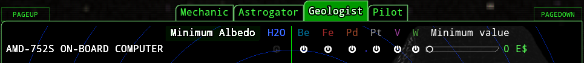

Your geologist judges chunks by how much of a mineral they hold, instead of by what they are worth, and so do your arm
and your drones.

## What changes

In a dive, your geologist puts an info box next to each chunk of ore they identify, with the kg of each mineral in it
and its value. The *Geologist* tab of the Onboard Maintenance System (press **J**) has a row for your HUD, and one for
each piece of equipment that picks chunks: your AR-1500 Manipulator (the arm), your MPI Tug drones and MLF Haul Drones,
and your NT Mining Companion. Each row has its own mineral switches and its own *Minimum value*. In the game, a chunk
passes a row when it is worth at least that row's *Minimum value* and holds a mineral switched on in it. The HUD's row
decides which info boxes stay full: the game shrinks the others, hiding the list and the value. The arm's row decides
which chunks the arm takes, and each drone row which chunks those drones work on.

With the mod, a new tab, **GBM** (short for GeologyByMass), sits right after the *Geologist* tab, with a switch and a
mass for each mineral. Switch the mod on, and a chunk passes every row when it holds at least the mass of a mineral
switched on in the **GBM** tab, whatever the chunk is worth: the rows' own mineral switches and *Minimum value* no
longer count. So the same switches and masses decide which info boxes stay full, and which chunks your arm and your
drones go for. Use it when you are after one mineral: how much of it a chunk holds tells you more than its price,
which mixes every mineral in it and changes with the market.

That goes for water (H2O) too: the HUD's row can't switch it on, but the **GBM** tab can, and then a chunk with enough
water keeps a full info box as well.

The kg are the ones the info box shows, as your geologist estimates them: a better geologist gets them closer. A chunk
your geologist hasn't identified yet is judged as in the normal game.

While the switch is on, the *Geologist* tab dims the mineral switches and the *Minimum value* of those rows, and you
can't change them, since they no longer count. The rows of your cargo containers, which pick the ore they carry
instead, stay as they are. Switch the mod off, and they work again, with the values you set.

**Without the mod:**

**With the mod, switched on:**

With the switch off, the game works as normal.

## Settings

In the **GBM** tab:

- The switch at the top, *Judge ore by mineral mass instead of the Geologist tab's switches and minimum value*: off at
  first.
- One row for each mineral, H2O (water) too:
  - its switch: on, the mineral counts for every row. They start as the game's own do: every mineral on but H2O;
  - its mass, the least kg of it a chunk needs, from 0 kg to 5,000 kg, starting at 0;
  - what that mass is worth at today's price, so you can compare it with a *Minimum value*.
- At the bottom, a line on your geologist. With none in your dive crew, it gives a warning: no chunk gets an info box
  then, so the masses have no effect. Otherwise it names the Education of your best one, and how far off their
  estimates can be: up to 90 % with Self-taught education, 70 % with Basic, 50 % with High and 30 % with Master. Set
  the masses a bit lower or higher to allow for it.

The sliders work like the ones in the *Geologist* tab. While the switch is off the rows are dimmed, but you can still
set them. Point at a switch or a slider to read what it does. Each ship keeps its own settings, saved with your game.
If you set masses before the tab had a switch for each mineral, each mineral keeps the mass it needed then.

With a gamepad, the D-pad moves down from the switch at the top into the mineral switches, up and down either column,
and left and right between a mineral's switch and its slider, and the description of what you select shows under it.
Press A on a slider to change it with left and right, then A or B when you are done.

In the picture, H2O is switched on too, and a chunk needs less of a dear mineral than of a cheap one: 200 kg of Be, the
dearest, and 200 kg more for each step down in price, to H2O, the cheapest.

## Changes how the game plays

Compared to the normal game, while the mod's switch is on, which chunks keep a full info box, and which ones your arm and
your drones go for, depends on how many kg they hold of the minerals you switch on in its tab, not on what they are
worth or on the minerals switched on in each row. With the switch off, nothing changes.

If the info boxes, the arm, the drones or the *Geologist* tab do something wrong, try again without the mod before you
report a bug to the game's developers.

## Works with other mods

[DroneAltPriorities](DroneAltPriorities) also adds a tab right after the *Geologist* tab: both show, this mod's **GBM**
tab first. With this mod's switch on, DroneAltPriorities ranks only the identified chunks the masses let through, then
the ones not identified yet, and [ArmAltTargetSelection](ArmAltTargetSelection) picks the arm's target only among
those the masses let through.

## Install

See [Installing mods](Home#installing-mods).

<!-- wiki-values (checked by wiki.ps1)
game-checked: 1.93.1
GeologyByMass/i18n/en.po GEOLOGYBYMASS_TAB = "GBM" | images/GeologyByMass-settings.png, images/GeologyByMass-geologist-with.png
GeologyByMass/Settings.gd ENABLED.default = false -> off at first
GeologyByMass/i18n/en.po GEOLOGYBYMASS_ENABLED = "Judge ore by mineral mass instead of the Geologist tab's switches and minimum value" | images/GeologyByMass-settings.png
GeologyByMass/i18n/en.po GEOLOGYBYMASS_HINT = "GeologyByMass mod: while this is on, an identified chunk passes every row of the Geologist tab when it holds at least the mass set below for a mineral switched on here. The rows' own mineral switches and minimum values no longer count, nor does the chunk's value. The rows decide which chunks keep a full info box, and which ones the arm and the drones go for." | images/GeologyByMass-settings.png
GeologyByMass/i18n/en.po GEOLOGYBYMASS_MINERAL_SWITCH = "Count this mineral: a chunk with at least its mass passes every row of the Geologist tab." -> counts for every row
GeologyByMass/Settings.gd MIN_MASS.default = 0
GeologyByMass/Settings.gd MIN_MASS.min = 0 -> 0 kg
GeologyByMass/Settings.gd MIN_MASS.max = 5000 -> 5,000 kg
GeologyByMass/i18n/en.po GEOLOGYBYMASS_MIN_MASS = "Least mass of this mineral, as your geologist estimates it, for a chunk to pass while its switch is on." -> as your geologist estimates
GeologyByMass/SettingsUI.gd MASS_FORMAT = "%s " | images/GeologyByMass-settings.png
GeologyByMass/SettingsUI.gd VALUE_FORMAT = "%s E$" | images/GeologyByMass-settings.png
GeologyByMass/SettingsUI.gd PERCENT_FORMAT = "%s%%" | images/GeologyByMass-settings.png
GeologyByMass/i18n/en.po GEOLOGYBYMASS_GEOLOGIST = "You have a Geologist with %s education. Expect up to %s variation in the mass estimation." | images/GeologyByMass-settings.png
GeologyByMass/i18n/en.po GEOLOGYBYMASS_NO_GEOLOGIST = "WARNING: No Geologist on board. The values above will have no effect." -> a warning
game: 90 %, 70 %, 50 % and 30 %, the most error of a geologist's estimates with Self-taught, Basic, High and Master education, morale left out (CurrentGame.gd deriveStats CREW_STATS_GEOLOGIST_PREDICTION at each level's lowest talent, translateLevel; hud/MineralMark.gd _ready)
note: 200 kg, the least mass of Be and the step of the example in the settings picture (its steps in _shots/shots.psd1, by the game's base prices, CurrentGame.mineralPrices): change it with that
-->
