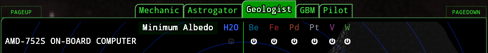
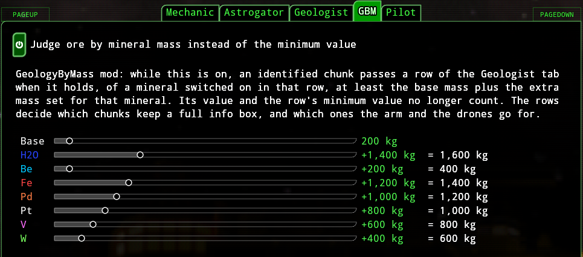

Your geologist judges chunks by how much of a mineral they hold, instead of by what they are worth, and so do your arm
and your drones.

## What changes

In a dive, your geologist puts an info box next to each chunk of ore they identify, with the kg of each mineral in it
and its value. The *Geologist* tab of the Onboard Maintenance System (press **J**) has a row for your HUD, and one for
each piece of equipment that picks chunks: your AR-1500 Manipulator (the arm), your MPI Tug drones and MLF Haul Drones,
and your NT Mining Companion. Each row has its own mineral switches and its own *Minimum value*. In the game, a chunk
passes a row when it is worth at least that row's *Minimum value* and holds a mineral switched on in it. The HUD's row
decides which info boxes stay full: the game shrinks the others, hiding the list and the value. The arm's row decides
which chunks the arm takes, and each drone row which chunks those drones work on.

With the mod, a new tab, **GBM** (short for GeologyByMass), sits right after the *Geologist* tab. Switch it on, and a
chunk passes a row when it holds enough kg of one of the minerals switched on in that row, whatever the chunk is worth:
the *Minimum value* no longer counts. So the same masses decide which info boxes stay full, and which chunks your arm
and your drones go for. Each row still has its own mineral switches. Use it when you are after one mineral: how much of
it a chunk holds tells you more than its price, which mixes every mineral in it and changes with the market.

How much is enough is the **Base** mass, plus an extra mass for each mineral, on top of the base. Moving the Base
slider raises or lowers every mineral together. The kg are the ones the info box shows, as your geologist estimates
them. A chunk your geologist hasn't identified yet is judged as in the normal game.

While the switch is on, the *Geologist* tab hides the *Minimum value* of those rows, and the title above them, since it
no longer counts. The game already hides it for the rows of your cargo containers, which pick the ore they carry
instead. Switch the mod off, and the title and the sliders come back, with the values you set.

**Without the mod:**

**With the mod, switched on:**

With the switch off, the game works as normal.

## Settings

In the **GBM** tab:

- The switch at the top, *Judge ore by mineral mass instead of the minimum value*: off at first.
- **Base**: the least mass for every mineral, from 0 kg to 5,000 kg. It starts at 0.
- One row for each mineral: its extra mass (+ kg), from 0 kg to 5,000 kg, starting at 0, and then the total that
  mineral needs (= kg). H2O (water) is there too: only the rows of the arm and the drones can switch it on.

The sliders work like the ones in the *Geologist* tab. While the switch is off they are dimmed, but you can still set
them. Each ship keeps its own settings, saved with your game.

In the picture, a chunk needs less of a dear mineral than of a cheap one: 200 kg more for each step down in price,
from Be, the dearest, to H2O, the cheapest.

## Changes how the game plays

Compared to the normal game, while the mod's switch is on, which chunks keep a full info box, and which ones your arm and
your drones go for, depends on how many kg of your chosen minerals they hold, not on what they are worth. With the
switch off, nothing changes.

If the info boxes, the arm, the drones or the *Geologist* tab do something wrong, try again without the mod before you
report a bug to the game's developers.

## Install

See [Installing mods](Home#installing-mods).

<!-- wiki-values (checked by wiki.ps1)
game-checked: 1.93.1
GeologyByMass/i18n/en.po GEOLOGYBYMASS_TAB = "GBM" | images/GeologyByMass-settings.png, images/GeologyByMass-geologist-with.png
GeologyByMass/Settings.gd ENABLED.default = false -> off at first
GeologyByMass/i18n/en.po GEOLOGYBYMASS_ENABLED = "Judge ore by mineral mass instead of the minimum value" | images/GeologyByMass-settings.png
GeologyByMass/i18n/en.po GEOLOGYBYMASS_HINT = "GeologyByMass mod: while this is on, an identified chunk passes a row of the Geologist tab when it holds, of a mineral switched on in that row, at least the base mass plus the extra mass set for that mineral. Its value and the row's minimum value no longer count. The rows decide which chunks keep a full info box, and which ones the arm and the drones go for." | images/GeologyByMass-settings.png
GeologyByMass/Settings.gd BASE_MASS.default = 0
GeologyByMass/Settings.gd BASE_MASS.min = 0 -> 0 kg
GeologyByMass/Settings.gd BASE_MASS.max = 5000 -> 5,000 kg
GeologyByMass/i18n/en.po GEOLOGYBYMASS_BASE_MASS = "Base" | images/GeologyByMass-settings.png
GeologyByMass/SettingsUI.gd EXTRA_FORMAT = "+%s " | images/GeologyByMass-settings.png
GeologyByMass/SettingsUI.gd TOTAL_FORMAT = "= %s " | images/GeologyByMass-settings.png
GeologyByMass/Settings.gd EXTRA_MASS.default = 0
GeologyByMass/Settings.gd EXTRA_MASS.min = 0 -> 0 kg
GeologyByMass/Settings.gd EXTRA_MASS.max = 5000 -> 5,000 kg
GeologyByMass/i18n/en.po GEOLOGYBYMASS_EXTRA_MASS = "Mass of this mineral needed on top of the base, as your geologist estimates it, for a chunk to pass a row of the Geologist tab that has it switched on." -> on top of the base
note: 200 kg, the base and the step of the example in the settings picture (its steps in _shots/shots.psd1, by the game's base prices, CurrentGame.mineralPrices): change it with that
-->
