Hides the titles on the screens of your ship's HUD, so they don't cover anything.

## What changes

Your ship's HUD, the displays around the view in a dive, has small titles on its screens: *visual feed*, the name of
your LIDAR (for example IRL-360 Infrared LIDAR), *Remote scanner* and *cargo hold*. With the mod, they are gone, and
everything else stays where it was. On some HUDs the titles covered a reading: on the OCP-209's, the *cargo hold*
title covered the cargo's mass.

Which titles you see depends on your HUD: the *Head-Up Display* you fit on the Equipment screen, on any ship.
*Remote scanner* only shows with the Obonto USV-D Microseismic Series as your *Reconnaissance Craft*, also fitted on
the Equipment screen.

The Eon Interstellar Model E HUD hides its screens, titles included, while their readings hold still. *Inactive
display visibility*, in the HUD's Tuning, keeps them on screen, dimmed: its pictures have it at 100 %. On that HUD,
*cargo hold* is the name of the row with the cargo's mass, under the ship: with the mod, the row shows only the mass.

The same titles on the station's Equipment and Tuning screens, and the cargo title in the Onboard Maintenance System,
stay as they are.

Open your HUD to see it without and with the mod. Every picture shows the same ship, a K37 TNTRL, in a dive.

HAL9000

**Without the mod:**

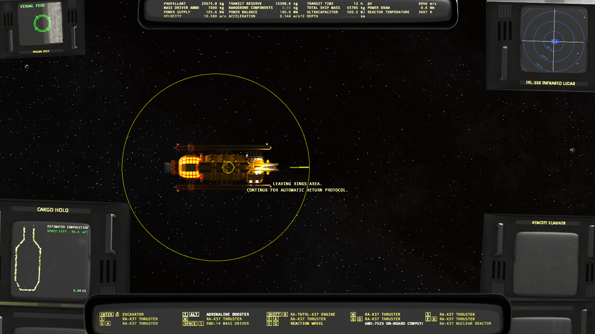

**With the mod:**

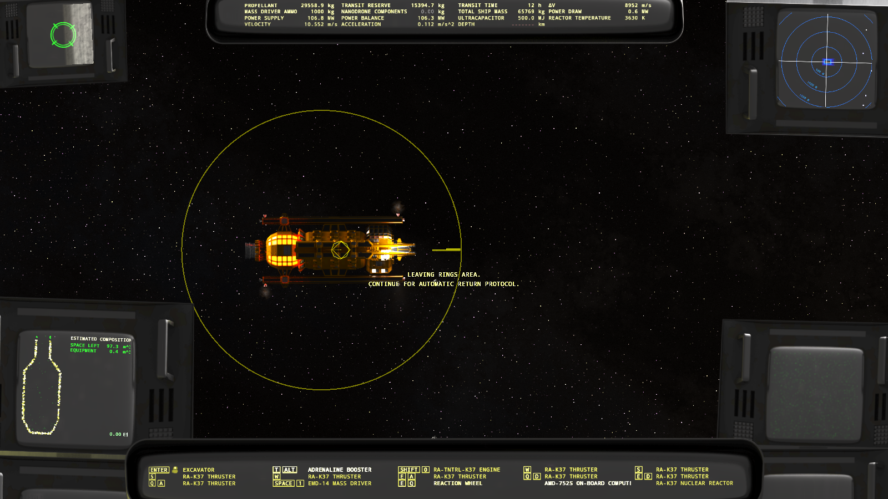

Eagle Prospector, and Eagle Prospector (metric mod)

The metric mod only changes the units.

**Without the mod:**

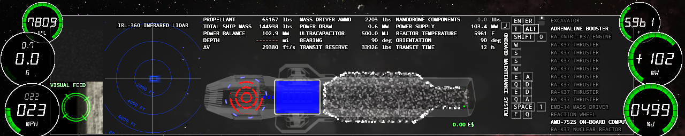

**With the mod:**

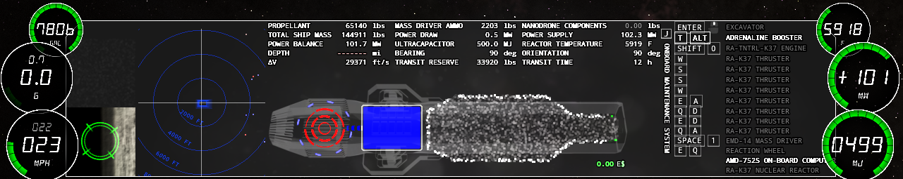

K37 TNTRL

**Without the mod:**

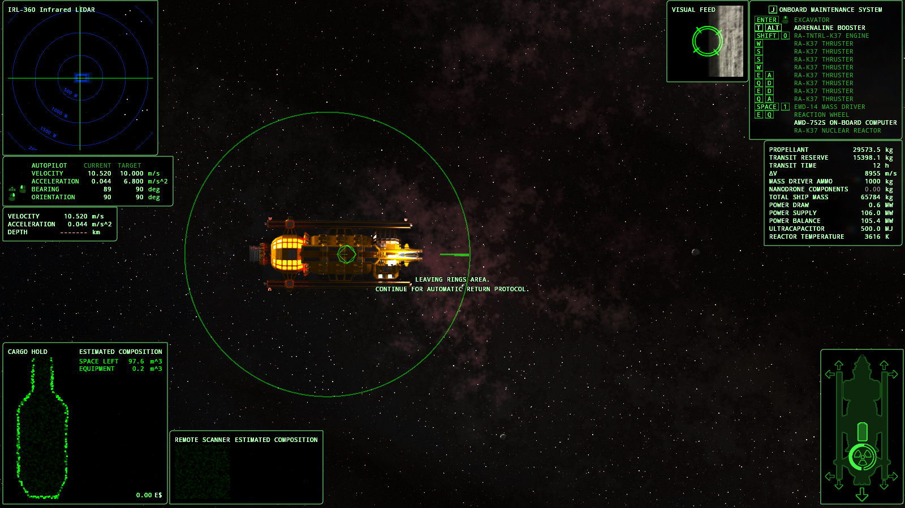

**With the mod:**

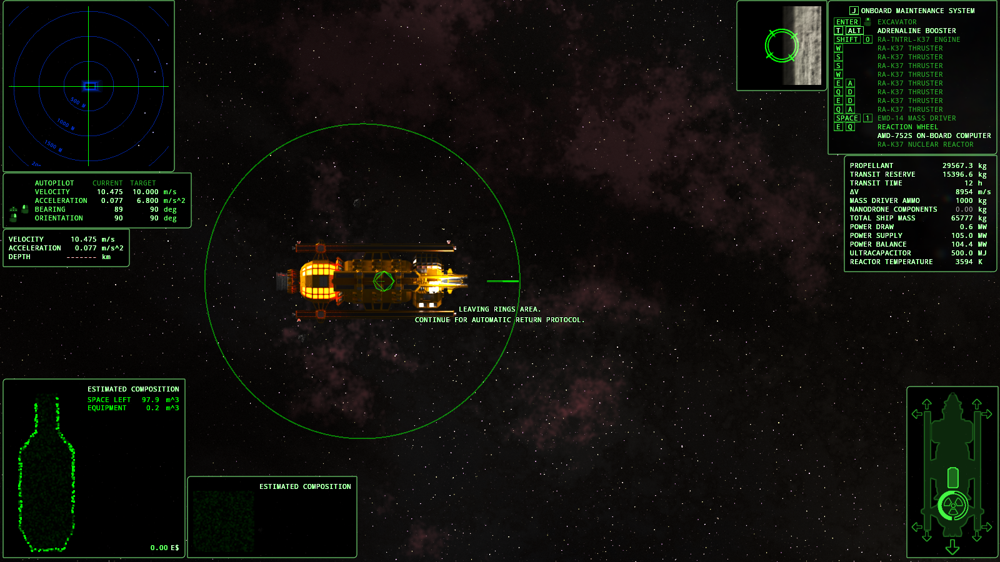

AT-K225

**Without the mod:**

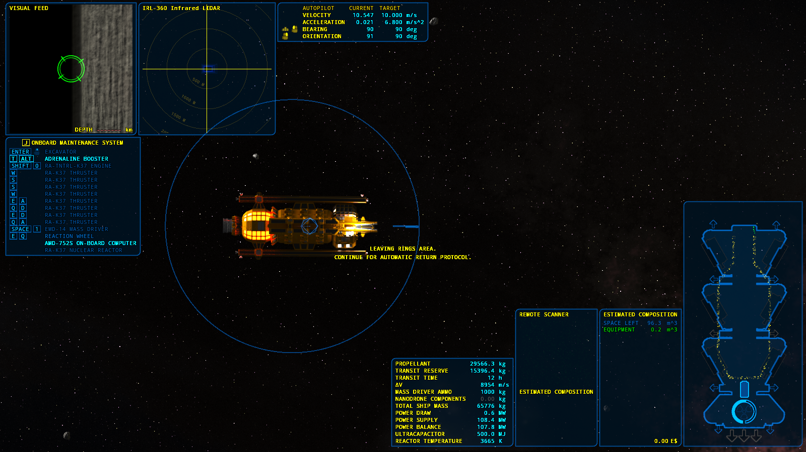

**With the mod:**

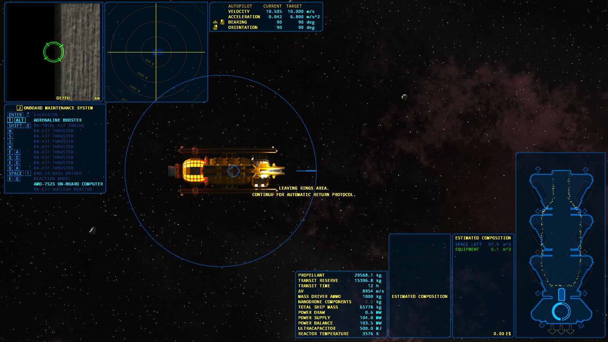

OCP-209

**Without the mod:**

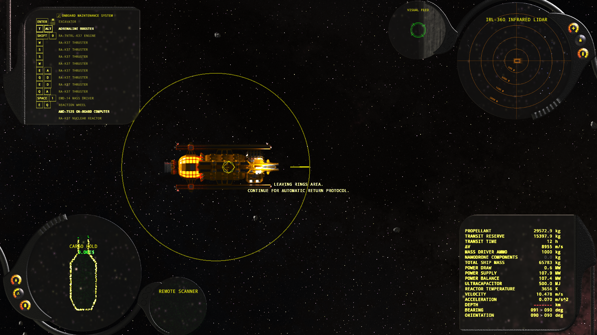

**With the mod:**

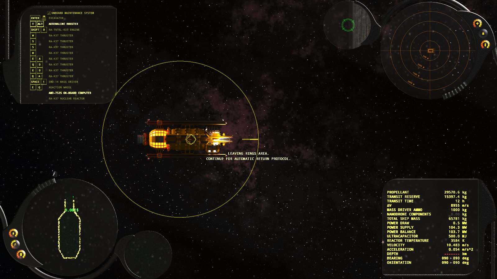

MAD Cernunnos II

**Without the mod:**

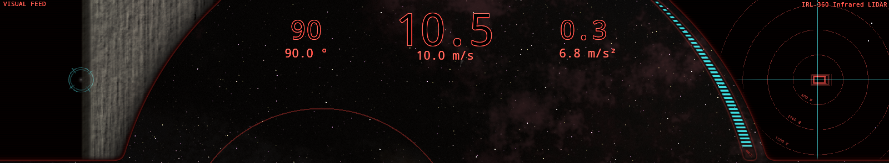

**With the mod:**

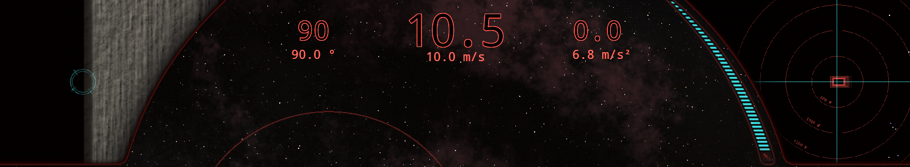

Eon Interstellar Model E

**Without the mod:**

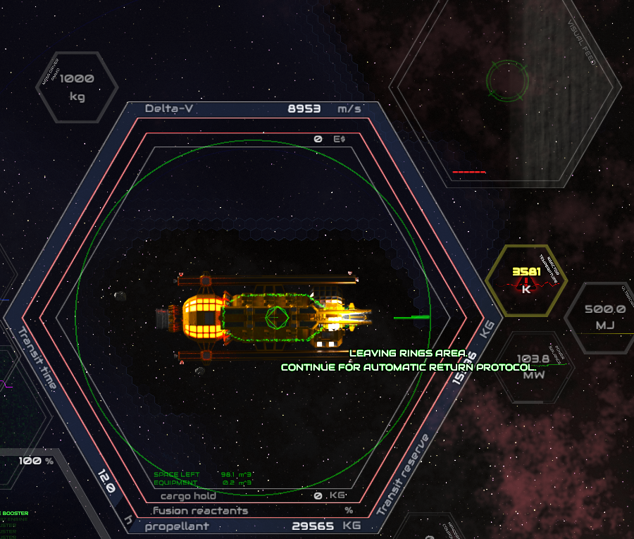

**With the mod:**

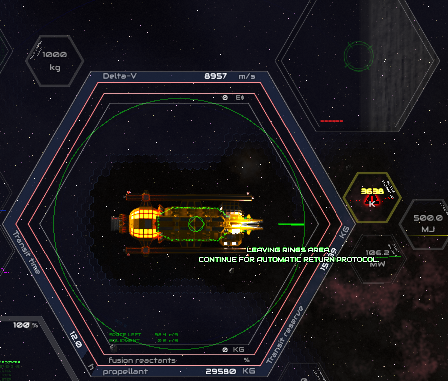

ND-LIS Kitsune

**Without the mod:**

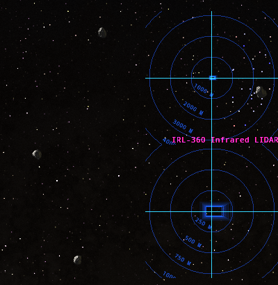

**With the mod:**

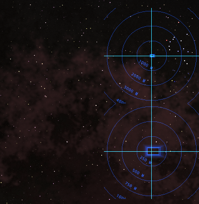

Bald Eagle Racing HUD

**Without the mod:**

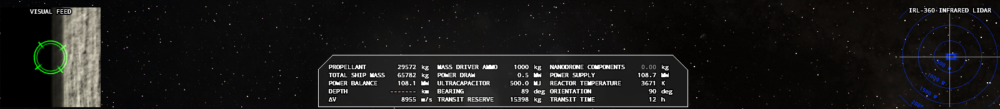

**With the mod:**

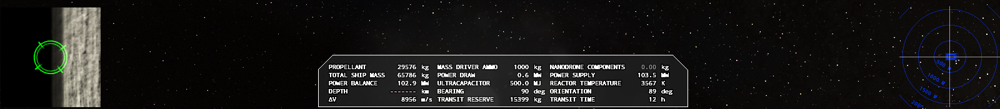

## Install

See [Installing mods](Home#installing-mods).

<!-- wiki-values (checked by wiki.ps1)
game-checked: 1.93.1
HudHideLabels/Code.gd HIDDEN_KEYS = ["HUD_VISUAL_FEED", "HUD_LIDAR", "HUD_REMOTE_SCAN", "HUD_CARGO"] -> Remote scanner | images/HudHideLabels-hal-with.png, images/HudHideLabels-prospector-with.png, images/HudHideLabels-tntrl-with.png, images/HudHideLabels-at225-with.png, images/HudHideLabels-ocp209-with.png, images/HudHideLabels-cerf-with.png, images/HudHideLabels-eime-with.png, images/HudHideLabels-kitsune-with.png, images/HudHideLabels-prospector-bald-with.png
game: the titles' texts, visual feed, Remote scanner, cargo hold (i18n/en.po HUD_VISUAL_FEED, HUD_REMOTE_SCAN, HUD_CARGO), and the LIDAR's name (hud/HardwareLabel.gd; the K37 TNTRL's, IRL-360 Infrared LIDAR, SYSTEM_LIDAR_DOPPLER)
game: the HUDs, in the Equipment screen's Head-Up Display, in its order (enceladus/Upgrades.tscn; i18n/en.po SLOT_HUD, SYSTEM_HUD_*), each its own layout (hud/Hud.tscn Huds, hud/Display-*.tscn); the metric mod is the Eagle Prospector's layout (hud/Display-Prospector-Metric.tscn)
game: Remote scanner only with the Obonto USV-D Microseismic Series as Reconnaissance Craft (SYSTEM_RD_SPECTROMETER, SLOT_RECON_DRONE; hud/ShowWhenSystemInstalled.gd, Display-OCP209.tscn Remote)
game: 100 %, the most of Inactive display visibility (TUNE_HUD_HIDE, hud/FadeAwaySensor.gd), which keeps the Eon Interstellar Model E's screens dimmed when they would fade out; cargo hold names its cargo mass row (Display-EIME.tscn MassLabel)
-->
