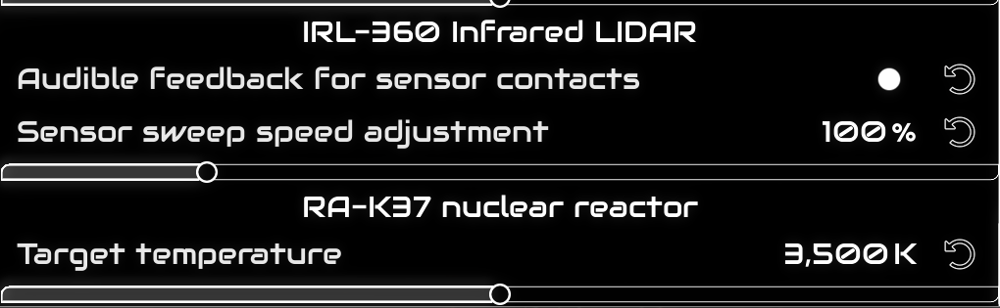
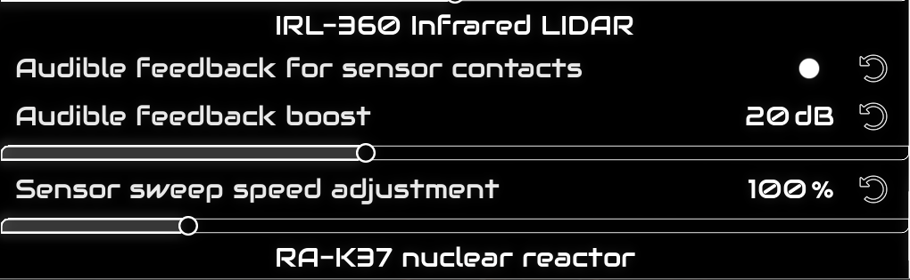

Makes the LIDAR's ping louder, by as much as you choose, so you don't miss what it finds.

## What changes

Your LIDAR plays a ping for each thing it finds around the ship: chunks of ore, ships, equipment, even shots. Over the
rest of the ship's sounds, that ping is easy to miss. With the mod, it plays louder, by the boost you set.

The game plays the ping louder and lower for contacts far away, and quieter and higher for close ones. The mod keeps
that: it adds the same boost to both. About every 10 dB sounds twice as loud, and 0 dB leaves the game's volume. With
a big boost, the game holds the pings back a little and briefly turns other sounds down with them.

## Settings

In the station's Tuning screen, right below the switch *Audible feedback for sensor contacts*, there is a new slider:
**Audible feedback boost**. It goes from 0 dB to 50 dB, and starts at 20 dB. It only works while that switch is on.
Each ship keeps its own boost, saved with your game.

While the slider is selected, the screen's preview plays a ping from a far, a halfway and a close contact, again and
again, so you can hear how it will sound in flight.

**Without the mod:**

**With the mod:**

## Install

See [Installing mods](Home#installing-mods).

<!-- wiki-values (checked by wiki.ps1)
game-checked: 1.92.5
LidarLouderPing/Code.gd LOUDER_PING_DB_DEFAULT = 20.0 -> 20 dB | images/LidarLouderPing-tuning-with.png
LidarLouderPing/Code.gd LOUDER_PING_DB_MIN = 0.0 -> 0 dB
LidarLouderPing/Code.gd LOUDER_PING_DB_MAX = 50.0 -> 50 dB
LidarLouderPing/i18n/en.po TUNE_LIDARLOUDERPING_GAIN = "Audible feedback boost" | images/LidarLouderPing-tuning-with.png
LidarLouderPing/Code.gd LOUDER_PING_DEMO_RANGES = [1.0, 0.5, 0.1] -> a far, a halfway and a close contact
note: 10 dB, about twice as loud: a rule of thumb about hearing, not a value of the mod
game: Audible feedback for sensor contacts, the LIDAR's sound switch (i18n/en.po TUNE_AUDIO_LIDAR)
-->
