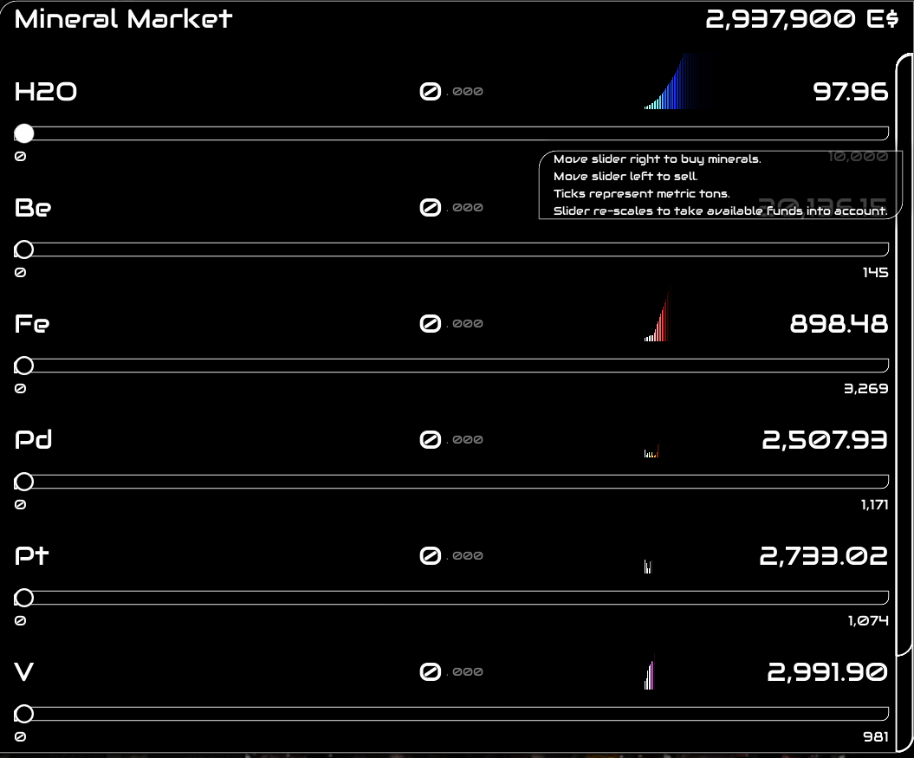
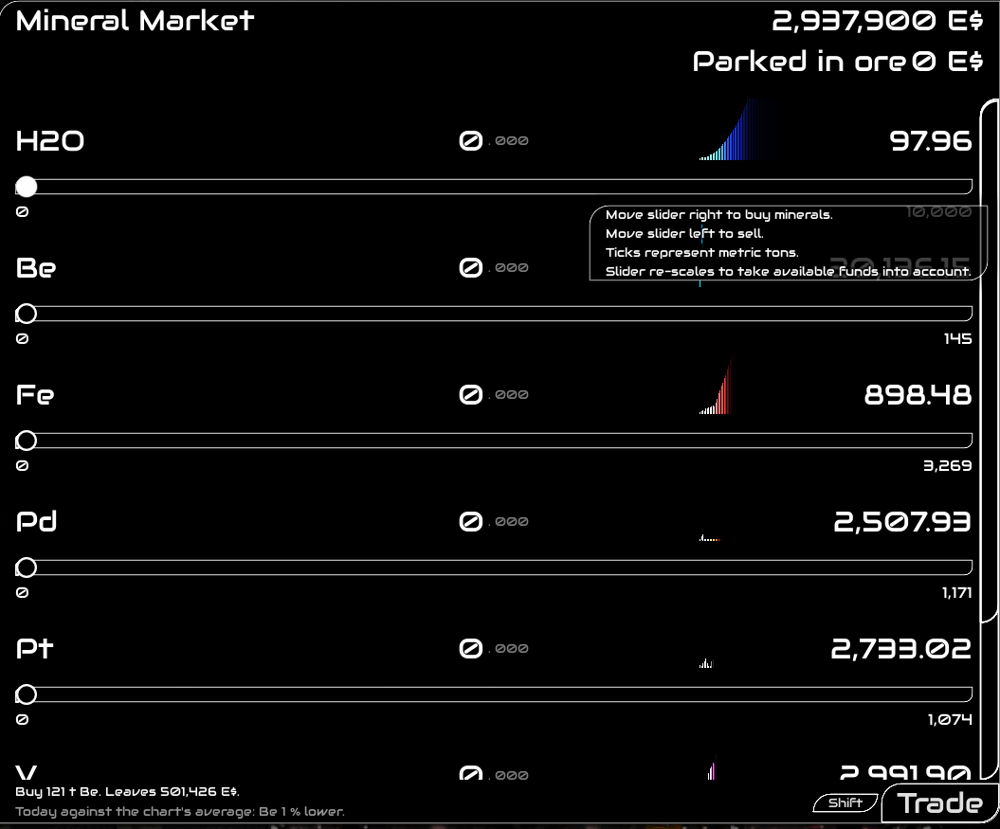
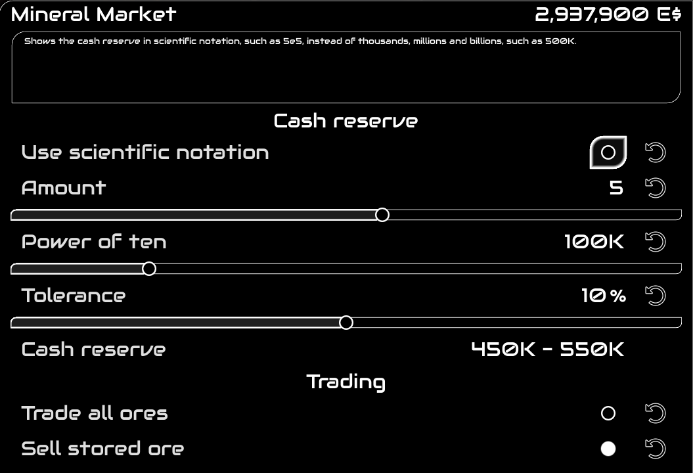

A Trade button at the Mineral Market keeps the cash you want at hand and puts the rest in ore, and the station menu
tells you when there is a trade to make.

## What changes

- **The Mineral Market.** Under the list of minerals, a new row tells you what to trade, compares today's prices with
  each price chart's average, and has a **Trade** button that makes those trades for you, at the day's prices, as if
  you moved the sliders yourself. You choose a **cash reserve**, the cash you want to keep at hand. When you have more,
  Trade buys ore with the rest; when you have less, it sells that ore back. Your cash ends up a little above the
  reserve, by less than the price of one tonne.
- **The tolerance.** You also choose how far your cash may stray from the reserve, above or below it. Inside that
  range, Trade leaves your cash alone, so a repair or a sale doesn't make it sell ore at a bad price, or buy ore at a
  high one, just to match the reserve. Once your cash leaves the range, Trade brings it back to the reserve.
- **Why ore.** At the market, buying and selling cost the same, with no fee, and every price keeps drifting back
  towards its average. So spare cash kept in ore bought below its average, and sold above it, earns money instead of
  sitting idle. The cash goes into Be, or into every mineral with *Trade all ores*: then into the ones furthest below
  their average, selling first the ones furthest above it.
- **The ore from your dives.** Trade also sells the ore you bring back, on the best day before your ship is ready. The
  mod remembers which tonnes Trade bought, so it never sells those as ore from a dive.
- **The best day.** While your ship is in maintenance (repairs and new equipment keep it at the station for a while),
  the advice may tell you to wait, and for which day: the chart forecasts a better price then. The forecast is the
  chart's, as good as your geologist makes it. With your ship ready, it trades now.
- **Parked in ore.** At the top of the screen, under your cash, a new line shows what the ore Trade bought would sell
  for today.
- **The station menu.** The **Mineral Market (\*)** entry tells you there is a trade to make now. The small badge
  beside the entry reminds you how to open the settings (see [Settings](#settings)).

| Without the mod | With the mod |
|---|---|
|  |  |
|  |  |

## Settings

Hold **Shift** and click the Mineral Market entry to open the settings (a plain click still opens the market). With a
gamepad, highlight the Mineral Market entry, hold **LT** and press **X**. The small badge beside the entry reminds you
how: it reads *Shift*, or *LT+X* while you play with a gamepad (the game's *Controls* setting at *Gamepad*, or at
*Auto* once you use the gamepad), and pointing at it, or highlighting the entry with a gamepad, tells you what to do.

The settings show where the market does, laid out like the Tuning screen: at the top, what the setting you have
selected does; below it, the settings in two groups. They close with Esc (B on a gamepad) or when you pick another
entry of the menu. A change applies at once. Each save game keeps its own settings.

- **Cash reserve**:
  - **Use scientific notation**: shows the cash reserve as, for example, 5e5 instead of 500K. Off at first.
  - **Amount** and **Power of ten**: the cash reserve is the amount, from 0 to 9, times the power of ten, from 10K to
    1B. They start at 5 and 100K. At an amount of 0, all your cash goes into ore.
  - **Tolerance**: how far your cash may stray from the cash reserve, above or below it, before Trade trades, from 0 to
    20 %. It starts at 10 %.
  - The **Cash reserve** line under them shows the range your cash may stay in: 450K - 550K with the settings as they
    start. At a tolerance of 0, it shows the cash reserve alone.
- **Trading**:
  - **Trade all ores**: keeps your cash in every mineral, not only Be. Off at first. Spread over more minerals, your
    trading moves each price less in the months after.
  - **Sell stored ore**: Trade also sells the ore you bring back from your dives. On at first. At the end of a dive,
    pick *Store Minerals* instead of *Sell all*, so the ore can wait for its best day.

## Works with other mods

It works with [CrewCheapHireNotifier](CrewCheapHireNotifier), [DealerNotifier](DealerNotifier),
[DiveSkipTransit](DiveSkipTransit) and [ServiceNotifier](ServiceNotifier), whose settings also open with Shift and a
click on their menu entries. ServiceNotifier marks the Services entry when a service you pick can be bought again.

## Install

See [Installing mods](Home#installing-mods).

<!-- wiki-values (checked by wiki.ps1)
game-checked: 1.93.1
MarketAdvisor/i18n/en.po MARKETADVISOR_ALERT = "%s (*)" -> Mineral Market (*) | images/MarketAdvisor-menu-with.png
MarketAdvisor/Badge.gd PAD_MODIFIER_NAME = "LT" -> LT
MarketAdvisor/Badge.gd PAD_BUTTON_NAME = "X" -> X
MarketAdvisor/i18n/en.po MARKETADVISOR_TRADE = "Trade" | images/MarketAdvisor-market-with.png
MarketAdvisor/i18n/en.po MARKETADVISOR_PARKED = "Parked in ore" | images/MarketAdvisor-market-with.png
MarketAdvisor/Settings.gd MAIN_MINERAL = "Be" -> Be
MarketAdvisor/Settings.gd SETTINGS.scientific.default = false -> Off at first
MarketAdvisor/i18n/en.po MARKETADVISOR_SCIENTIFIC = "Use scientific notation" | images/MarketAdvisor-settings.png
MarketAdvisor/i18n/en.po MARKETADVISOR_CASH_AMOUNT = "Amount" | images/MarketAdvisor-settings.png
MarketAdvisor/Settings.gd SETTINGS.cashAmount.default = 5
MarketAdvisor/Settings.gd SETTINGS.cashAmount.min = 0
MarketAdvisor/Settings.gd SETTINGS.cashAmount.max = 9
MarketAdvisor/i18n/en.po MARKETADVISOR_CASH_POWER = "Power of ten" | images/MarketAdvisor-settings.png
MarketAdvisor/Settings.gd SETTINGS.cashPower.default = 5 -> 100K
MarketAdvisor/Settings.gd SETTINGS.cashPower.min = 4 -> 10K
MarketAdvisor/Settings.gd SETTINGS.cashPower.max = 9 -> 1B
MarketAdvisor/i18n/en.po MARKETADVISOR_CASH_TOLERANCE = "Tolerance" | images/MarketAdvisor-settings.png
MarketAdvisor/Settings.gd SETTINGS.tolerance.default = 0.10 -> 10 % | images/MarketAdvisor-settings.png
MarketAdvisor/Settings.gd SETTINGS.tolerance.min = 0.0 -> 0
MarketAdvisor/Settings.gd SETTINGS.tolerance.max = 0.20 -> 20 %
MarketAdvisor/i18n/en.po MARKETADVISOR_CASH_TOTAL = "Cash reserve" | images/MarketAdvisor-settings.png
MarketAdvisor/i18n/en.po MARKETADVISOR_RANGE = "%s - %s" -> 450K - 550K | images/MarketAdvisor-settings.png
MarketAdvisor/i18n/en.po MARKETADVISOR_TRADE_ALL = "Trade all ores" | images/MarketAdvisor-settings.png
MarketAdvisor/Settings.gd SETTINGS.tradeAll.default = false -> Off at first
MarketAdvisor/i18n/en.po MARKETADVISOR_SELL_ORE = "Sell stored ore" | images/MarketAdvisor-settings.png
MarketAdvisor/Settings.gd SETTINGS.sellOre.default = true -> On at first
note: 500K and 5e5, the cash reserve from the defaults of Amount and Power of ten, in both notations: change them with those
note: 450K - 550K, the range from the defaults of Amount, Power of ten and Tolerance: change it with those
-->
