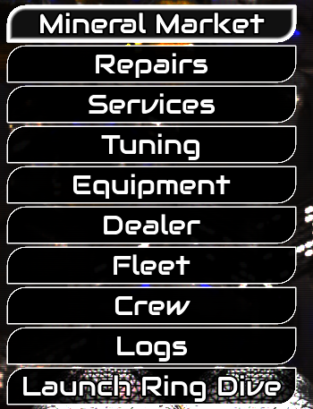
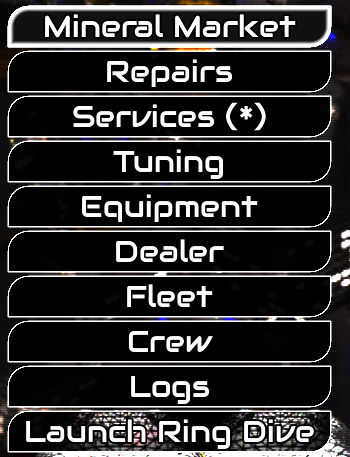
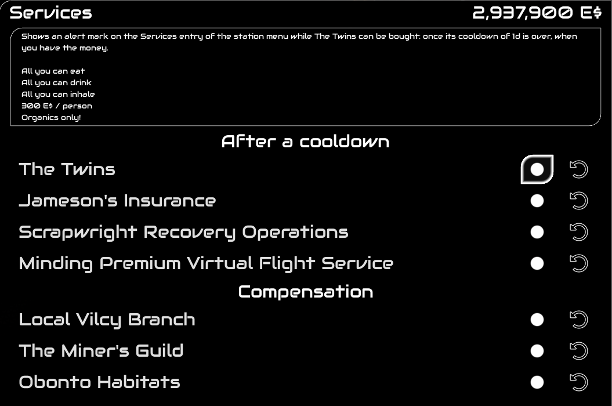

The station menu tells you when a service you pick can be bought again: The Twins once their day is over, a monthly
service once its month is up, or a side you can pay off.

## What changes

- **The station menu.** Without the mod, the menu's Services entry always reads *Services*. With the mod, it reads
  **Services (\*)** while one of the services you picked can be bought, so you don't have to open Services to check.
- **Which services.** Those you can't buy again right after buying them:
  - **After a cooldown**: The Twins, the bar that lifts your crew's morale, once a day; and once every 30 days
    Jameson's Insurance (more insurance, which pays for repairs before your money does), Scrapwright Recovery
    Operations (derelict ships brought to the rings for you to salvage) and Minding Premium Virtual Flight Service (the
    simulator's ring scenario). Each one marks the entry once it can be bought again, if you have the money.
  - **Compensation**: Local Vilcy Branch, The Miner's Guild and Obonto Habitats pay off the bounty hunters, the miners
    or Obonto while they are hostile to you, or afraid of you. Each one marks the entry while there is something to pay
    and you have the money. Once you pay, it costs nothing until you give them a new reason.
  - The hotels never mark it: you can stay at one again right away.
- **As the game decides.** When the mark is there, the Services screen lets you buy that service.

The mark updates when you arrive at the station, every in-game hour you spend there, and when your money or your crew
changes.

| Without the mod | With the mod |
|---|---|
|  |  |

## Settings

Hold **Shift** and click the Services entry to open the settings (a plain click still opens Services). They show
where Services does, laid out like the Tuning screen: at the top, what the switch you have selected does, followed by
the game's own offer for that service; below it, a switch for each service, in two groups, **After a cooldown** and
**Compensation**. Point at a switch to read *Mark Services when this service can be bought*. Every switch starts on.
The settings close with Esc or when you pick another entry of the menu. A change applies at once. Each save game keeps
its own settings.

## Works with other mods

It works with [CrewCheapHireNotifier](CrewCheapHireNotifier), [DealerNotifier](DealerNotifier),
[DiveSkipTransit](DiveSkipTransit) and [MarketAdvisor](MarketAdvisor), whose settings also open with Shift and a click
on their menu entries.

## Install

See [Installing mods](Home#installing-mods).

<!-- wiki-values (checked by wiki.ps1)
game-checked: 1.93.1
ServiceNotifier/i18n/en.po SERVICENOTIFIER_ALERT = "%s (*)" -> Services (*) | images/ServiceNotifier-menu-with.png
ServiceNotifier/Settings.gd SETTINGS.alert.default = true -> starts on
ServiceNotifier/i18n/en.po SERVICENOTIFIER_SWITCH = "Mark Services when this service can be bought"
ServiceNotifier/i18n/en.po SERVICENOTIFIER_GROUP_COOLDOWN = "After a cooldown" | images/ServiceNotifier-settings.png
ServiceNotifier/i18n/en.po SERVICENOTIFIER_GROUP_COMPENSATION = "Compensation" | images/ServiceNotifier-settings.png
game: once a day, The Twins' cooldown (enceladus/Services.tscn: SERVICE_BAR_TWINS, cooldownHours 24)
game: 30 days, the cooldown of Jameson's Insurance, Scrapwright Recovery Operations and Minding Premium Virtual Flight Service (enceladus/Services.tscn: cooldownHours 720)
-->
