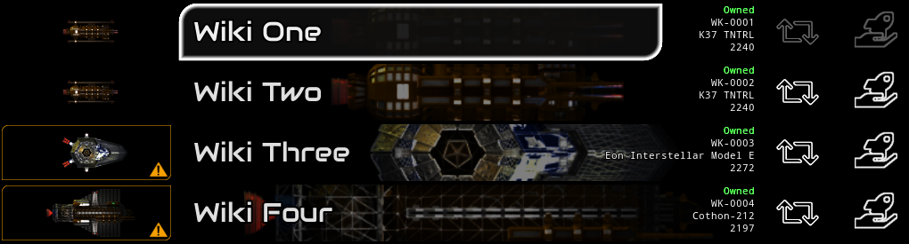
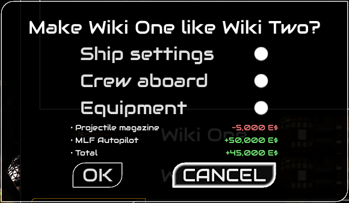

On the Fleet screen, makes the ship you fly like another ship of the same model: its settings, its crew aboard and its
equipment, as you choose.

## What changes

Repairs take hours. With two ships of the same model, you can switch to the spare and dive while the other one is
repaired. But each ship keeps its own equipment, Tuning, mineral targeting and crew, and setting the spare up again
by hand takes a while. This mod does it for you.

On the Fleet screen, right before *Switch ship*, your other ships get a **Copy** button (two sheets of paper). To use
it:

1. *Switch ship* to the spare.
2. Press **Copy** on the ship that is going in for repairs.
3. Pick what to copy in the window that opens, and press *OK*.

**Copy** only works on ships of exactly the same model as the one you fly. When it is greyed out, point at it to see
why. The ship you fly has no **Copy** button: there is nothing to copy onto itself.

**Without the mod:**

**With the mod:** Copy on the spare of the same model, and greyed out on the ships of other models.

The window asks to make the ship you fly like the other one, with a row for each part of the setup. Where the two
ships differ, the row has a switch, on when the window opens: switch off what you don't want copied. Where they are
already the same, the row says *Same*.

- **Ship settings:** the Tuning, the mineral targeting of the *Geologist* tab, and the mineral filters of the arm and
  the drone plants, all together.
- **Crew aboard:** who dives with the ship. A ship only remembers its crew once you have hired, fired or changed who
  dives while flying it. A ship that doesn't remember anyone has no crew, so copying its crew leaves nobody aboard.
  People you have fired since are left out.
- **Equipment:** each piece that differs is bought at the Equipment screen's price, minus what the old piece is worth.
  Under the row, each piece with its price, then the total: what you pay in red, with a minus sign, and money you get
  back (when the copied piece is cheaper) in green, with a plus sign. Replacing a damaged piece adds its repair time,
  as on the Equipment screen, which the list shows as *Repairs*. If you don't have enough money, *OK* says
  *Insufficient funds* and doesn't work, unless you switch the equipment off.

If the other ship has a piece the Equipment screen doesn't sell (one found on a salvaged ship, or one the story hasn't
unlocked yet), its equipment can't be copied: the row says *Incompatible equipment*, and the list shows only those
pieces, each marked *Not sold here*.

Never copied: the ship's name and registration, the damage of the pieces it keeps, repairs under way, the cargo, and
the propellant, ammunition and drone parts (those are topped up when you launch anyway).

## Works with other mods

It works with [ShipHighlightTypeAndPrice](ShipHighlightTypeAndPrice) and
[ShipSortByTypeAndPrice](ShipSortByTypeAndPrice). The Geologist tab settings it copies include those of
[GeologyByMass](GeologyByMass).

## Install

See [Installing mods](Home#installing-mods).

<!-- wiki-values (checked by wiki.ps1)
game-checked: 1.93.1
ShipCopyPaste/i18n/en.po SHIPCOPYPASTE_CONFIRM = "Make %s like %s?" | images/ShipCopyPaste-dialog.png
ShipCopyPaste/i18n/en.po SHIPCOPYPASTE_SETTINGS = "Ship settings" | images/ShipCopyPaste-dialog.png
ShipCopyPaste/i18n/en.po SHIPCOPYPASTE_CREW = "Crew aboard" | images/ShipCopyPaste-dialog.png
ShipCopyPaste/i18n/en.po SHIPCOPYPASTE_EQUIPMENT = "Equipment" | images/ShipCopyPaste-dialog.png
ShipCopyPaste/i18n/en.po SHIPCOPYPASTE_COST = "-%s E$" | images/ShipCopyPaste-dialog.png
ShipCopyPaste/i18n/en.po SHIPCOPYPASTE_GAIN = "+%s E$" | images/ShipCopyPaste-dialog.png
ShipCopyPaste/i18n/en.po SHIPCOPYPASTE_TOTAL = "Total" | images/ShipCopyPaste-dialog.png
ShipCopyPaste/i18n/en.po SHIPCOPYPASTE_SAME = "Same"
ShipCopyPaste/i18n/en.po SHIPCOPYPASTE_REPAIRS = "Repairs"
ShipCopyPaste/i18n/en.po SHIPCOPYPASTE_NO_MONEY = "Insufficient funds"
ShipCopyPaste/i18n/en.po SHIPCOPYPASTE_INCOMPATIBLE = "Incompatible equipment"
ShipCopyPaste/i18n/en.po SHIPCOPYPASTE_UNFIT = "Not sold here"
-->
