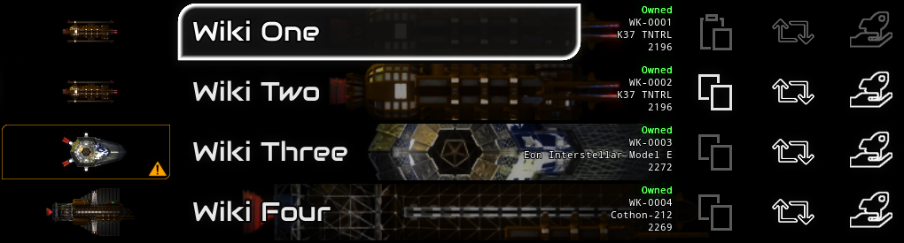

On the Fleet screen, copies one ship's setup onto the ship you fly, when both are the same model.

## What changes

Repairs take hours. With two ships of the same model, you can switch to the spare and dive while the other one is
repaired. But each ship keeps its own equipment, Tuning, mineral targeting and crew, and setting the spare up again
by hand takes a while. This mod does it for you.

On the Fleet screen, right before *Switch ship*, your other ships get a **Copy** button (two sheets of paper), and the
ship you fly gets a **Paste** button (a clipboard). To use them:

1. *Switch ship* to the spare.
2. Press **Copy** on the ship that is going in for repairs. Its button lights up.
3. Press **Paste** on the ship you fly now, the spare.
4. Check the list that opens, and press *OK*.

**Copy** only works on ships of exactly the same model as the one you fly. When a button is greyed out, point at it to
see why.

**Without the mod:**

**With the mod:** Paste on the ship you fly (greyed out until you copy a ship), Copy lit on the spare of the same
model, and greyed out on the ships of other models.

The list shows, side by side, what is *Copied* and what is *Not copied*:

- **Copied:** the equipment, the Tuning, the mineral targeting of the *Geologist* tab, the mineral filters of the arm
  and the drone plants, and the crew aboard. Each piece of equipment that differs is bought at the Equipment screen's
  price, minus what the old piece is worth; when the copied piece is cheaper, you get money back. Replacing a damaged
  piece adds its repair time, as on the Equipment screen. If you don't have enough money, the list says *Not enough
  money* and *OK* doesn't work.
- **Not copied:** the ship's name and registration, the damage of the pieces it keeps, repairs under way, the cargo,
  and the propellant, ammunition and drone parts (those are topped up when you launch anyway). A piece the Equipment
  screen doesn't sell stays as it is.

About the crew: a ship only remembers who goes aboard once you have hired, fired or changed who dives while flying it.
If the copied ship has no crew list yet, the crew stays as it is, and the list says so.

The copy is forgotten when you close the Fleet screen. Nothing is saved.

## Works with other mods

It works with [ShipHighlightTypeAndPrice](ShipHighlightTypeAndPrice) and
[ShipSortByTypeAndPrice](ShipSortByTypeAndPrice). The Geologist tab settings it copies include those of
[GeologyByMass](GeologyByMass).

## Install

See [Installing mods](Home#installing-mods).

<!-- wiki-values (checked by wiki.ps1)
game-checked: 1.93.1
ShipCopyPaste/i18n/en.po SHIPCOPYPASTE_CONFIRM = "Make %s like %s?" | images/ShipCopyPaste-dialog.png
ShipCopyPaste/i18n/en.po SHIPCOPYPASTE_COPIED = "Copied" | images/ShipCopyPaste-dialog.png
ShipCopyPaste/i18n/en.po SHIPCOPYPASTE_NOT_COPIED = "Not copied" | images/ShipCopyPaste-dialog.png
ShipCopyPaste/i18n/en.po SHIPCOPYPASTE_TUNING = "Tuning" | images/ShipCopyPaste-dialog.png
ShipCopyPaste/i18n/en.po SHIPCOPYPASTE_TARGETING = "Mineral targeting of the Geologist tab" | images/ShipCopyPaste-dialog.png
ShipCopyPaste/i18n/en.po SHIPCOPYPASTE_CREW = "Crew aboard: %s" | images/ShipCopyPaste-dialog.png
ShipCopyPaste/i18n/en.po SHIPCOPYPASTE_NAME = "Name and registration" | images/ShipCopyPaste-dialog.png
ShipCopyPaste/i18n/en.po SHIPCOPYPASTE_DAMAGE = "Damage of the pieces it keeps" | images/ShipCopyPaste-dialog.png
ShipCopyPaste/i18n/en.po SHIPCOPYPASTE_MAINTENANCE = "Repairs under way" | images/ShipCopyPaste-dialog.png
ShipCopyPaste/i18n/en.po SHIPCOPYPASTE_CARGO = "Cargo" | images/ShipCopyPaste-dialog.png
ShipCopyPaste/i18n/en.po SHIPCOPYPASTE_CONSUMABLES = "Propellant, ammunition and drone parts" | images/ShipCopyPaste-dialog.png
ShipCopyPaste/i18n/en.po SHIPCOPYPASTE_SAME = "Equipment: nothing to buy" | images/ShipCopyPaste-dialog.png
ShipCopyPaste/i18n/en.po SHIPCOPYPASTE_NO_MONEY = "Not enough money"
-->
