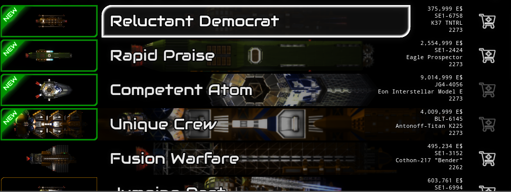
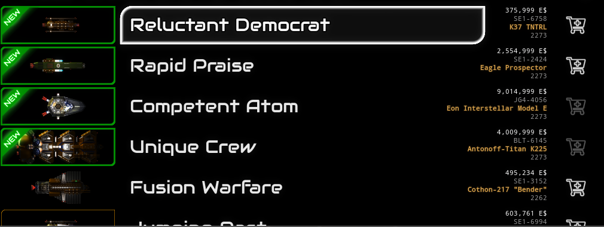
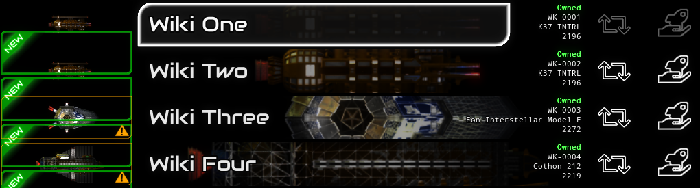
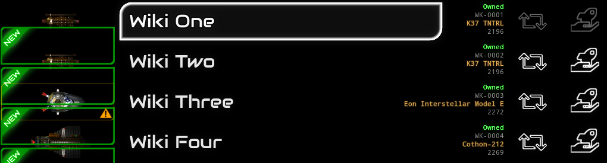

In the Dealer and Fleet lists, each ship's type stands out, so you can find the model you want at a glance.

## What changes

In the station's Dealer and Fleet lists, each ship's row shows:

- its **type** (such as K37 TNTRL) in bold amber;
- its name and price as before (despite the mod's name, the price doesn't change);
- its registration and year dimmed to grey, so the type is easy to spot.

The ship picture stretched behind each row is hidden, so the text is easier to read.

**The Dealer without the mod:**

**The Dealer with the mod:**

**The Fleet without the mod:**

**The Fleet with the mod:**

## Works with other mods

Together with [ShipSortByTypeAndPrice](ShipSortByTypeAndPrice), the Dealer's ships are grouped by type and the types
stand out. It also works with [ShipCopyPaste](ShipCopyPaste).

## Install

See [Installing mods](Home#installing-mods).

<!-- wiki-values (checked by wiki.ps1)
game-checked: 1.93.1
ShipHighlightTypeAndPrice/Code.gd TYPE_COLOR = Color(1.0, 0.75, 0.35) -> amber | images/ShipHighlightTypeAndPrice-dealer-with.png, images/ShipHighlightTypeAndPrice-fleet-with.png
ShipHighlightTypeAndPrice/Code.gd DIM_COLOR = Color(0.6, 0.6, 0.6) -> grey | images/ShipHighlightTypeAndPrice-dealer-with.png, images/ShipHighlightTypeAndPrice-fleet-with.png
-->
