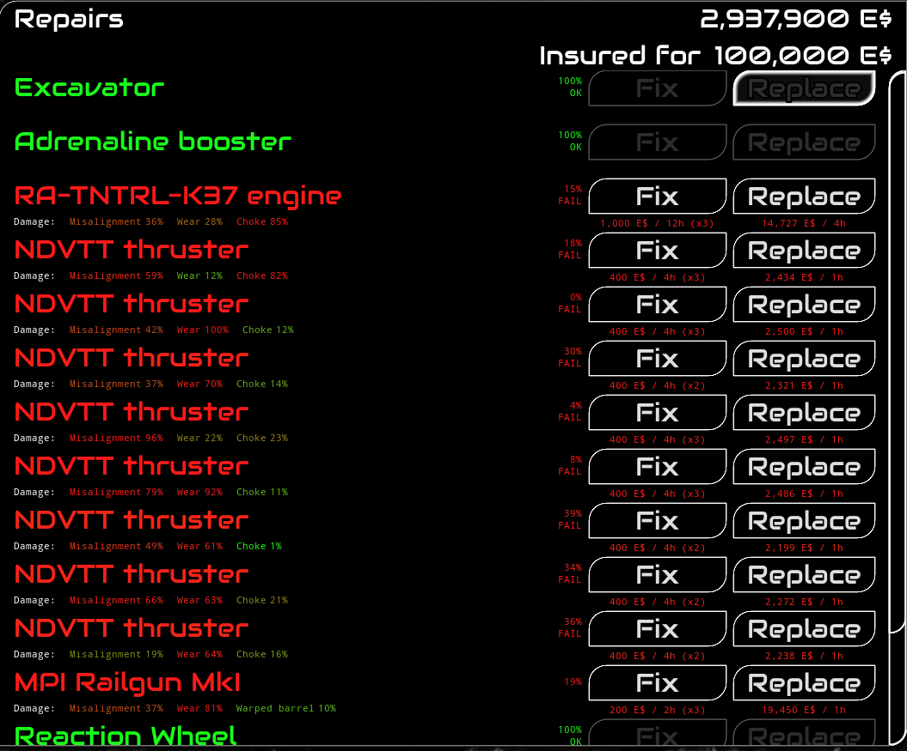
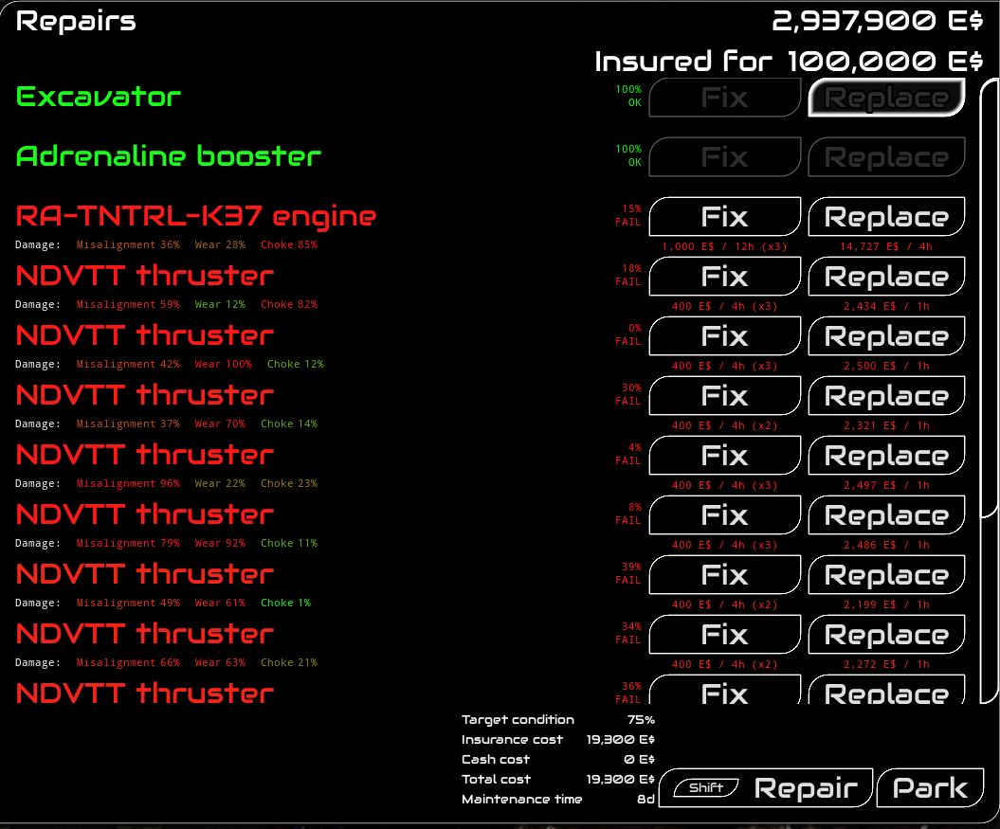
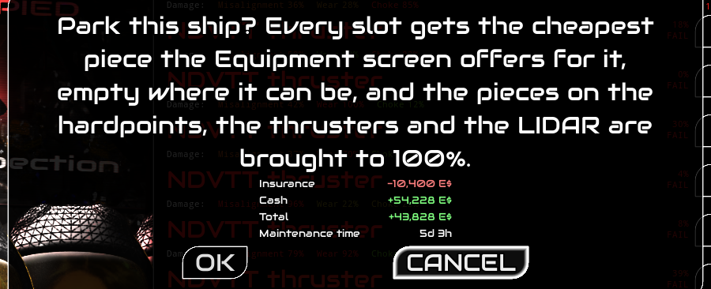
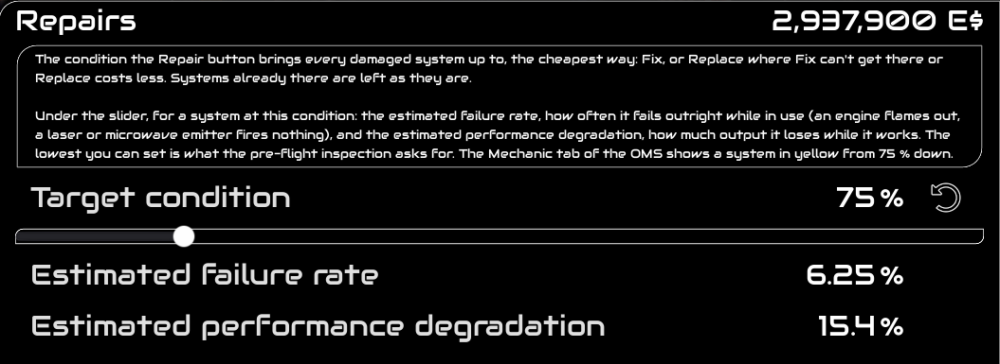

Repairs your ship the cheapest way with one button, and gets a ship ready to hold your cash with another.

## What changes

The Repairs screen gets a row at the bottom, with two buttons and a table beside them:

| Without the mod | With the mod |
|---|---|
|  |  |

Both buttons only do what you could do by hand, faster: they click the game's own *Fix* and *Replace* buttons of the
Repairs screen, and Park also the *Buy* buttons of the Equipment screen, and only while the game lets you click them.
So you pay the game's prices, your insurance pays first as usual, the Logs list every repair and purchase, and your
mechanics get their experience.

### Repair

**Repair** brings every damaged part of your ship up to the **target condition** you set (75 % to start with), the
cheapest way:

- Each *Fix* click halves a part's damage and costs its full fix price again, while *Replace* makes it new for its price
  less what it is still worth. So the cheapest way can be a few Fix clicks, or some Fix clicks and then Replace, and the
  mod works out which for every part.
- Your insurance counts as money: what it pays for one part can't pay for the next.
- A part that can't get there, because the Fix button stops working first, is fixed as far as Fix takes it.
- Parts already at the target are left as they are.

The table shows the target condition, then what Repair will cost (from your insurance, from your cash, both together)
and how many hours the repairs add to the ship's maintenance. It changes as soon as anything changes: your money, your
crew, the setting, a repair you do by hand. The cash cost turns red when it would leave you with less than nothing, as
Fix clicks can. Repair is greyed out when there is nothing to repair.

### Park

**Park** gets a ship ready to hold your cash. Buying expensive equipment for a ship that stays at the station keeps your
money safe, and the Equipment screen gives it back when you swap a part for another. For a part on a hardpoint (the
mounts for weapons, the arm and other equipment), a thruster or the LIDAR, it gives back what the part is worth, so all
of it only for a part in full condition. So before you use a ship that way, Park:

1. Fixes the damaged parts it is about to swap, where a Fix click adds more to what they are worth than it costs.
2. Swaps every part for the cheapest one the Equipment screen offers for it, or takes it off where the screen lets you
   leave the slot empty. The swaps that give money back come first.
3. Brings the parts on the hardpoints, the thrusters and the LIDAR to 100 %. A swap gives them a new part, and the ones
   it keeps are repaired.

Park leaves every other part as it is (the reactor, the turbine, the cargo processing unit, the HUD, …): the Equipment
screen gives them back at their full price whatever their condition, or never swaps them, so repairing them would only
spend the cash you want to keep.

The Repairs screen never fixes or replaces a part at 99.5 % or more. Park still brings a part on a hardpoint, a thruster
or the LIDAR from there to 100 %, by swapping it for another part and back.

Park first asks you to confirm:

- **Insurance**, **Cash** and **Total**: money coming in has a + and is green, money going out has a - and is red, as
  the Fleet screen shows a trade-in. Swaps that give money back can make the total positive.
- **Maintenance time**: how long the swaps and repairs keep the ship at the station.
- If you don't have enough money for every step, a line says how much more you need, and OK is greyed out: Park does
  everything or nothing.
- If a part on a hardpoint, a thruster or the LIDAR can't be brought to 100 % by any button of the game (at 99.5 % or
  more, with no other part to swap it for and back), a line names it. OK still works, and Park does all the rest.

CANCEL, or Esc, closes the question and leaves the Repairs screen open.

## Settings

Hold **Shift** and click the **Repair** button to open the settings. This works even when the button is greyed out,
and it never repairs. With a gamepad, highlight the Repair button (press down from the last part), hold **LT** and press
**X**. The small badge inside the button, on its left, reminds you how: it reads *Shift*, or *LT+X* while you play with
a gamepad (the game's *Controls* setting at *Gamepad*, or at *Auto* once you use the gamepad), and pointing at it, or
highlighting the button with a gamepad, tells you what to do.

The settings show in the Repairs screen's place, laid out like the Tuning screen: at the top, what the setting does.
Esc (B on a gamepad) closes them and brings the Repairs screen back; picking another entry of the menu closes them too.
A change applies at once. Each save game keeps its own settings.

- **Target condition**: the condition Repair brings every damaged part up to. From 70 % to 100 %, in steps of 1 %. It
  starts at 75 %, where the OMS Mechanic tab starts showing a part in yellow. The lowest is what the pre-flight
  inspection asks of every part.

  Under it, two estimates for a part at that condition: the **estimated failure rate**, how often it fails outright
  while in use (an engine flames out, a laser or microwave emitter fires nothing), and the **estimated performance
  degradation**, how much of its output it loses while it works.

## Install

See [Installing mods](Home#installing-mods).

<!-- wiki-values (checked by wiki.ps1)
game-checked: 1.93.1
game: 99.5 %, the condition from which the Repairs screen offers neither Fix nor Replace (enceladus/SystemShipRepairUI.gd isReplaceable; CurrentGame.gd getRepairLimit is at most 99.5)
game: 75 %, where the OMS Mechanic tab shows a system in yellow (hud/SystemList.gd warnLevel)
ShipRepairAdvisor/Code.gd _SRA_PARK_TARGET = 100.0 -> 100 % | images/ShipRepairAdvisor-park.png
ShipRepairAdvisor/i18n/en.po SHIPREPAIRADVISOR_REPAIR = "Repair" | images/ShipRepairAdvisor-repairs-with.png
ShipRepairAdvisor/i18n/en.po SHIPREPAIRADVISOR_PARK = "Park" | images/ShipRepairAdvisor-repairs-with.png
ShipRepairAdvisor/i18n/en.po SHIPREPAIRADVISOR_PERCENT = "%s%%" | images/ShipRepairAdvisor-repairs-with.png
ShipRepairAdvisor/i18n/en.po SHIPREPAIRADVISOR_INSURANCE_COST = "Insurance cost" | images/ShipRepairAdvisor-repairs-with.png
ShipRepairAdvisor/i18n/en.po SHIPREPAIRADVISOR_CASH_COST = "Cash cost" | images/ShipRepairAdvisor-repairs-with.png
ShipRepairAdvisor/i18n/en.po SHIPREPAIRADVISOR_TOTAL_COST = "Total cost" | images/ShipRepairAdvisor-repairs-with.png
ShipRepairAdvisor/i18n/en.po SHIPREPAIRADVISOR_TIME = "Maintenance time" | images/ShipRepairAdvisor-repairs-with.png, images/ShipRepairAdvisor-park.png
ShipRepairAdvisor/i18n/en.po SHIPREPAIRADVISOR_MONEY = "%s E$" | images/ShipRepairAdvisor-repairs-with.png
ShipRepairAdvisor/i18n/en.po SHIPREPAIRADVISOR_PARK_CONFIRM = "Park this ship? Every slot gets the cheapest piece the Equipment screen offers for it, empty where it can be, and the pieces on the hardpoints, the thrusters and the LIDAR are brought to %s." | images/ShipRepairAdvisor-park.png
ShipRepairAdvisor/i18n/en.po SHIPREPAIRADVISOR_INSURANCE = "Insurance" | images/ShipRepairAdvisor-park.png
ShipRepairAdvisor/i18n/en.po SHIPREPAIRADVISOR_CASH = "Cash" | images/ShipRepairAdvisor-park.png
ShipRepairAdvisor/i18n/en.po SHIPREPAIRADVISOR_TOTAL = "Total" | images/ShipRepairAdvisor-park.png
ShipRepairAdvisor/i18n/en.po SHIPREPAIRADVISOR_PLUS = "+%s E$" | images/ShipRepairAdvisor-park.png
ShipRepairAdvisor/i18n/en.po SHIPREPAIRADVISOR_MINUS = "-%s E$" | images/ShipRepairAdvisor-park.png
ShipRepairAdvisor/Badge.gd PAD_MODIFIER_NAME = "LT" -> LT
ShipRepairAdvisor/Badge.gd PAD_BUTTON_NAME = "X" -> X
ShipRepairAdvisor/i18n/en.po SHIPREPAIRADVISOR_TARGET = "Target condition" | images/ShipRepairAdvisor-repairs-with.png, images/ShipRepairAdvisor-settings.png
ShipRepairAdvisor/i18n/en.po SHIPREPAIRADVISOR_TARGET_DESC = "The condition the Repair button brings every damaged system up to, the cheapest way: Fix, or Replace where Fix can't get there or Replace costs less. Systems already there are left as they are.\n\nUnder the slider, for a system at this condition: the estimated failure rate, how often it fails outright while in use (an engine flames out, a laser or microwave emitter fires nothing), and the estimated performance degradation, how much output it loses while it works. The lowest you can set is what the pre-flight inspection asks for. The Mechanic tab of the OMS shows a system in yellow from 75 % down." | images/ShipRepairAdvisor-settings.png
ShipRepairAdvisor/i18n/en.po SHIPREPAIRADVISOR_FAILURE_RATE = "Estimated failure rate" | images/ShipRepairAdvisor-settings.png
ShipRepairAdvisor/i18n/en.po SHIPREPAIRADVISOR_PERFORMANCE_LOSS = "Estimated performance degradation" | images/ShipRepairAdvisor-settings.png
note: 6.25 % and 15.4 %, the estimates the settings picture shows at the default target, from Settings.gd failureRate and performanceLoss (their constants below and ESTIMATE_LOSS_LINEAR, a fraction): re-take it when they change
ShipRepairAdvisor/Settings.gd ESTIMATE_LOSS_SQUARE = 0.47 | images/ShipRepairAdvisor-settings.png
ShipRepairAdvisor/Settings.gd FAILURE_DECIMALS = 2 | images/ShipRepairAdvisor-settings.png
ShipRepairAdvisor/Settings.gd LOSS_DECIMALS = 1 | images/ShipRepairAdvisor-settings.png
ShipRepairAdvisor/Settings.gd SETTINGS.target.default = 75 -> 75 % | images/ShipRepairAdvisor-repairs-with.png, images/ShipRepairAdvisor-settings.png
ShipRepairAdvisor/Settings.gd SETTINGS.target.min = 70 -> 70 %
ShipRepairAdvisor/Settings.gd SETTINGS.target.max = 100 -> 100 %
ShipRepairAdvisor/Settings.gd SETTINGS.target.step = 1 -> 1 %
-->
