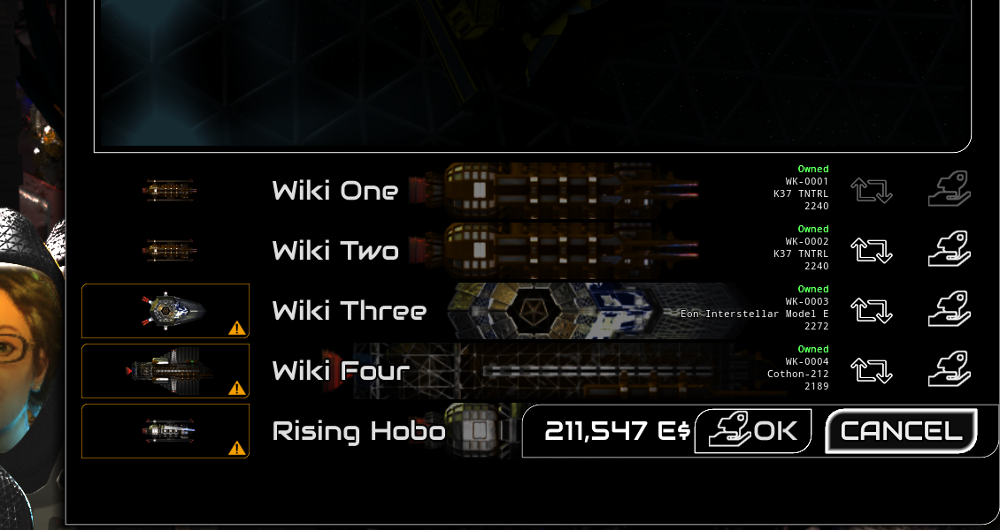
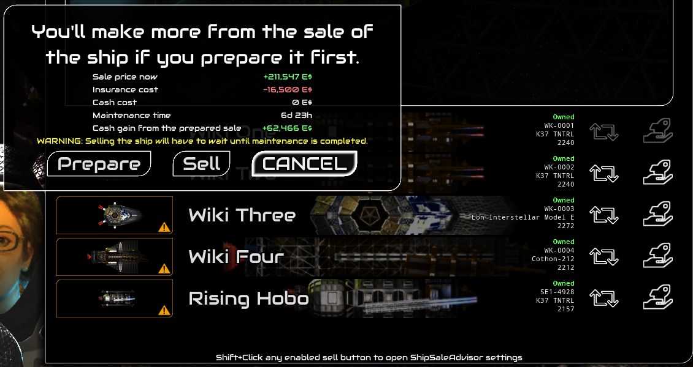
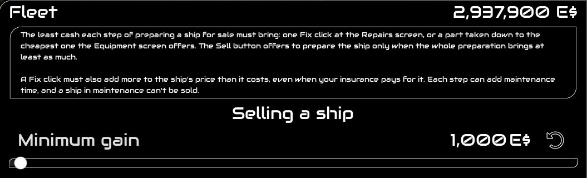

When you sell a ship at the Fleet screen, tells you if getting it ready first would bring you more cash, and gets it
ready for you.

## What changes

Selling a ship at the Fleet screen pays 90 % of what it is worth. But the Equipment screen gives you back the full
worth of a part when you swap it for a cheaper one, and fixing a damaged part at the Repairs screen makes it worth
more, sometimes by more than the fix costs. So a ship can bring more cash if you get it ready before selling it:
switch to it, swap its parts for the cheapest ones, fix what is worth fixing, switch back and sell. This mod works all
of that out when you press the sell button (*Sell this ship*, the hand holding a ship), and does it for you.

When getting the ship ready brings more cash, the sell button opens a window instead of the game's question:

| Without the mod | With the mod |
|---|---|
|  |  |

- **Sale price now**: what selling the ship as it is pays.
- **Insurance cost** and **Cash cost**: what the fixes cost. Your insurance pays first, as at the Repairs screen, and
  the rest comes out of your cash.
- **Maintenance time**: how long the fixes and swaps keep the ship at the station.
- **Cash gain from the prepared sale**: how much more cash you end up with. That's the money the swaps give back, plus
  the higher sale price, less the cash cost. What your insurance pays doesn't count here: it isn't cash.
- The **warning** at the bottom shows when getting ready takes time: a ship in maintenance can't be sold until it's
  done.

The buttons:

- **Prepare** gets the ship ready, as if you did it yourself at the Equipment and Repairs screens: you pay for the
  fixes and get money back for the swaps, the Logs list each one, and your mechanics get their experience. It doesn't
  sell the ship. Come back once its maintenance is done, and the sell button shows the game's question, with the
  higher price. If anything changed while the window was open, Prepare shows the new figures first, and gets the ship
  ready on the next press.
- **Sell** sells the ship as it is.
- **Cancel**, or Esc, closes the window and leaves the Fleet screen open.

How the mod decides:

- A part is swapped for the cheapest one the Equipment screen offers for that ship when that gives money back. A
  damaged part worth less than the cheapest one stays.
- A part is fixed one *Fix* click at a time, as you'd click *Fix* at the Repairs screen: each click halves its damage,
  and costs the full fix price again. A click is only made when it adds more to the ship's price than it costs, even
  when your insurance would pay for it. Fixing a part can make it worth swapping, and the mod works that out too.
- Parts are never replaced at the Repairs screen: a new part adds to the ship's worth exactly what it costs, and the
  sale pays back only 90 % of that.
- Each click and each swap must bring at least the **minimum gain** in cash, and so must the whole preparation.
  Otherwise the sell button shows the game's question, as usual.

It only works on ships you can sell: not the one you fly, nor one in maintenance (the game greys out their sell
buttons). The mod doesn't switch ships to get one ready, so the ship you fly and the crew aboard stay as they are.

## Settings

Hold **Shift** and click any sell button that isn't greyed out to open the settings. This never sells the ship. With a
gamepad, highlight a sell button, hold **LT** and press **X**. A note at the bottom of the Fleet screen reminds you
how: it changes to the gamepad's buttons while you play with a gamepad (the game's *Controls* setting at *Gamepad*, or
at *Auto* once you use the gamepad).

The settings show in the Fleet screen's place, laid out like the Tuning screen: at the top, what the setting does.
Esc (B on a gamepad) closes them and brings the Fleet screen back; picking another entry of the menu closes them too.
A change applies at once. Each save game keeps its own settings.

- **Minimum gain**: the least cash each Fix click and each swap must bring, and the whole preparation, for the sell
  button to offer it. From 0 to 100,000 E$, in steps of 500 E$. It starts at 1,000 E$. At 0, any gain counts.

## Works with other mods

It works with [ShipCopyPaste](ShipCopyPaste), which also adds to the Fleet screen's ships, and with
[ShipHighlightTypeAndPrice](ShipHighlightTypeAndPrice) and [ShipSortByTypeAndPrice](ShipSortByTypeAndPrice).

## Install

See [Installing mods](Home#installing-mods).

<!-- wiki-values (checked by wiki.ps1)
game-checked: 1.93.1
game: 90 %, the share of a ship's worth that selling it at the Fleet screen pays (CurrentGame.gd shipSellMarkdown)
ShipSaleAdvisor/i18n/en.po SHIPSALEADVISOR_INTRO = "You'll make more from the sale of the ship if you prepare it first." | images/ShipSaleAdvisor-sell-with.png
ShipSaleAdvisor/i18n/en.po SHIPSALEADVISOR_SALE_NOW = "Sale price now" | images/ShipSaleAdvisor-sell-with.png
ShipSaleAdvisor/i18n/en.po SHIPSALEADVISOR_INSURANCE_COST = "Insurance cost" | images/ShipSaleAdvisor-sell-with.png
ShipSaleAdvisor/i18n/en.po SHIPSALEADVISOR_CASH_COST = "Cash cost" | images/ShipSaleAdvisor-sell-with.png
ShipSaleAdvisor/i18n/en.po SHIPSALEADVISOR_TIME = "Maintenance time" | images/ShipSaleAdvisor-sell-with.png
ShipSaleAdvisor/i18n/en.po SHIPSALEADVISOR_GAIN = "Cash gain from the prepared sale" | images/ShipSaleAdvisor-sell-with.png
ShipSaleAdvisor/i18n/en.po SHIPSALEADVISOR_WARNING = "WARNING: Selling the ship will have to wait until maintenance is completed." | images/ShipSaleAdvisor-sell-with.png
ShipSaleAdvisor/i18n/en.po SHIPSALEADVISOR_PREPARE = "Prepare" | images/ShipSaleAdvisor-sell-with.png
ShipSaleAdvisor/i18n/en.po SHIPSALEADVISOR_SELL = "Sell" | images/ShipSaleAdvisor-sell-with.png
ShipSaleAdvisor/i18n/en.po SHIPSALEADVISOR_PLUS = "+%s E$" | images/ShipSaleAdvisor-sell-with.png
ShipSaleAdvisor/i18n/en.po SHIPSALEADVISOR_MINUS = "-%s E$" | images/ShipSaleAdvisor-sell-with.png
ShipSaleAdvisor/i18n/en.po SHIPSALEADVISOR_ZERO = "%s E$" | images/ShipSaleAdvisor-sell-with.png
ShipSaleAdvisor/i18n/en.po SHIPSALEADVISOR_NOTE = "%s+Click any enabled sell button to open %s settings" | images/ShipSaleAdvisor-sell-with.png
ShipSaleAdvisor/Badge.gd PAD_MODIFIER_NAME = "LT" -> LT
ShipSaleAdvisor/Badge.gd PAD_BUTTON_NAME = "X" -> X
ShipSaleAdvisor/i18n/en.po SHIPSALEADVISOR_GROUP_SALE = "Selling a ship" | images/ShipSaleAdvisor-settings.png
ShipSaleAdvisor/i18n/en.po SHIPSALEADVISOR_MIN_GAIN = "Minimum gain" | images/ShipSaleAdvisor-settings.png
ShipSaleAdvisor/i18n/en.po SHIPSALEADVISOR_MIN_GAIN_DESC = "The least cash each step of preparing a ship for sale must bring: one Fix click at the Repairs screen, or a part taken down to the cheapest one the Equipment screen offers. The Sell button offers to prepare the ship only when the whole preparation brings at least as much.\n\nA Fix click must also add more to the ship's price than it costs, even when your insurance pays for it. Each step can add maintenance time, and a ship in maintenance can't be sold." | images/ShipSaleAdvisor-settings.png
ShipSaleAdvisor/Settings.gd SETTINGS.minGain.default = 1000 -> 1,000 E$ | images/ShipSaleAdvisor-settings.png
ShipSaleAdvisor/Settings.gd SETTINGS.minGain.min = 0 -> 0
ShipSaleAdvisor/Settings.gd SETTINGS.minGain.max = 100000 -> 100,000 E$
ShipSaleAdvisor/Settings.gd SETTINGS.minGain.step = 500 -> 500 E$
-->
