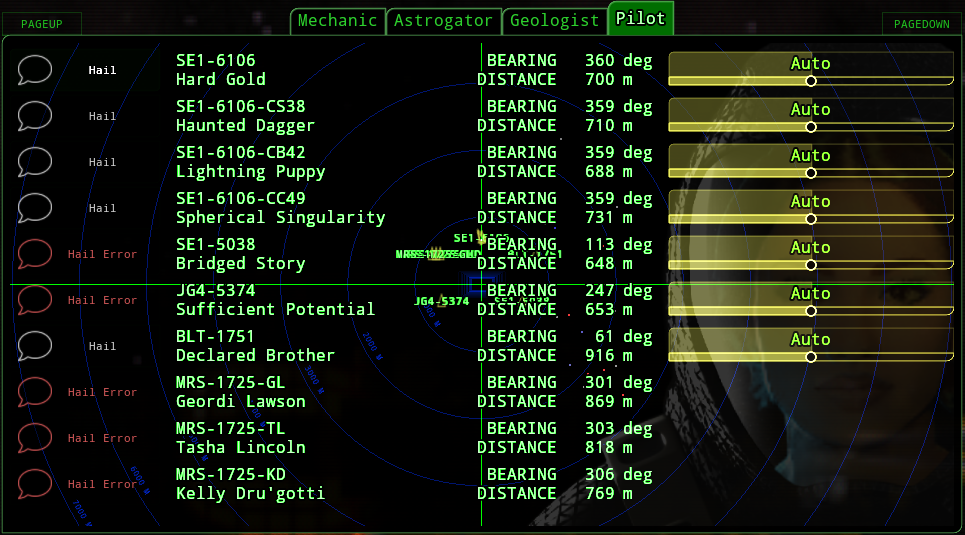
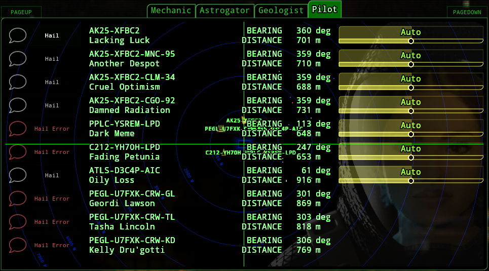

New transponder codes tell you what you are looking at: the model of a ship, and which ship a drone or anything else
belongs to.

## What changes

Every ship and many objects in the rings broadcast a transponder code: you see it under each ship at the Dealer and in
your Fleet, next to ships on the HUD and the LIDAR, in the Pilot tab of the Onboard Maintenance System, and when
someone calls you.

Without the mod, a code is a place of registry and four digits picked at random, like MRS-3127. Two codes tell you
nothing about the ships that carry them.

With the mod, a new ship's code starts with its model, then a serial of 5 letters and digits, enough for every ship of
a model: a Cothon-212 is C212-7KX2M, a K37 TNTRL is TK37-4HV9R. A serial never has I, O or Q, which are easy to take
for digits. A ship always gets the same code: the Dealer's ships keep theirs from day to day. Every model has its own
code, all of the same length. These are the ships the Dealer sells:

| Ship | Code | | Ship | Code |
|---|---|---|---|---|
| K37 TNTRL | TK37 | | Cothon-212 | C212 |
| KX37 TNTRL | TX37 | | Cothon-211 "Chonker" | C211 |
| Runasimi KR37 TNTRL | TR37 | | Cothon-213 "Triplet" | C213 |
| KTA24 TNTRL | TA24 | | Cothon-217 "Bender" | C217 |
| Eagle Prospector | PEGL | | Antonoff-Titan K225 | AK25 |
| Vulture Prospector | PVUL | | Antonoff-Titan K225-BB | AB25 |
| Peacock Prospector | PPCK | | Eon Interstellar Model E | EIME |
| Pelican Prospector | PPLC | | OCP-209 | O209 |
| | | | ND-LIS Kitsune | NKTS |

<b>SPOILER ALERT</b>: ships the Dealer doesn't sell (click to show)

| Ship | Code | | Ship | Code |
|---|---|---|---|---|
| K44 MHFTR Prototype | MK44 | | The hybrid hunter | HYBR |
| Bald Eagle | PBLD | | Tsukuyomi | TSKY |
| Antonoff-Titan K225 (modified) | AR25 | | Racing drone | RDRN |
| MAD-CERF (the rescue ship) | MCRF | | ATLAS drone | ATLS |
| | | | Obonto habitat | OBNT |

Things that belong to a ship add a word of their own to its code:

- **Drones your ship launches:** each gets your ship's code, a word for what it is and a number, like TK37-4HV9R-CGO-42.
  CGO is a THI Cargo Container or Monocargo Container, MNC the NT Mining Companion, CLM a B8 Claim Beacon. Other
  ships' drones, and the claim beacons you come across, are coded the same way.

<b>SPOILER ALERT</b>: things you can't buy at the station (click to show)

- **Lifepods.** When a ship explodes and leaves a lifepod, the pod broadcasts the ship's code with -LPD at the end, so
  C212-7KX2M leaves C212-7KX2M-LPD. It keeps the ship's name, as without the mod. A lifepod you find floating on its own
  gets the code of a ship like the ones the Dealer sells, with -LPD.
- **The AI core** an ATLAS drone leaves behind: the drone's code with -AIC.
- **Frozen bodies.** The bodies you find floating together share the code of a lost ship with -CRW (crew): their beacon
  broadcasts it as it is, and each body adds its initials, like C212-7KX2M-CRW-AB. The bodies around the destroyed
  habitat have the habitat's code with -CRW.

The Pilot tab of the Onboard Maintenance System lists what your ship has identified around it, with each one's code
under its name. Here it lists an Antonoff-Titan K225 with its three drones out, two lifepods, an AI core and three
frozen bodies, in the same place without and with the mod.

<b>SPOILER ALERT</b>: the Pilot tab with one of each (click to show)

**Without the mod:**

**With the mod:**

What stays as it is:

- Ships that already have a code keep it: your ships, the ships you sold, and the ships the game remembers meeting.
  The game makes a ship's name and its captain's name from its code, so a new code would rename them.
- But some ships you meet again and again, and in a save from before you installed the mod they still have the game's
  code: the miners in the rings, and some of the derelicts you come across. The next time you meet one of those, it
  gets a code of its model instead, once. It keeps its name and what it thinks of you, but its captain gets a new name.

<b>SPOILER ALERT</b>: things you can't buy at the station (click to show)

- The rescue ship, the racer and its drone in the ring races, the ATLAS drone and Vilcy's ships come back again and
  again too, and get a code of their model the same way.
- Stations, habitats and beacons keep their codes, since the crew and the people you talk to mention some of them by
  name. So does the Big Bad Wolf.
- Pirates still turn their transponders off.

If you remove the mod, your save loads as before. Ships that already have a code keep it, with their names: your
ships, the ships you sold and the ships the game remembers meeting. New codes are the game's again, so for a while
your lists mix both kinds. Your drones go back to the game's ending after your ship's code, like C212-7KX2M-CC42.
Putting the mod back doesn't change the codes it gave before.

## Changes how the game plays

You can tell what a ship is before you see it. Its code shows on the LIDAR as soon as the LIDAR picks it up, and in the
Pilot tab with its bearing and distance, so you know whether that blip far away is a little K37 TNTRL or an
Antonoff-Titan. Without the mod the code tells you nothing until the ship is in sight.

<b>SPOILER ALERT</b>: things you can't buy at the station (click to show)

Pirates still show no code.

If ship identification, the LIDAR or the Pilot tab does something wrong, try again without the mod before you report a
bug to the game's developers.

## Works with other mods

It works with [CombatSimulator](CombatSimulator): both can be installed together.

## Install

See [Installing mods](Home#installing-mods).

<!-- wiki-values (checked by wiki.ps1)
game-checked: 1.93.1
game: four digits picked at random after a place of registry, like MRS-3127 (CurrentGame.gd getNewTransponder)
TransponderAltCodes/Code.gd MODEL_CODES.TRTL = "TK37" -> TK37
TransponderAltCodes/Code.gd MODEL_CODES.TRTL-LCB = "TX37" -> TX37
TransponderAltCodes/Code.gd MODEL_CODES.TRTL-R = "TR37" -> TR37
TransponderAltCodes/Code.gd MODEL_CODES.TRTL-T = "TA24" -> TA24
TransponderAltCodes/Code.gd MODEL_CODES.TRTL-44 = "MK44" -> MK44
TransponderAltCodes/Code.gd MODEL_CODES.PROSPECTOR = "PEGL" -> PEGL | images/TransponderAltCodes-pilot-with.png
TransponderAltCodes/Code.gd MODEL_CODES.PROSPECTOR-VP = "PVUL" -> PVUL
TransponderAltCodes/Code.gd MODEL_CODES.PROSPECTOR-LUX = "PPCK" -> PPCK
TransponderAltCodes/Code.gd MODEL_CODES.PROSPECTOR-FAT = "PPLC" -> PPLC | images/TransponderAltCodes-pilot-with.png
TransponderAltCodes/Code.gd MODEL_CODES.PROSPECTOR-BALD = "PBLD" -> PBLD
TransponderAltCodes/Code.gd MODEL_CODES.COTHON = "C212" -> C212 | images/TransponderAltCodes-pilot-with.png
TransponderAltCodes/Code.gd MODEL_CODES.COTHON-CHK = "C211" -> C211
TransponderAltCodes/Code.gd MODEL_CODES.COTHON-LND = "C213" -> C213
TransponderAltCodes/Code.gd MODEL_CODES.COTHON-V = "C217" -> C217
TransponderAltCodes/Code.gd MODEL_CODES.AT225 = "AK25" -> AK25 | images/TransponderAltCodes-pilot-with.png
TransponderAltCodes/Code.gd MODEL_CODES.AT225-R = "AR25" -> AR25
TransponderAltCodes/Code.gd MODEL_CODES.AT225-B = "AB25" -> AB25
TransponderAltCodes/Code.gd MODEL_CODES.EIME = "EIME" -> EIME
TransponderAltCodes/Code.gd MODEL_CODES.OCP209 = "O209" -> O209
TransponderAltCodes/Code.gd MODEL_CODES.KITSUNE = "NKTS" -> NKTS
TransponderAltCodes/Code.gd MODEL_CODES.MADCERF = "MCRF" -> MCRF
TransponderAltCodes/Code.gd MODEL_CODES.HYBRID = "HYBR" -> HYBR
TransponderAltCodes/Code.gd MODEL_CODES.TSUKUYOMI = "TSKY" -> TSKY
TransponderAltCodes/Code.gd MODEL_CODES.DRONE = "RDRN" -> RDRN
TransponderAltCodes/Code.gd MODEL_CODES.ATLAS = "ATLS" -> ATLS | images/TransponderAltCodes-pilot-with.png
TransponderAltCodes/Code.gd MODEL_CODES.OBONTO = "OBNT" -> OBNT
TransponderAltCodes/Code.gd SERIAL_LENGTH = 5 -> 5 | images/TransponderAltCodes-pilot-with.png
TransponderAltCodes/Code.gd SERIAL_CHARS = "0123456789ABCDEFGHJKLMNPRSTUVWXYZ" -> I, O or Q
TransponderAltCodes/Code.gd LIFEPOD_SUFFIX = "-LPD" -> -LPD | images/TransponderAltCodes-pilot-with.png
TransponderAltCodes/Code.gd AI_CORE_SUFFIX = "-AIC" -> -AIC | images/TransponderAltCodes-pilot-with.png
TransponderAltCodes/Code.gd CREW_SUFFIX = "-CRW" -> -CRW | images/TransponderAltCodes-pilot-with.png
TransponderAltCodes/Code.gd DRONE_CODES.CC = "CGO" -> CGO | images/TransponderAltCodes-pilot-with.png
TransponderAltCodes/Code.gd DRONE_CODES.CS = "MNC" -> MNC | images/TransponderAltCodes-pilot-with.png
TransponderAltCodes/Code.gd DRONE_CODES.CB = "CLM" -> CLM | images/TransponderAltCodes-pilot-with.png
-->
