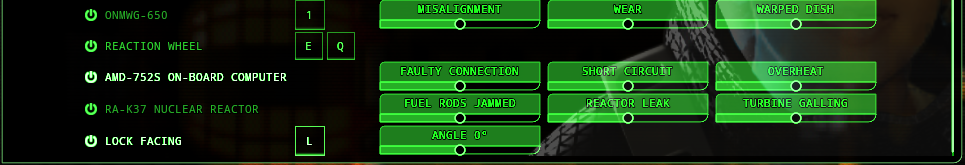

Your ship's turrets can face where their hardpoints point, at an angle you set, and fire only when you pull the
trigger.

## What changes

A turret, such as the ONMWG-650, turns by itself to aim at a target it picks: a hostile ship or a rock. That makes it
nearly impossible to aim at the target you want. Without the mod, the ONMWG-650 also fires by itself.

With the mod, while your ship has a turret, the *Mechanic* tab of the Onboard Maintenance System (press **J**) ends
with a **LOCK FACING** row. Switch it on, or press **L** in flight, and each turret turns to face where a fixed weapon
on its hardpoint would point, most often straight ahead, and keeps facing that way as your ship turns. It then fires
only while you hold the trigger, so your shots go where you point the ship. Switch it off, or press **L** again, and
your turrets pick their own targets again.

The AEMD-14 mass driver and the CL-200AP pulse mining laser turn only a little, so they work as normal, as do your
fixed weapons and other ships' turrets.

<b>SPOILER ALERT</b>: another turret (click to show)

After a story event, the station also sells the NDPT-4205 turret. The mod locks it too. Without the mod, it already
fires only while you hold the trigger, but it aims by itself.

## Settings

On the **LOCK FACING** row of the *Mechanic* tab:

- The switch: whether the turrets face where their hardpoints point. It is off at the start of every dive. **L** does
  the same.
- **ANGLE**: how far each locked turret turns from where its hardpoint points, up to 5° either way, in steps of 0.5°.
  It starts at 0°. With a positive angle, the turrets on the left of your ship turn right and those on the right turn
  left, so their shots meet ahead of you. A negative angle spreads them apart. A turret in the middle turns right. On
  the OCP-209's side bay, which faces a side, the front turret turns back and the back one forward.

Each ship keeps its angle, saved with your game, as long as it has the same turrets: put another turret on one of its
hardpoints and the angle is back at 0°, until you put the old one back. Point at the switch or at the angle to read
what it does.

With a gamepad, the D-pad reaches the switch and the angle as it reaches the other rows. Press A on the angle to
change it with left and right, then A or B when you are done.

## Changes how the game plays

Compared to the normal game, while the lock is on, your turrets don't pick targets or aim at them, and they fire only
while you hold the trigger: the ONMWG-650 no longer fires by itself. With the lock off, nothing changes.

If your turrets do something wrong, try again without the mod before you report a bug to the game's developers.

## Works with other mods

[WeaponMaxPowerSwitch](WeaponMaxPowerSwitch) also adds a row to the *Mechanic* tab, at its top: both rows show, each
with its own key.

## Install

See [Installing mods](Home#installing-mods).

<!-- wiki-values (checked by wiki.ps1)
game-checked: 1.93.1
TurretLockableFacing/i18n/en.po TURRETLOCKABLEFACING_ROW = "Lock facing" -> LOCK FACING | images/TurretLockableFacing-mechanic.png
TurretLockableFacing/i18n/en.po TURRETLOCKABLEFACING_ANGLE = "Angle %s°" -> ANGLE | images/TurretLockableFacing-mechanic.png
TurretLockableFacing/Shared.gd KEY = KEY_L -> L | images/TurretLockableFacing-mechanic.png
TurretLockableFacing/Shared.gd FACING_ANGLE_DEFAULT = 0.0 -> 0° | images/TurretLockableFacing-mechanic.png
TurretLockableFacing/Shared.gd FACING_ANGLE_MAX = 5.0 -> 5°
TurretLockableFacing/Shared.gd FACING_ANGLE_STEP = 0.5 -> 0.5°
game: a turret picks its own targets and aims at them (ships/modules/PDT.gd getTarget, _physics_process)
game: the ONMWG-650 fires by itself and the NDPT-4205 only while you hold the trigger (ships/modules/PDT.gd autoFire, which ships/modules/PDT-minigun.tscn turns off)
game: the AEMD-14 and the CL-200AP turn only a little (ships/modules/act-massdriver.tscn, act-laser.tscn gimbalLimit)
game: the station sells the ONMWG-650 at any time, the NDPT-4205 only after a story event (enceladus/Upgrades/WeaponSlotUpgrade.tscn storyFlag hardware.nakamura)
-->
