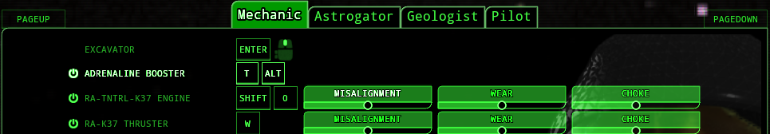
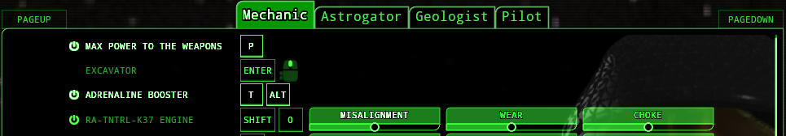
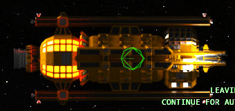
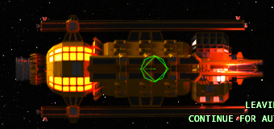

A switch, and a key, send your ship's weapons to full power when a fight comes, and back to your own settings when it
is over.

## What changes

At the station, the *Tuning* screen sets each weapon's power, and a pulse laser's *Pulse frequency*, for the whole
dive: in the normal game you can't change them during a dive.

With the mod, the *Mechanic* tab of the Onboard Maintenance System (press **J**) starts with a new row, *Max power to
the weapons*, with a key of its own, **P**, which works with the Onboard Maintenance System closed too. Switch it on,
and your mass drivers, lasers and microwave emitters fire at the highest power their *Tuning* allows, half again their
default, whatever you set there. The CL-600P pulse mining laser fires at its lowest *Pulse frequency*: fewer, stronger
pulses, all of their damage kinetic, enough to make a reactor leak. The CL-200AP pulse mining laser fires at its
highest, since its pulses are only ever heat. Switch it off, and every weapon fires as you tuned it again: your
*Tuning* itself never changes.

Everything else stays as you tuned it: a microwave emitter's *Water Resonance*, the exhaust weapons' *Thrust*, and all
your other equipment. The SPC Gungnir has no *Tuning*, so the switch doesn't change it either.

The row shows only while your ship has a weapon the switch changes. Every dive starts with the switch off.

**Without the mod:**

**With the mod, switched on:**

While the switch is on, your ship's cabin light is red, so you can tell it is on without opening the Onboard
Maintenance System.

| Without the mod | With the mod, switched on |
|---|---|
|  |  |

When you use the key, you also hear your ship's alarm, the one that sounds when a mineral storage fills up: twice when
it switches on, once when it switches off. Press the key again while the alarm sounds, and it stops and plays the new
one. The key does nothing during a cutscene. The switch in the tab clicks instead, like the game's other switches.

## Changes how the game plays

Compared to the normal game, while the switch is on, part of your ship's *Tuning* changes during a dive: your mass
drivers, lasers and microwave emitters fire at their highest power, so they hit harder, but they also use more power
and wear out more than twice as fast as at their default, and a mass driver kicks harder. The CL-600P and CL-200AP
pulse mining lasers fire at the ends of their *Pulse frequency*. With the switch off, nothing changes.

If a weapon, its power or its wear does something wrong, try again without the mod before you report a bug to the
game's developers.

## Install

See [Installing mods](Home#installing-mods).

<!-- wiki-values (checked by wiki.ps1)
game-checked: 1.93.1
WeaponMaxPowerSwitch/i18n/en.po WEAPONMAXPOWERSWITCH_ROW = "Max power to the weapons" | images/WeaponMaxPowerSwitch-mechanic-with.png
WeaponMaxPowerSwitch/Code.gd _WMPS_HIGHEST[0] = "TUNE_MASSDRIVER_POWER" -> mass drivers
WeaponMaxPowerSwitch/Code.gd _WMPS_HIGHEST[1] = "TUNE_LASER_POWER" -> lasers
WeaponMaxPowerSwitch/Code.gd _WMPS_HIGHEST[2] = "TUNE_EMP_POWER" -> microwave emitters
WeaponMaxPowerSwitch/Code.gd _WMPS_FREQUENCY.SYSTEM_CL600P = "min" -> lowest
WeaponMaxPowerSwitch/Code.gd _WMPS_FREQUENCY.SYSTEM_CL200P = "max" -> highest
WeaponMaxPowerSwitch/Code.gd _WMPS_LIGHT_COLOR = Color(1, 0.17, 0.17) -> red | images/WeaponMaxPowerSwitch-light-with.png
WeaponMaxPowerSwitch/MechanicTab.gd _WMPS_ALARM_ON = 2 -> twice
WeaponMaxPowerSwitch/MechanicTab.gd _WMPS_ALARM_OFF = 1 -> once
game: half again, the top of a weapon's power slider over its default (weapons/massdriver.gd, laser.gd, emp.gd getTuneables)
game: more than twice as fast, a weapon's wear at the top of its power against its default, which grows with the square of the power (massdriver.gd, laser.gd, emp.gd powerFactor)
-->
